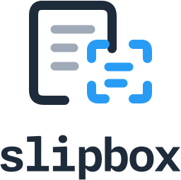
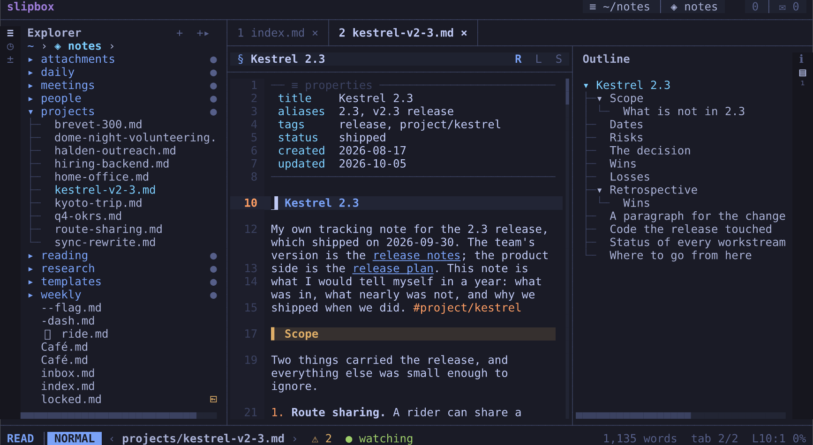

<p align="center">
  <picture>
    <source media="(prefers-color-scheme: dark)" srcset="assets/slipbox-logo-light.svg">
    
  </picture>
</p>
<p align="center">
  <a href="https://github.com/remziduzagac/slipbox/actions/workflows/ci.yml"></a>
</p>

**Read, review and edit what your coding agent writes, in your terminal.**

Keep documents readable while making focused edits with the lens. Use slipbox on your own notes and code too, and add
agent integration when it helps.


slipbox sits beside Claude Code, Codex, or any agent that runs shell commands. Follow an idea from the first plan to
the code that implements it. Read comfortably, review what changed, and make edits of your own. Tables fit the window,
and code is highlighted. Pictures, diagrams and maths sit alongside your writing. Themes, keys and settings make it
yours.

Editing is **intuitive yet innovative**. The lens opens the Markdown around your cursor for editing, while the rest
stays rendered. Stay where you were reading, keep the surrounding document in view, and focus on the change.

The editor is **necessary and sufficient**. It has the everyday editing tools, from selections, undo and
find-and-replace to completion, language servers, linters and spelling. Your own editor is a key away whenever you
want more.

Use the arrow keys and the shortcuts you know from other editors, or vim's keys, and discover the rest as you go.
`space` opens a menu of actions, `?` shows every key, and `:` opens the command palette. Everything is clickable too.

An agent works on saved files through slipbox's command line and bundled skill. It searches, follows links and makes
changes. A write guarded with `--if-unchanged` refuses to replace a file changed since the agent read it. What the agent
saves appears at once. If a file changes while you have unsaved edits, slipbox asks what to keep.

Gather references and excerpts in the scratch, each with its file path and line numbers. Build your next prompt while
keeping your document focused.

Review what the agent changed, in git. A note's diff shows each paragraph before and after, with the words that changed
marked, and a code file's sits side by side. Keep, revert or send back each change, one at a time. Settle a merge's
conflicts on a merge screen, and see which links a merge would break before you make it.

Open the folder you already have: a repository, an Obsidian vault, a zk notebook or an ordinary folder. Opening it
writes nothing there. Your notes and code stay in their files, alongside the tools you already use.

- **Start here:** [What is slipbox?][manual/introduction], then [Installation][guides/install]. The
  [Quick start][guides/quick-start] takes two minutes. The documentation is a website, with search:
  <https://remziduzagac.github.io/slipbox/docs/>.
- **Status:** every phase on the [roadmap](blueprint/roadmap.md) is built: reading, editing, search, vaults and named
  folders, git with its review and merge screen, language servers and linters, and export. Releases are published,
  with previews of the next one between them. slipbox is before 1.0. [Versions][manual/versions] says what may
  still change.
- **Help:** the documentation, and its [troubleshooting chapter][manual/troubleshooting] for the usual
  problems. Questions and ideas go in [Discussions](https://github.com/remziduzagac/slipbox/discussions). A bug goes
  in an [issue](https://github.com/remziduzagac/slipbox/issues/new/choose). A security problem goes privately, as
  [SECURITY.md](SECURITY.md) says, never in an issue.
- **Contributing:** anyone may open an issue. Pull requests come from collaborators. [MAINTAINING.md](MAINTAINING.md)
  says how slipbox is maintained.

## Install

On a Mac with Apple silicon and on Linux (and Windows through WSL), one line installs slipbox, with nothing else
needed:

```bash
curl -fsSL https://remziduzagac.github.io/slipbox/install.sh | sh                   # the latest release
curl -fsSL https://remziduzagac.github.io/slipbox/install.sh | sh -s -- --preview   # the newest preview
```

The first line installs the latest release. The second installs the newest preview, a build of what the next release
will hold.

`slipbox upgrade` keeps it current, and slipbox offers a newer version when one is out: it upgrades and restarts where
you were. `slipbox channel` says whether it follows previews, and changes that.

With Homebrew, run `brew install remziduzagac/tap/slipbox`. Intel Macs aren't supported any more:
0.3.0 was the last release built for them.

[Installation][guides/install] has the rest: previews, Windows through WSL, upgrading and removing it,
and running it from source.

## Try it

Follow [Working with slipbox][guides/getting-started], then
[Reading and editing in slipbox][guides/lens], for the complete introductory walkthroughs.

Open a folder you already have, your notes or a repository your agent works in:

```bash
slipbox ~/notes
```



A reading cursor moves with the arrow keys and the usual editor shortcuts, or with vim's keys. `space` opens a menu of
everything else, and `?` lists every key. These are the keys to start with:

| To | Press |
| --- | --- |
| Move | the arrows or `h` `j` `k` `l` |
| Move by word | `ctrl+right`/`ctrl+left` or `w`/`b` |
| Move by heading | `alt+up`/`alt+down` or `[ [` / `] ]` |
| Follow the link under the cursor | `enter` |
| Go back | `ctrl+o` (or `space h p`) |
| Go forward | `space h n` |
| Switch notes | `ctrl+p` |
| Find | `ctrl+f` |
| Find and replace | `ctrl+h` (or vim's `:%s/old/new/g`) |
| Find and replace in every note | `ctrl+shift+h` |
| Open the command palette | `:` |
| Select, then copy | `shift` with an arrow, then `ctrl+c` (or `v`, then `y`) |
| Open, then focus, then close the explorer | `space e` |
| Open, then focus, then close the outline | `space o` |
| Return to the note from the explorer or the outline | `esc` |
| Split the window | `ctrl+w v` |
| Open a new tab | `ctrl+t c` |
| Open the lens, then start typing there | `i`, `a` or `o`, then the same key again |
| Show the whole note as Markdown (SOURCE view), and back | `ctrl+k` (or `space n v`) |
| Open the git panel: review, commit, pull and push | `space g g` |
| Save | `ctrl+s` |
| Tick a task | `ctrl+l` (or `space n t`, or a click) |
| Hand the note to your editor | `space n e` |
| Hand the note to a running nvim | `space n s` |
| Quit | `ctrl+q` |

Everything is clickable too.

The lens shows the Markdown around the cursor between two rules, with the rest left rendered. The vim commands work
(`dw`, `ciw`, `p`, `u`, `.`), and autosave saves after a pause. When you quit, slipbox remembers where you were.
[Reading and editing in slipbox][guides/lens] walks through it with examples.

[Keys you already know][guides/keys-you-know] lists the shortcuts from other editors. Every key is in
[Keyboard and mouse shortcuts][manual/keys], and all of them are configurable
([Configuration settings][manual/configuration]). The configuration reloads itself when you save it.

[Working with slipbox][guides/getting-started] walks through a first session.
[Reviewing changes with Git][guides/code-and-git] reviews an agent's change, from its diff to its merge.
[Links and backlinks][manual/links-and-vaults] explains how links find their notes, across folders too.
[Working across folders and vaults][guides/vaults] explains the folders slipbox works in, with examples.

## For agents

These commands run on the demo folder. Go there with `cd examples/vault`. If `slipbox` isn't installed, use
`bun ../../src/main.ts` in its place.

```bash
slipbox resolve 'equipment/telescope-comparison.md#Summary' --from home.md --json
slipbox backlinks telescope-comparison --json
slipbox find 'Aster' --json                  # a note's text, or every note's
slipbox read home --json                     # the raw text and its sha
slipbox write home --stdin --if-unchanged <sha> < new.md
slipbox replace home Aster Astra --dry-run --json
slipbox task 2026-09-14-weekly 17 --check
slipbox write observing-log-2026 --append -- '- 22:10 seeing 2"'
slipbox stat home --json                     # size, dates, title, link counts
slipbox links --all --json                   # every link, and whether it resolves and how
slipbox link telescope-comparison --from home --json   # a link to write, in this folder's convention
slipbox resolve slipbox://halden/home.md --json        # a named folder's file, wherever it is here
slipbox capture --ref ../../src/main.ts:1-3 --snippet
slipbox render home --plain
```

With `--json`, each call gives one JSON object. The exit codes are stable.

The skill in [skills/slipbox/SKILL.md](skills/slipbox/SKILL.md) teaches the surface to agents, and slipbox carries
it. Installation and upgrades install the matching skill for detected Claude Code and Codex user configurations.
`--no-skill` or `SLIPBOX_NO_SKILL=1` skips automatic writes; `slipbox skill --auto` detects agents installed later.
`slipbox skill --install <folder>` chooses another destination.

For you, the same ground is in [Working with agents][guides/agents] and
[The command line][manual/cli].

## Documentation

- [The documentation][docs], a website with search: guides to start with, and a manual covering every key, setting
  and command. Its pages are written in [docs/](docs/).
- [CHANGELOG.md](CHANGELOG.md): what each release changed.
- [ARCHITECTURE.md](ARCHITECTURE.md): a map of the code, for whoever changes it.
- [ACCESSIBILITY.md](ACCESSIBILITY.md): what the TUI does for accessibility, and its limits.
- [CONTRIBUTING.md](CONTRIBUTING.md): how to report a bug, ask a question or suggest an idea, and the [code of
  conduct](CODE_OF_CONDUCT.md).
- [blueprint/](blueprint/README.md): the design, with its requirements, how it works, the decisions behind it and the
  roadmap.

## Development

To run slipbox from source, you need [Bun](https://bun.sh) 1.4.2 or later:

```bash
bun install
bun src/main.ts examples/vault   # the TUI, on the demo folder
scripts/install-local.sh         # a `slipbox` launcher in ~/.local/bin
```

To check a change:

```bash
bun run check                  # typecheck, the core-never-imports-tui boundary, dependencies, lint, the docs'
                               # lint, spelling and links, the tests your change reaches
bun run test:terminal:changed  # the terminal tests your change reaches: slipbox itself, driven by keys in
                               # headless terminals
```

Both compare your branch with where it left `origin/dev`, as CI compares a pull request with its base; `bun run test`
and `bun run test:terminal` run every one, as CI does before a release.

[blueprint/design/testing.md](blueprint/design/testing.md) describes the test strategy, the demo folder
(`examples/vault`) and the terminal tests.

## Thanks

slipbox's rendering was measured against [leaf](https://github.com/RivoLink/leaf), RivoLink's lightweight Markdown
reader for the terminal: it set the bar for how Markdown should look there. If reading is all you need, leaf is the
one to use.

## Use at your own risk

slipbox changes files and runs programs on your machine, and a coding agent can do the same through its command line
and skill. slipbox makes no guarantee about what it, or an agent using it, does.

You use slipbox entirely at your own risk. You alone are responsible for using it and for everything that results,
including what an agent does with it for you. So:

- review what an agent proposes and does before you accept it;
- keep backups, and keep your notes and code under version control;
- trust only folders whose code you would run yourself, and use your agent's own permission settings.

slipbox is provided "as is", without warranties or conditions of any kind. To the extent the law allows, its authors
and contributors are not liable for any damages arising from its use. Sections 7 and 8 of the [licence](LICENSE) set
out these terms.

## Licence

slipbox is licensed under the [Apache License 2.0](LICENSE). Each release carries the licence and `NOTICES.txt`.
`NOTICES.txt` lists the third-party software built into the binary, and their licences. Beside each build, its SBOM
lists the same in CycloneDX's format.

<!-- The documentation's pages on its website (site/scripts/gather.ts: pageUrl), each from its file in docs/. -->

[docs]: https://remziduzagac.github.io/slipbox/docs/
[guides/agents]: https://remziduzagac.github.io/slipbox/docs/guides/agents/
[guides/code-and-git]: https://remziduzagac.github.io/slipbox/docs/guides/code-and-git/
[guides/getting-started]: https://remziduzagac.github.io/slipbox/docs/guides/getting-started/
[guides/install]: https://remziduzagac.github.io/slipbox/docs/guides/install/
[guides/keys-you-know]: https://remziduzagac.github.io/slipbox/docs/guides/keys-you-know/
[guides/lens]: https://remziduzagac.github.io/slipbox/docs/guides/lens/
[guides/quick-start]: https://remziduzagac.github.io/slipbox/docs/guides/quick-start/
[guides/vaults]: https://remziduzagac.github.io/slipbox/docs/guides/vaults/
[manual/cli]: https://remziduzagac.github.io/slipbox/docs/manual/cli/
[manual/configuration]: https://remziduzagac.github.io/slipbox/docs/manual/configuration/
[manual/introduction]: https://remziduzagac.github.io/slipbox/docs/manual/introduction/
[manual/keys]: https://remziduzagac.github.io/slipbox/docs/manual/keys/
[manual/links-and-vaults]: https://remziduzagac.github.io/slipbox/docs/manual/links-and-vaults/
[manual/troubleshooting]: https://remziduzagac.github.io/slipbox/docs/manual/troubleshooting/
[manual/versions]: https://remziduzagac.github.io/slipbox/docs/manual/versions/
