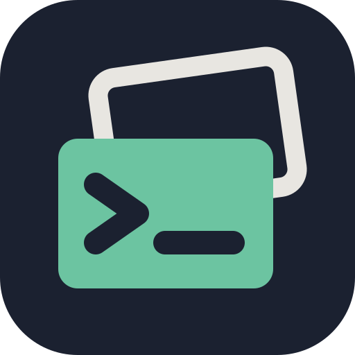

<p align="center"></p>
<h1 align="center">slipbox</h1>
<p align="center">
  <a href="https://github.com/remziduzagac/slipbox/actions/workflows/ci.yml"></a>
</p>

A terminal Markdown notes app: a shared workspace for people and agents over plain files. It reads a folder of
Markdown notes (a repository, an Obsidian vault, a zk notebook, or any folder), renders them properly (tables that
fit, highlighted code, pictures, diagrams and maths, themes), follows links in the folder's own conventions, and
reloads the instant an agent rewrites a note. You read and edit in the TUI; agents and scripts drive the same files
through the CLI.

- **Start here:** [Getting started](docs/guides/getting-started.md), a first session of about ten minutes, once
  [Installing slipbox](docs/guides/install.md) has it on your machine. [The documentation](docs/README.md) has the
  rest.
- **Status:** every phase on the [roadmap](blueprint/roadmap.md) is built: reading, editing, search, roots and named
  folders, git and merge review, language servers and linters, export. No release is published yet. slipbox is before
  1.0: [Versions](docs/manual/versions.md) says what may still change.
- **Help:** the documentation, and its [troubleshooting chapter](docs/manual/troubleshooting.md) for the usual
  problems. A bug goes in an [issue](https://github.com/remziduzagac/slipbox/issues/new/choose); a security problem
  goes privately, as [SECURITY.md](SECURITY.md) says, never in an issue.
- **Maintained by** Remzi Duzagac ([@remziduzagac](https://github.com/remziduzagac)), alone and in their own time:
  [MAINTAINING.md](MAINTAINING.md). Anyone may open an issue; pull requests come from collaborators.

## Try it

From source, with [Bun](https://bun.sh) 1.4.2 or later:

```bash
bun install
bun src/main.ts examples/vault                      # the TUI, on the demo folder
bun src/main.ts render examples/vault/equipment/telescope-comparison.md  # render to stdout
scripts/install-local.sh                            # a `slipbox` launcher in ~/.local/bin
```

[Installing slipbox](docs/guides/install.md) has the rest: releases (a binary per platform, for macOS and Linux, with
no Bun needed) and Homebrew once they are published, Windows through WSL, upgrading and removing it. Then
[Getting started](docs/guides/getting-started.md) walks through a first session.

A file's **root** is the nearest folder above it holding `.git`, `.slipbox/`, `.obsidian/` or `.zk/`: what `/` in a
link starts from, where a wikilink's names are looked for, whose link convention is followed. A folder without one
works too, as the folder opened. `slipbox init --name notes` gives a folder a name that other folders link to it by,
`slipbox://notes/inbox.md`, wherever it is on each machine; a repository is named by its remote.
[Links and roots](docs/manual/links-and-roots.md) explains it all.

## In the TUI

A reading cursor moves with vim keys or the usual editor keys. `space` opens a which-key popup listing everything
else, and `?` lists every key, so nothing needs memorising:

- **Moving:** `h` `j` `k` `l` or the arrows; `w`/`b` or `ctrl+right`/`ctrl+left` by word; `[ [` / `] ]` or
  `alt+up`/`alt+down` by heading.
- **Links:** `enter` follows the link under the cursor; `ctrl+o` (or `space h p`) goes back, `space h n` forward.
- **Finding and copying:** `ctrl+p` switches notes, `ctrl+f` finds, `ctrl+h` finds and replaces (or vim's
  `:%s/old/new/g`), `ctrl+shift+h` in every note, `:` opens the command palette, and `v` selects then `y` copies.
- **Panes:** `space e` explorer and `space o` outline (each opens, then focuses, then closes; `esc` returns to the
  note), `ctrl+w v` split, `ctrl+t c` new tab. Everything is clickable too.
- **Editing:** `i`, `a` or `o` start typing, in source mode (`ctrl+k` or `space n v` switches to it and back) or in
  the lens (`space n l`: the Markdown around the cursor between two rules, the rest left rendered). The vim commands
  work (`dw`, `ciw`, `p`, `u`, `.`); `ctrl+s` saves, and autosave does after a pause. `ctrl+l` (or `space n t`, or a
  click) ticks a task; `space n e` hands the note to your editor, `space n s` to a running nvim.
- **Quitting:** `ctrl+q`, and slipbox remembers where you were.

Every key is in [Keys](docs/manual/keys.md), and all of them are configurable
([Configuration](docs/manual/configuration.md)). The configuration reloads itself when you save it.

## For agents

On the demo folder (`cd examples/vault`; `bun ../../src/main.ts` if `slipbox` isn't installed):

```bash
slipbox resolve 'equipment/telescope-comparison.md#Summary' --from home.md --json
slipbox backlinks telescope-comparison --json
slipbox find 'Aster' --json                  # a note's text, or every note's
slipbox read home --json                     # the raw text and its sha
slipbox write home --stdin --if-unchanged <sha> < new.md
slipbox replace home Aster Astra --dry-run --json
slipbox task 2026-09-14-weekly 17 --check
slipbox write observing-log-2026 --append -- '- 22:10 seeing 2"'
slipbox stat home --json                     # size, dates, title, link counts
slipbox links --all --json                   # every link, and whether it resolves and how
slipbox link telescope-comparison --from home --json   # a link to write, in this folder's convention
slipbox resolve slipbox://halden/home.md --json        # a named folder's file, wherever it is here
slipbox capture --ref ../../src/main.ts:1-3 --snippet
slipbox render home --plain
```

One JSON object per call with `--json`; stable exit codes. The skill in
[skills/slipbox/SKILL.md](skills/slipbox/SKILL.md) teaches the surface to agents, and slipbox carries it:
`slipbox skill --install ~/.claude/skills` installs the one matching the binary;
[Working with agents](docs/guides/agents.md) and [The command line](docs/manual/cli.md) are the people's side.

## Documentation

- [docs/](docs/README.md): the user documentation: guides to start with, and a manual covering every key, setting
  and command.
- [CHANGELOG.md](CHANGELOG.md): what each release changed.
- [ARCHITECTURE.md](ARCHITECTURE.md): a map of the code, for whoever changes it.
- [ACCESSIBILITY.md](ACCESSIBILITY.md): what the TUI does for accessibility, and its limits.
- [blueprint/](blueprint/README.md): the design: requirements, how it works, the decisions behind it, the roadmap.

## Development

```bash
bun run check        # typecheck, the core-never-imports-tui boundary, dependencies, lint, the docs' lint, spelling
                     # and links, tests
bun run e2e --tab    # the terminal tests: slipbox itself in a herdr pane (needs herdr)
```

The test strategy, the demo folder (`examples/vault`) and the terminal tests are in
[blueprint/design/testing.md](blueprint/design/testing.md).

## Licence

slipbox is licensed under the [Apache License 2.0](LICENSE). Each release carries the licence and `NOTICES.txt`, the
third-party software built into the binary and their licences; beside each build, its SBOM lists the same in
CycloneDX's format.
