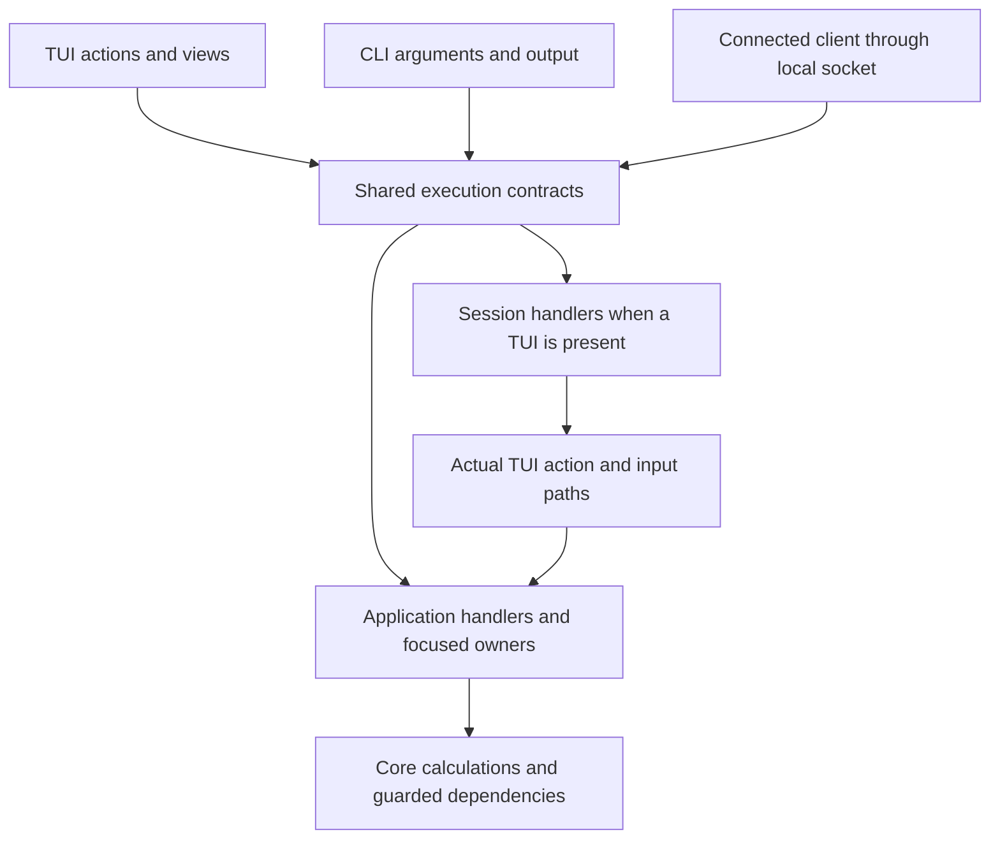
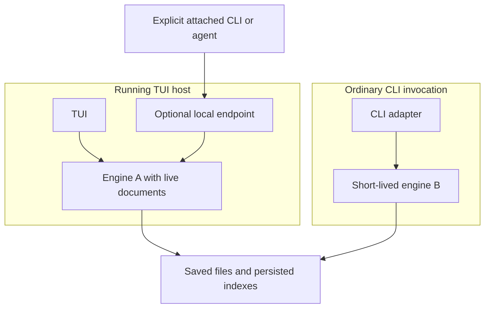
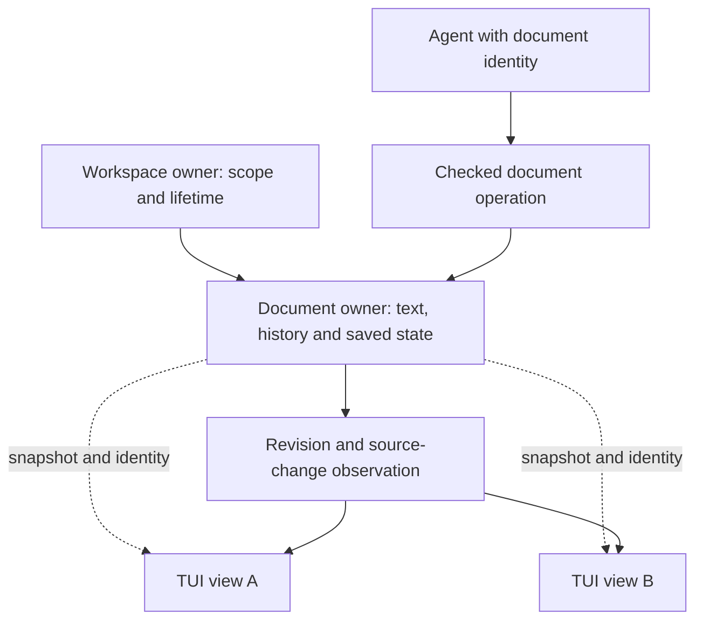
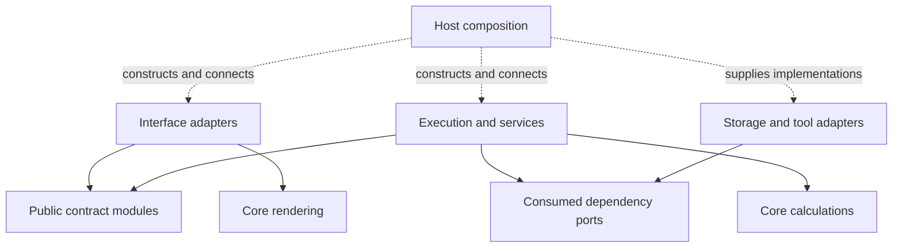
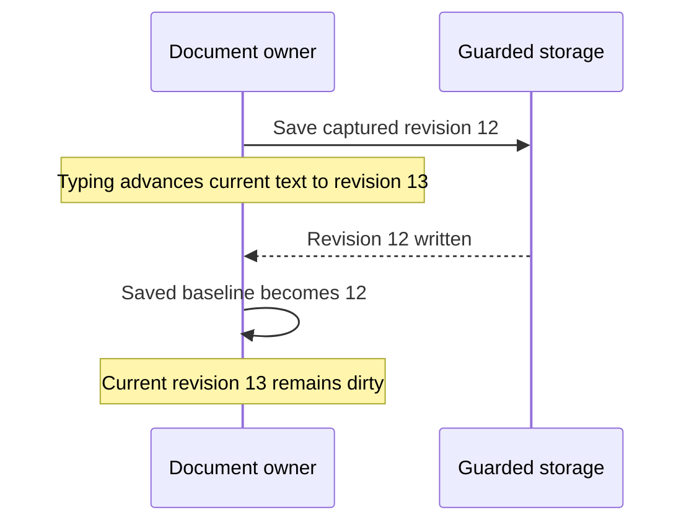
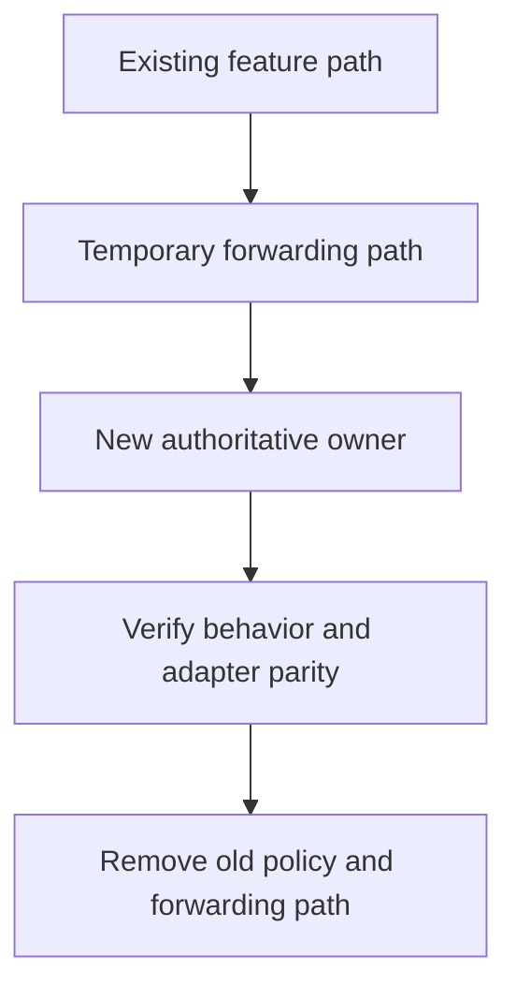
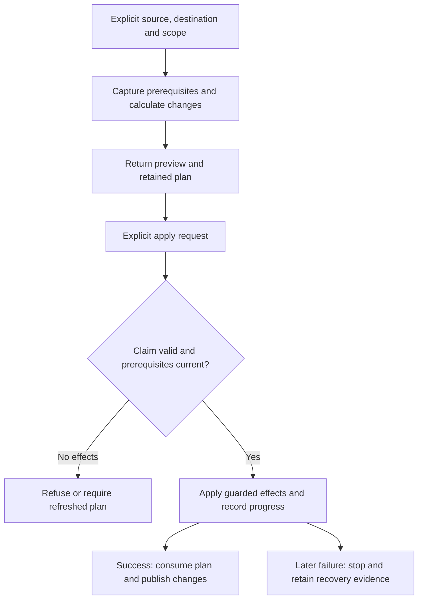

# Proposal: backend architecture

Proposed on 2026-10-18. The goal is a necessary-and-sufficient backend architecture that supports continued feature
growth while preserving Slipbox's functionality and UI. This proposal organizes and strengthens the existing ENG
design; it does not replace it, introduce implementation work or settle the remaining exposure choices.

The scope is the backend boundaries needed for shared execution and maintainability. Broader product or UI changes
belong to separate workstreams. Existing accepted ENG-D1 through ENG-D15 remain in force. The patterns and refinements
below are proposals until reviewed and recorded as decisions; permission to draft this document is not their adoption.

## Reading from whole to parts

Read the system shape first, then its state ownership, boundaries, execution rules and lifecycle. The pattern names
explain why those boundaries fit together; they are not a separate framework to build. Diagrams illustrate the
proposal and omit secondary branches. The linked engine documents remain the source of exact contracts.

1. [Purpose](#starting-point-and-goals): what the architecture needs to improve.
2. [Whole system](#overall-architecture): the backend and the interfaces around it.
3. [Runtime instances](#where-the-engine-runs): shared implementation versus shared running state.
4. [Ownership](#who-owns-what): documents, views, services and dependencies.
5. [Boundaries](#dependency-and-port-map): what calls what, and what may import what.
6. [Behavior](#patterns-and-their-concrete-jobs): how requests, changes and lifetimes are organized.
7. [Walkthroughs](#representative-vertical-walkthrough): save, rename and language edits through those boundaries.
8. [Verification and growth](#how-the-architecture-supports-testing-and-growth): how to test and extend the result.
9. [Tradeoffs](#costs-alternatives-and-limits) and [adoption](#proposed-application-to-the-detailed-design).

## Starting point and goals

The [current engine overview](../design/how-it-works.md) already separates interfaces, application owners and core
computations. Its [contracts](../design/contracts.md), [runtime](../design/runtime.md),
[interfaces](../design/interfaces.md) and [testing](../design/testing.md) retain the detailed reviewed behavior.
This document provides the architecture above those pieces, naming each pattern's job and limits.

A file split solves navigation through source code; an ownership boundary solves a different problem: knowing
where a rule belongs and which module may change a piece of state. ENG should achieve both. Adding a socket alone
would expose existing dependencies without resolving them; adding a general architecture framework would create
another system to maintain. The proposal puts boundaries around responsibilities that already exist in Slipbox.

Success means a normal feature change stays concentrated in its owner and deliberate integration points; domain
rules have one implementation; interface-specific behavior is separately testable; and failures/lifetimes remain
understandable. These are review criteria, not a demand for every feature to have the same file/class template.

## Overall architecture

Use ports and adapters around focused application services and state owners. A port is a narrow contract consumed
by an application participant; an adapter implements or calls that contract for a concrete interface or dependency.
The existing engine remains the shared backend, usable in-process as well as through the local socket.



This is a call-flow diagram. It says that several entry points reach the same capabilities, not that they share
one global engine process. Application handlers provide document/workspace operations. Session handlers provide
control of the existing visible UI and are absent from hosts without that facility.

The backend does not decide how to ask you a question or which panel to open. It can return a conflict, a preview,
choices or a task result. The interface presents those outcomes. Conversely, the UI must not be the only place that
checks a write prerequisite: a direct client must meet the same application rule.

For example, opening a rename picker is a TUI action; calculating and applying a checked rename is application
work. Showing the result is TUI work again. A CLI supplies the name directly, while a connected agent can either
call the operation directly or deliberately drive the same picker through session control.

## Where the engine runs

Shared means one implementation and one set of contracts. It means shared live state only when clients explicitly
address the same running instance. An engine is an owned collection of services that a host constructs and closes.
It does not require a permanent server or an embedded terminal.



Engine A can own unsaved documents and background services. Engine B reads saved files and uses the existing disk
coordination/conflict rules; it cannot inspect A's memory by happening to open the same directory. Attachment chooses
A explicitly, and the request then declares whether it needs saved or live content. There is no silent connection
fallback. A headless test can construct either an application host or the actual TUI over a test Canvas.

This distinction also explains the extension seam: a later client can use the public contract without receiving App
or a mutable document. It does not imply third-party handler loading, a plugin runtime or a daemon requirement.

## Who owns what

Ownership answers three questions: who is allowed to change the state, who keeps it alive, and who cleans up the
resources associated with it. A service may publish an immutable snapshot, but handing out a snapshot does not
transfer authority to mutate its source.



Two panes can show one document while retaining independent positions. A direct agent edit changes the document;
the views map their existing anchors through the edit. It does not select the agent's edited range or steal focus.
If the agent deliberately uses session input, changing the visible cursor is part of that requested interaction.

| Responsibility | Authoritative owner | What other parts receive |
| --- | --- | --- |
| Text, undo and saved baseline | Documents | Snapshots, revision handles, checked edit results |
| Cursor, layout, prompts and focus | TUI/session | Scoped session state and retained frames |
| File/workspace identity and scope | Workspaces | Explicit handles and configuration context |
| A feature's caches and background resources | Its feature service | Versioned results and narrow capabilities |
| Invocation and task outcomes | Execution/task owner | Inspectable receipts, progress and terminal results |
| Filesystem/process handles | Guarded host adapter under service ownership | Values and bounded resource handles |

An application service coordinates a workflow across these owners; it does not become a second owner of their state.
For example, rename coordinates documents, workspace scope, link calculations and guarded writes. Each dependency
retains its own responsibility. The composition root constructs this graph once; it is wiring, not a service that
all other modules consult for arbitrary dependencies.

## Dependency and port map

| Boundary | Contract owner | Concrete participant | Intended rule |
| --- | --- | --- | --- |
| Application invocation | Shared public contracts | TUI, CLI, socket proxy | Shared validation and handlers |
| Session control | Shared contracts, TUI session owner | Session handlers | Actual UI paths, optional host facility |
| Document/content access | Document owner | Feature services | Immutable snapshots and checked mutations |
| Storage and recovery | Consuming application service | Guarded filesystem/state adapter | Guarded feature writes |
| Tools | Language/git service | Guarded runner/installer | Explicit scope, effects and lifecycle |
| Time and background work | Consuming owner | Runtime clock/worker adapter | Controlled delivery for tests |
| External formats | Consuming feature | Parser/export/spelling adapter | Narrow values, limits and failure mapping |

The word port has two useful meanings here. An incoming port describes what a caller can ask Slipbox to do. An
outgoing dependency port describes what an application service needs from storage, a tool or another host facility.
An adapter translates one concrete environment into that contract. For example, the save service needs guarded
replacement of an authorized destination; it does not need every method of a general filesystem wrapper.



Here solid arrows mean source dependencies; dotted arrows mean construction. A service calls an injected storage
implementation at runtime while its source depends on the small port, not that concrete implementation. This is
dependency inversion. It permits a controlled storage implementation in tests without making production services
know about testing. It does not require an interface around an already-pure helper.

The dependency rule also has a deliberate session exception in placement, not direction: session handlers live
with the TUI and are registered by host composition. They use the shared contract format, but the terminal-independent
engine never imports them. Existing TUI rendering may still use core rendering helpers directly.

A consuming service defines only the dependency capabilities it needs. Shared contracts move to a common module
when several consumers actually agree on their meaning. Do not create a universal filesystem/service interface or
a port for each internal helper. Existing guarded I/O modules can implement a port without being rewritten.

The runtime host supplies implementations through constructors/functions. A small manual composition root is enough;
a dependency-injection container, ambient current caller or mutable service locator would obscure dependencies.
Narrow ports improve testability and replacement; in-process interfaces do not restrict a dependency's OS authority.

## Patterns and their concrete jobs

### Application services

A workflow often needs more than one owner. Saving checks a document and disk baseline; renaming also affects links
and paths; an export captures inputs and writes an artifact. An application service is the small place that orders
those steps and interprets their outcome. It keeps that ordering consistent across interfaces.

Keep workflow coordination in focused services: save, checked plan/apply, mixed language edits, handoff preparation,
export and tool acquisition. A service validates prerequisites, calls owners and dependencies, and classifies results.
The operation handler is its public execution entry, not a second copy of its workflow.

Core functions compute edits, diffs, layouts and plans from values. A TUI action collects input and presents outcomes.
Internal service-to-service calls stay ordinary function calls with explicit dependencies; they do not manufacture
RPC invocations or copy policy into adapters. Keep orchestration near its feature rather than one central switch.

### Command/query separation

The first question about an operation is whether it inspects application state or changes it. This distinction
helps a caller understand effects and helps the backend decide which permissions, reservations and failure rules
apply. Reading a document needs a stable view of data; saving it needs a guarded mutation boundary.

Describe application inspection separately from mutation in operation effects, scheduling and tests. They share
one document/workspace model and catalog; no separate database, duplicate read model or eventual-consistency system
is introduced. A query needing a consistent view consumes an immutable versioned snapshot.

Inspection does not imply that every runtime activity is free of effects: a tool query may need an explicit tool
capability, and approved host caching has its own storage owner. Requested effects and independent configured host
policies remain distinguished as in the existing contract. Do not advertise arbitrary process execution as a query.

### Single-owner state and explicit messages

Background work finishes at inconvenient times: the file may have changed, a query may have been replaced or a
workspace may have closed. Giving the worker direct mutable access makes every such change its responsibility.
Returning a result to the owner gives those checks one reliable home.

```mermaid
sequenceDiagram
    participant Owner as Feature owner
    participant Worker as Background computation
    Owner->>Worker: Immutable input, revision and lifetime
    Note over Owner: Input or lifetime can change while work runs
    Worker-->>Owner: Result with captured prerequisites
    alt Still applicable
        Owner->>Owner: Commit and publish the result
    else Superseded or disposed
        Owner->>Owner: Drop derived result; preserve actual mutation outcomes
    end
```

Each document/feature service owns its authoritative state. Background workers capture immutable inputs and return
results to that owner; only the owner validates lifetime/revision and commits changes. Events describe committed
facts for observation, not permission for subscribers to mutate another owner's state synchronously.

This is local ownership on the existing runtime, not a requirement for an actor framework or one thread per owner.
Several services can share a process and event loop. Shared execution carries identity and permissions; internal
calls preserve them without introducing an ambient mutable context. The existing reservation policies still govern
overlapping effects across owners.

### Functional core and imperative shell

A computation is easiest to test when its inputs and result are explicit. Checking whether a set of text ranges
overlaps needs text/ranges, not a running TUI or a real filesystem. Applying the validated changes to a document and
writing them to disk needs an owner and guarded effects. Keep that distinction visible in the module structure.

Keep calculations pure where useful: range checks, edit construction, conflict comparisons, diff/projection,
source mappings and plan validation over captured values. Place disk access, processes, timers and publication in
the surrounding service/adapter code. Do not force naturally stateful document histories into artificial purity.

Test calculations directly, orchestration with controlled ports, and real library/tool integration at its boundary.
Avoid tests that mock every helper or merely repeat implementation steps. Core has no dependency on execution or UI.

### Small state machines

Document valid transitions for lifecycle-heavy parts using discriminated value states and transition functions or
tables, where appropriate. No state-machine library or inheritance hierarchy is required. Transitions name their
preconditions, authoritative effects and failure outcomes. Existing runtime terms remain authoritative; examples
here are modeling guidance, not a new set of wire status names.

Keep independent dimensions separate. A document can be dirty and deleted on disk, and saving can finish while
newer edits remain dirty. Combining every dimension into one document enum creates unnecessary state explosion.

| Model | Transition or invariant to make explicit | Existing detail home |
| --- | --- | --- |
| Document content | Edits/undo advance revision; dirty compares with saved baseline | Runtime: edits and save |
| Document disk relation | Disk relation is separate from dirty text | Runtime: reconciliation |
| Save invocation | Capture revision, write, reconcile; newer text need not become clean | Runtime: save path |
| Plan | Ready to claimed/applying to consumed or recovery-required; dry-run does not consume | Runtime: plans |
| Finite task | Admission, running, safe stop, terminal outcome and retention | Runtime: tasks |
| Service lifetime | Open to committed close to disposed; stale delivery cannot revive it | Runtime: lifetimes |
| Shutdown | Refused preflight leaves open; committed close drains or reports unsettled work | Runtime: shutdown |



For example, a save captures revision 12, typing produces 13, and the write of 12 succeeds. The saved baseline becomes
12; current text remains 13 and dirty. This is a completed save plus a dirty document, not a failed transition.
A plan's apply claim is a different model, with its own cross-process state and recovery rules.

TUI mode/prompt/input states remain with the session owner. Frame acknowledgement is an observation alongside task
completion, not a replacement task status. New tables must preserve these distinctions instead of merging them.

### Disposable resource scopes

A feature can appear closed while a timer, subscription or queued callback still keeps doing work. Resource
ownership therefore includes cleanup, not just state fields. The scope is a small bookkeeping aid owned by the
feature; it is not a new global lifecycle manager.

An owner can hold a small resource scope that tracks subscriptions, timers and worker/process handles for cleanup.
Disposal is idempotent and invalidates delivery first; owned resources are stopped according to their declared
policies. Use the existing runtime's cleanup primitives and a small local helper only if repetition warrants it.

A resource scope does not make asynchronous mutation settlement disappear. Active effects remain under their
engine owner until safely settled or reported uncertain. Persistent servers belong to service lifetimes after
finite readiness tasks finish. Refused quit does not dispose a resource scope. Cleanup failures are surfaced;
there is no destructor that silently swallows errors or an automatic rollback promise.

### Strangler migration

Replace the existing implementation in working slices. This lets us check the new boundary against the old behavior
while the rest of the product continues to work. The word strangler names that gradual replacement strategy, not
a requirement for parallel engines or a long-lived compatibility architecture.



This is a migration sequence, not the final runtime. During the temporary step there is still only one authoritative
implementation of the moved behavior. Remaining unmigrated capabilities keep their current owner until their slice.

Route a bounded capability through its new owner, verify parity, then remove its old orchestration. Temporary
forwarding delegates have one authoritative implementation and a named removal condition. The existing T1–T6
migration remains the starting proposal, including its clean-toggle staging and later live-document transfer.

Do not create two registries, two writers, shadow state or permanent compatibility engines. Tests move to the new
owner while adapter assertions remain for boundaries they still establish. Each slice preserves UI behavior and
existing compatibility; it does not need to wait for a fully enumerated catalog or new feature framework.

## Representative vertical walkthrough

The following examples connect the patterns into actual use. They show responsibility boundaries and preserve the
existing engine contracts; their arrows are runtime calls or observations, not source imports.

### Saving a document

```mermaid
sequenceDiagram
    participant Caller as TUI action or attached client
    participant Exec as Shared execution
    participant Save as Save service and document owner
    participant Storage as Guarded storage
    Caller->>Exec: Document, expected revision and invocation identity
    Exec->>Save: Validated request with scoped origin
    Save->>Save: Capture inputs; reserve and revalidate
    Save->>Storage: Write captured content
    Storage-->>Save: Written fingerprint or failure
    Save->>Save: Reconcile saved baseline and record outcome
    Save-->>Exec: Result, revision and observations
    Exec-->>Caller: Structured outcome or retained receipt
```

Consider saving an existing dirty document. This is an illustration; the exact operation names remain unspecified.

1. A TUI action resolves its document and invokes save. An attached socket client supplies that document's identity
   and expected revision. Both reach the same public operation definition and application handler; only the adapter
   input and result presentation differ. Ordinary standalone CLI writes retain their existing saved-file contract.
2. Shared execution validates schema, authenticated origin, access and invocation identity. It obtains the owner's
   current prerequisites; the application service captures immutable text, revision and disk baseline.
3. Pure calculations prepare/check serialized content. The service uses existing reservation and revision rules,
   rechecks prerequisites at effects, then calls its guarded storage port. A test can pause or fail that dependency.
4. The document owner updates the saved baseline, preserving newer edits. The service records actual effects before
   publishing observations. If derived index refresh fails after writing, the result says written with a warning.
5. The TUI updates presentation from the observation. The socket adapter returns structured outcome/receipt data.
   A later frame is separate from application completion. No renderer or transport implements another save policy.

Existing autosave reaches the same document/save services under its explicit host-policy authority. A client edit
does not acquire that authority by inheritance. The detailed lifecycle, retry and conflict guarantees remain in
[the runtime](../design/runtime.md), rather than being repeated as a second specification here.

### Renaming across files

Rename demonstrates coordination across owners. The action first gathers a destination; the planner reads captured
inputs and calculates path/link changes. Preview is read-only apart from retaining the plan. No reservation stays
held while a person considers the preview. Apply claims the plan, validates all current prerequisites and performs
guarded effects under the existing reservation rules.



Invocation retry and plan consumption solve different problems. A retry asks about the same execution; a consumed
plan cannot be applied again under a new invocation ID. Multiple file writes remain non-atomic, so a later failure
must identify completed effects rather than pretending a rollback. Exact rules stay in
[runtime: plans](../design/runtime.md#plans-and-multi-file-effects).

### A language edit touching live and saved content

A language-server result may edit a dirty shown document and an unshown clean file. One generic disk-write loop
would lose the distinction: the first target should remain in memory, while existing behavior saves the second.
The workspace-edit service captures each target's source and persistence disposition, checks the whole batch, and
coordinates document edits plus the required saves. Each document retains its own undo group.

This uses the same document, reservation and storage capabilities as other operations, but keeps a distinct workflow
policy. Sharing helpers does not mean forcing rename, save and language edits into one generic transaction class.
A stale target refuses before effects; a later disk failure reports the actual partial outcome. The text-only
supported subset remains unchanged. See [mixed language edits](../design/runtime.md#mixed-livedisk-language-edits).

## How the architecture supports testing and growth

A useful boundary lets us test the rule without reconstructing unrelated surroundings. A pure edit calculation is
tested with values. A save service is tested with a real document owner and controlled storage. A socket test proves
framing, identity and result mapping against that same service. A TUI test proves actions, view anchors and frames.
These checks complement each other instead of repeating every assertion through every interface.

| Question | Smallest useful test boundary |
| --- | --- |
| Are the calculated edits correct? | Core function with representative text/ranges |
| Does a late save leave newer text dirty? | Document/save service with a controlled storage barrier |
| Does a disconnected caller duplicate an export? | Execution/task owner plus connection adapter |
| Does a panel show the result and retain focus? | Actual TUI over the test Canvas |
| Does terminal input/display work? | Existing terminal integration checks |

For a future feature, identify its owned state and resources, reuse existing document/workspace capabilities, and
add a narrow public operation only if an interface needs it. Add an outgoing port where a dependency boundary makes
failure/lifetime control or replacement useful. Register through composition and add tests at those boundaries.
A stateless core calculation needs no service class or state machine just to fit the architecture.

The existing [completion checklist](../design/maintenance.md#feature-completion-checklist) and
[test design](../design/testing.md) remain the detailed homes. The proposed patterns should make that checklist
easier to satisfy, not create a second development process. A review should be able to point to the owner, its
inputs, effects, lifetime and test boundary without following a chain through the entire application.

## Costs, alternatives and limits

The proposal adds explicit contracts, composition wiring and some lifecycle models. These pay off only if changes
become more local and tests easier to construct. A feature should not need a port, handler class, state machine,
repository, factory and event type merely to follow a pattern. Prefer ordinary functions/modules when sufficient.

| Alternative | Why this proposal prefers a smaller or different mechanism |
| --- | --- |
| Socket wrapper around App | Leaves application ownership and standalone execution dependent on UI |
| One generic feature/service base class | Forces unrelated lifecycle and state contracts into inheritance |
| Event sourcing for all state | Adds replay/persistence semantics beyond the current need |
| Full CQRS with separate stores | Duplicates models and adds consistency work without a demonstrated requirement |
| Global actor/event framework | Adds messaging machinery where local owners and direct calls suffice |
| Generic unit-of-work transaction abstraction | Filesystem/git effects remain non-atomic |
| Universal plugin/extension framework now | Exceeds ENG's agreed seam and deferred plugin scope |

The same-user socket is not a security sandbox. Process isolation and packaging still depend on evidence. Required
daemons, new product features and UI redesign are not consequences of choosing these patterns.

## Proposed application to the detailed design

After agreement, record the selected architecture choices and reasons, then apply them to these existing homes.
Preserve reviewed contracts and their acceptance scenarios; proposals that alter one require explicit reconciliation.

| Existing document | Proposed refinement, not applied yet |
| --- | --- |
| How it works | Dependency/port map, composition responsibilities, pattern boundaries |
| Contracts | Distinguish incoming operations, dependency ports, queries/commands and host policies |
| Runtime | Transition tables beside existing lifecycle contracts; resource scope responsibilities |
| Interfaces | TUI/socket vertical walkthrough and adapter responsibilities |
| Testing | Port-level contract tests, transition invariants and vertical parity scenarios |
| Maintenance | Pattern applicability checks and small-owner/resource-scope guidance |
| Roadmap | Identify which existing slice proves each selected rule; keep old-path deletion conditions |

First review the whole architecture for sufficiency and unnecessary machinery. Settle the actual choices, record
new decisions where needed and add dated notes to earlier decisions only if amended. Then update the detailed
pieces together, check requirement/acceptance traceability and review for contradictions. Finally create concrete
implementation tasks once the workstream is accepted. This document itself stays in ideas as proposal history.

## Questions for that review

- Are any proposed ports merely wrappers around a helper, rather than a useful boundary?
- Which existing lifecycle models need explicit tables, and which are already clear enough as ordinary code?
- Does a resource-scope helper remove repeated cleanup while keeping mutation settlement visible?
- Can representative owners be tested and composed without App or a universal engine context?
- Does every selected pattern have a concrete consumer and a verification case within the existing migration?

The separate [execution choices](execution.md#decisions-to-settle-before-implementation), including initial exposure,
shared undo acceptance and host timing, remain open. Naming an architecture pattern does not decide those policies.
