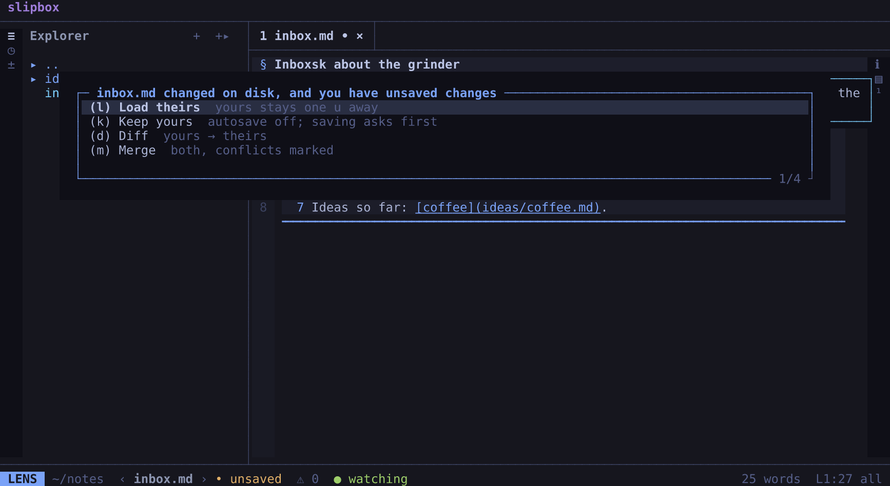

# Working with agents

slipbox is made to sit beside a coding agent: Claude Code, Codex, or any agent that runs shell commands. You read and
edit in slipbox's TUI; the agent uses slipbox's command line. Both work on the same files on disk, so there is nothing
to sync: what the agent writes, you see at once, and what you save is what the agent reads.

This guide sets that up, then walks through a session: the agent finding and changing notes, you handing it
references and context, and each of you seeing what the other did.

## Give the agent the skill

You need slipbox installed ([Installing slipbox](install.md)) and a folder of notes. This guide uses `~/notes`, with
the two notes [Getting started](getting-started.md) makes in it: `inbox.md` and `ideas/coffee.md`.

slipbox comes with a skill for agents: a short Markdown file, built into slipbox, that teaches an agent the command
line (which command for what, `--json`, the exit codes, the safe way to write). An agent that reads skills, such as
Claude Code, loads it when you mention your notes or slipbox. The skill a slipbox carries is the one that matches its
commands, so install it from the `slipbox` you run:

```bash
slipbox skill --install ~/.claude/skills
```

It writes the skill to `~/.claude/skills/slipbox/SKILL.md`, where Claude Code finds it, and says where. After an
upgrade, run it again to bring the skill up to date; when the skill there is already this one, it writes nothing and
says so. It won't write over a `SKILL.md` that slipbox didn't write, nor through a link, unless you add `--force`. For
another agent, give `--install` the folder it reads skills from, or have it run `slipbox skill`, which prints the
skill.

From a copy of slipbox's source, one script installs the `slipbox` command and links the skill instead:

```bash
scripts/install-local.sh --skill
```

It puts a `slipbox` launcher in `~/.local/bin` (and says so if that folder isn't on your `PATH`), and links the
source's `skills/slipbox/` folder to `~/.claude/skills/slipbox`, so the skill there follows the source as you update
it.

To check that slipbox answers in your folder, run (or ask the agent to run):

```bash
cd ~/notes
slipbox info
```

You see the folder slipbox works in (`root`), its name if it has one, how links are written there (`links`), and where
slipbox keeps its state and the scratch.

## Open slipbox beside the agent

Split your terminal (your terminal's own panes, tmux, zellij): slipbox in one pane, the agent in the other, both in
`~/notes`.

```bash
slipbox ~/notes
```

The agent's commands find the same folder by themselves: the nearest folder above where they run that holds `.git`,
`.slipbox/`, `.obsidian/` or `.zk/` (slipbox calls it the root: [Links and roots](../manual/links-and-roots.md)), else
the folder they run in.

## Watch the agent write

Open `inbox.md` in slipbox, and ask the agent to add a task to it. It runs something like:

```bash
slipbox write inbox --append --paragraph -- '- [ ] Call the plumber'
```

In slipbox the note reloads at once, and a message at the top right says `↻ inbox.md changed on disk — reloaded`. A
note the agent creates shows up in the explorer the same way.

If you have unsaved changes to that note, slipbox keeps both versions and asks what to do: `l` loads theirs, `k`
keeps yours, `d` shows the differences and `m` merges the two. Each answer is explained in
[When a file changes on disk](../manual/editing.md#when-a-file-changes-on-disk).



The agent hears about your unsaved changes too: every command it runs while slipbox holds them warns
`unsaved changes in a running slipbox: inbox.md` (with `--json`, the note is listed in `stale`). The skill tells it to
ask you before writing such a note.

## Writes that never clobber yours

An agent that rewrites a note reads it first, and writes back only if nothing changed in between:

```bash
slipbox read ideas/coffee --json                          # the text, and its sha
slipbox write ideas/coffee --stdin --if-unchanged <sha> < new.md
```

If you saved the note meanwhile, the write is refused, with exit code 5, and nothing is written:
`ideas/coffee.md changed since 126e8ecc93bebd26 (now a743dde9aa817bd7); not written`. The agent reads it again and
makes its change on your version.

Every write is atomic and stays inside the root. A command that changes many files at once (`mv`, `convert-links`,
`replace --all`) takes `--dry-run` to show each line it would change; with `--plan` it saves the change for
`slipbox apply` to make after you've looked; and `slipbox undo` takes the last one back.

## The command line and `--json`

Everything the agent does is a `slipbox` command. With `--json`, each prints exactly one JSON object (`ok`, `data`,
`warnings`, `stale`), and the exit codes are fixed: 0 ok, 3 not found, 4 ambiguous, 5 refused. The commands it uses
most:

```bash
slipbox search grinder setting --json       # notes ranked by the words
slipbox find 'pour-over' --json             # every line holding the text
slipbox links ideas/coffee --json           # its links, and whether each reaches something
slipbox backlinks ideas/coffee --json       # the notes linking to it
slipbox link ideas/coffee --from inbox      # a link to write, the way this folder writes them
```

`slipbox commands` lists each of the TUI's actions beside the command that does the same.
[The command line](../manual/cli.md) has every command and what it prints.

## Hand the agent references: the scratch

The scratch is a Markdown file, one per root (or per folder, where there is none), where references collect for your
next prompt. You and the agent both add to it; you read it, and paste it into the agent.

1. In slipbox, open `ideas/coffee.md`, put the cursor on the line `A ratio of 1 to 16 suits a pour-over.`, and press
   `space s a`. The scratch gets that line's place, `path:line`, in a code span: `` `ideas/coffee.md:5` ``. Select
   lines first (`shift+v`, then `j`) and it gets `path:line-line` and the lines themselves. A message says
   `added to the scratch · ␣ s s opens it`.
2. Press `space s s` to open it. It changes as the agent adds to it:

   ```bash
   slipbox capture "Is 1 to 16 right for the small pot?"
   slipbox capture --ref ideas/coffee.md:3-5 --snippet      # the place, and its lines fenced
   ```

3. `space s y` copies the whole scratch, to paste into a prompt. `space s d` clears it, after asking.

In a code file's notebook view, `space k s` adds the cell at the cursor, with its path and lines. An agent clears the
scratch only with `slipbox scratch clear --if-unchanged <sha>`, so nothing added since it read it is lost.

The scratch lives in slipbox's own state folder, not among your notes (`slipbox scratch path` says where);
`capture.location = "root"` keeps it in the root instead (never in a folder that isn't one), as `capture.file` names
it ([Configuration](../manual/configuration.md)).

### From nvim

`slipbox capture` works from any editor. In nvim, two mappings add the cursor's line, or the selected lines with their
text:

```lua
vim.keymap.set("n", "<leader>pc", function()
  vim.fn.system({ "slipbox", "capture", "--ref", vim.fn.expand("%:p") .. ":" .. vim.fn.line(".") })
end)
vim.keymap.set("v", "<leader>pc", function()
  local s, e = vim.fn.line("v"), vim.fn.line(".")
  if s > e then s, e = e, s end
  vim.fn.system({ "slipbox", "capture", "--snippet", "--ref", ("%s:%d-%d"):format(vim.fn.expand("%:p"), s, e) })
end)
```

They add to the scratch of the folder nvim is working in; a path inside it is stored relative to it.

## Give the agent a topic: the context bundle

On a note, press `space s c`. slipbox copies its context: the note, the notes and files it links to, and the notes
linking to it, as one Markdown document. Each file is a section with its path, its lines and why it's there, then its
text as it is on disk. A message says what went in:
`copied the context of ideas/coffee.md: 2 files (0 linked, 1 linking to it), …`. Paste it into the agent's prompt.
Unsaved notes are saved first, so it holds what you see.

The agent can gather the same itself:

```bash
slipbox context ideas/coffee
slipbox context ideas/coffee --depth 2 --limit 40 --no-backlinks
```

`--depth` follows links further out (1 by default), `--limit` caps the files (25), and `--no-backlinks` leaves out the
notes linking in; what didn't fit is named at the end. `context.depth`, `context.limit` and `context.backlinks` change
the defaults.

## Let the agent see what you're reading

The TUI records what you read, within a second of each change: the note on screen, the open tabs, and the notes read
lately with the line you were on. The agent reads it:

```bash
slipbox history --json        # data.current: the note on screen; data.read: newest first
```

So "the note I'm looking at" in a prompt needs no path. To point at a line, `y r` copies the cursor's `path:line`, to
paste.

The other way round, `slipbox send ideas/coffee --line 5` opens the note at that line in your running nvim, as
`space n s` does from slipbox. The skill tells the agent to do so only when you ask.

## Where next

- [The command line](../manual/cli.md): every command, its JSON and its exit codes.
- [Editing](../manual/editing.md): saving, autosave and the conflict prompt.
- [Configuration](../manual/configuration.md): the scratch's place, the context's defaults, your editor.
- [Code and git](code-and-git.md): reviewing what an agent changed on its branch, before you merge it.
