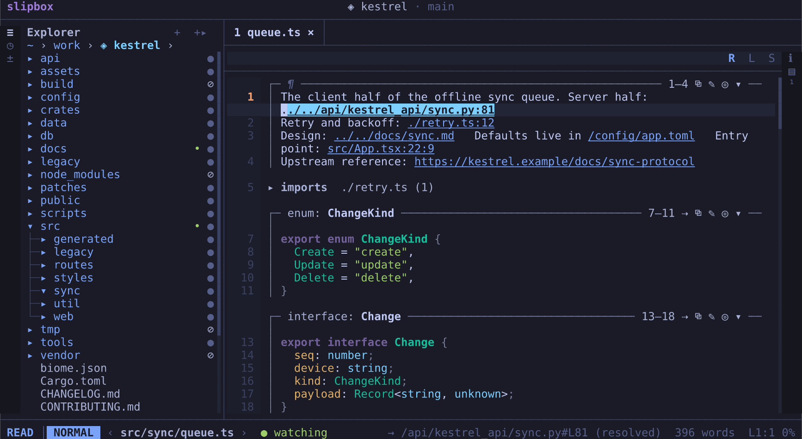
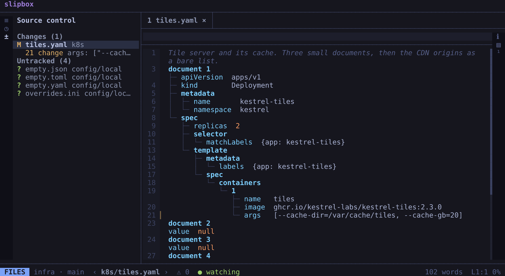
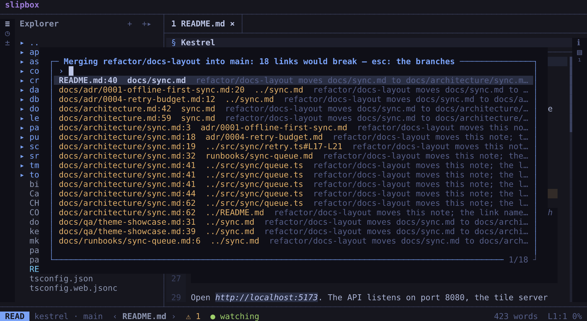

# Code and git

slipbox opens a repository the way it opens a folder of notes. It reads the code like a document: each function and
class is a cell, with its documentation drawn as prose.

- Language servers find what's wrong.
- Beside the lines, you see git's changes.
- An agent's change reads as a diff you can take in: a note's paragraphs before and after, a code file's lines side by
  side. You keep, revert or send back each piece.
- Before you merge a branch (yours or an agent's), slipbox tells you which links the merge would break.

This guide opens a repository, reads and checks its code, and commits a change. Then it reviews an agent's change from
start to end: its diff, each piece of it, its conflicts, and its merge.

## Open the repository

```bash
slipbox ~/code/app
```

A git repository is a vault of its own. slipbox opens it from its top folder, whichever file or subfolder inside it you
name. It writes nothing into it.

The explorer (`space e`) lists every text file in it, code included. In a repository holding a `.slipbox/` folder, it
lists its notes and data files, and `a` there shows the rest.

The status line shows the repository's name and the branch: `app · main`. The name comes from its remote, or else from
its path.

## Read a code file

Open a code file from the explorer (`enter`) or the switcher (`ctrl+p`). It opens in the code view:

- Each function, class, method or type is a cell.
- A cell's header says what it is and its name (`function: resolve`).
- Its doc comment is drawn as prose above its code.
- The code itself is exactly as written.
- Comments between definitions read as prose.
- The imports are folded into one row. `enter` on it unfolds them.



| Press | To |
| --- | --- |
| `z a` | Fold the cell at the cursor to its header, and open it again |
| `space o` | List the file's definitions in the outline |
| `space n v` (or `ctrl+k`) | Show the file as written, highlighted. Press it again for the cells |

A cell header's buttons are keys too:

| Press | To |
| --- | --- |
| `space k y` | Copy the cell |
| `space k r` | List where its definition is used |
| `space k s` | Add it to the scratch for an agent ([Working with agents](agents.md)) |

The code view covers TypeScript, TSX, JavaScript, Python, Go, Rust, Swift, PHP, Ruby, C, C++, Lua and Bash. Other
files open as written. `render.code = "source"` opens every code file as written
([Configuration](../manual/configuration.md)).

## Trust the folder, or not

A repository's own tools can run code it holds:

- its own copy of TypeScript
- an ESLint config that is a program
- git hooks and filters

slipbox runs none of them until you say you trust the folder. It asks the first time it matters, when a file's language
servers would otherwise leave something out:

```text
Trust ~/code/app? Its own tools would run code it holds — eslint not run (its config is code). Only a folder
you know (y trusts it; n keeps it safe)
```

- `y` trusts it. Its servers start again and run as they would anywhere, and git runs as the repository has it.
- `n` (or `esc`) keeps it safe. Servers run in their safe modes, and git runs none of the repository's hooks or
  filters.

slipbox remembers the answer in its own state, never in the folder. `:trust` and `:untrust` change it later.
`trust.roots` in your config trusts folders ahead of time, such as `~/code/*`.

The command line never asks, and it can't trust a folder. So an agent can't be talked into it.
[Code](../manual/code.md) says what each answer allows.

## Language servers and `slipbox doctor`

When you open a code file, slipbox starts its language servers: TypeScript's, pyright for Python, rust-analyzer, gopls
and the rest.

- slipbox installs a server it can get from npm into its own folder, the first time it's needed.
- You install a native one, such as rust-analyzer, yourself.

To see what's there:

```bash
cd ~/code/app
slipbox doctor                   # each language: its servers and linters, where each was found, or how to get it
slipbox doctor src/shelf.ts      # one file: the servers that would serve it here, and what trust leaves out
```

Each line names a server and one of these:

- where it was found: on your `PATH`, in the project, or in your install folders
- `not found: slipbox installs typescript@… when it's first needed`
- how to install it

`lsp.auto_install = false` stops the installs. [Troubleshooting](../manual/troubleshooting.md) covers a server that
isn't found.

## See the problems

What the servers, the linters and slipbox's own checks find shows where it is. A line's number takes the colour of its
worst problem, and the status line counts them.

| Press | To |
| --- | --- |
| `space n q` | Open the Problems panel on this file, a row per problem with its line |
| `space v p` | Open the panel's All tab: the whole vault's broken links, lint and conflicts |
| `shift+k` | Show what's under the cursor: its type, its documentation |
| `g d` | Go to its definition |
| `g r` | List where it's used |

In the Problems panel, `j` and `k` move, and the file follows. `enter` goes to the problem, and `q` closes the panel.

An agent gets the same list with `slipbox diagnostics src/shelf.ts`.

## Your changes in the gutter

The lines you've changed since the last commit are marked beside the text. They're compared against what's staged,
with unsaved typing included.

- `▎` marks lines added or changed, each in a soft colour of its own.
- `▁` marks where lines were deleted.

If you'd rather have them away from the text, `git.signs_at` puts them before the line numbers or at the window's right
edge ([Git](../manual/git.md)).

| Press | To |
| --- | --- |
| `] c` and `[ c` | Go to the next and previous change |
| a click on a change's sign | See the change, with Revert (its lines put back, unsaved) and Stage |

## Commit

1. Press `space g`, or click `±` on the left rail. The git panel, source control, opens in the left panel. It lists
   the changed files under Conflicts, Staged, Changes and Untracked, each with its letter (`M`, `A`, `D`, `R`, `?`).
2. Move with `j` and `k`, or point at a file. Press `enter`, or click the file, to see its diff. Press `l` to open the
   file into its changes, each of which you can stage alone.
3. Press `s`, or click its `+`, to stage the file or the change. `u` (`−`) unstages it, and `a` stages everything.
   `d` (`↺`) discards what isn't staged, after asking.
4. Type the message in the panel's message box (click it, or press `i`), then press `ctrl+enter`. A message says
   `committed`, with the commit's hash and subject. For a longer message, `c` opens it in a floating editor, where
   `ctrl+s` commits.



`shift+c` amends the last commit instead. In a folder you haven't trusted, the commit runs no hooks and isn't signed,
and the editor says so. The panel's buttons do the same, and say their keys when you point at them: commit, amend,
pull, push, fetch and stash.

## Review an agent's change

An agent's work comes to you in two ways: changes it hasn't committed yet, and commits on a branch of its own. slipbox
reviews both, by keys or by mouse. This section goes through one review from start to end.

Usually, an agent works on a branch of its own, in a git worktree beside your checkout. Here, the agent's branch is
`fix/retry`. It has committed part of its work, and left the rest uncommitted.

### Find its work in the git panel

1. Press `space g`. The git panel opens on the left, as in [Commit](#commit). At its top, it says where your branch
   stands: how far it's ahead of its base and behind it, and against its upstream.
2. Under Branches, the agent's branch shows. It's marked `⎇`: checked out in a worktree. At its end, it says how far
   it's ahead of its base (`↑3 on main`) and how many files it hasn't committed (`✎2`). `◆` marks work to review.
3. Press `enter` on it, or click it. It opens up in place, without going anywhere: its worktree's folder, its buttons
   (`[Open]`, `[Merge…]`, `[Remove…]`), its uncommitted files, and the files it changed against its base.

To give an agent a worktree like this one, press `n` in the panel: name the branch, pick where it starts, and keep "In
a new worktree".

### Read a change's diff

Press `enter` on a file, or click it, to see its diff in a floating window.

A note's diff shows each changed block twice: as it was, in a frame named `before`, and as it is now, in one named
`after`. A block is a paragraph, a heading, a list item or a table's row. The words that went are marked in `before`,
and the words that came are marked in `after`. So a paragraph the agent rewrote a sentence at a time reads as prose,
not as a wall of removed and added lines.


- A block added or removed whole has one frame, `added` or `removed`.
- Each group of changes is under `@@`, with the heading it's under and its line. The unchanged lines between groups
  fold to one row, `▸ 14 unchanged lines`. `enter` on it shows them.
- `tab` switches to the diff's lines: `-` before a removed line, `+` before an added one, the changed words marked.
  `tab` again goes back to the blocks.
- `enter` on a line goes to it in the file. `esc` comes back to the panel.

A code file's diff is its lines. When the window gives each side 80 columns, about 170 columns of terminal, the two
versions sit side by side: before on the left, now on the right, each line beside the line it became. In a narrower
window, they're in one column. `git.diff_layout` chooses, and `git.diff = "source"` opens a note's diff as its lines
too ([How a diff is drawn](../manual/git.md#how-a-diff-is-drawn)).

### Keep, revert or send back each change

The review goes through the uncommitted changes one at a time. They're in the agent's worktree, so go there first:

1. On the agent's branch, click `[Open]`, or press `o`. You're in its worktree, a vault of its own, at the note you were
   on if the branch has it. The git panel is the worktree's now: the agent's uncommitted files are under Changes and
   Untracked. `ctrl+o` takes you back to your checkout.
2. Press `v` in the git panel, or click Review. The first change opens in a floating window, drawn as its diff, with a
   few of the file's lines around it. Above it are the file, where the change is
   (`line 17 · change 1 of 2 here, 1 of 3 in all`), and the keys.

   

3. Decide on each change:

   | Key | What it does |
   | --- | --- |
   | `y` | Keeps the change: stages it |
   | `x` | Reverts it: its lines go back to what's staged, saved at once. `u` in the file brings them back |
   | `c` | Asks for a note, and adds the change to the scratch for the agent, with the file, its lines and the diff |
   | `n` / `p` | Goes to the next / previous change, deciding nothing |
   | `enter` | Ends the review, and opens the file at the change |
   | `esc` | Ends the review |

   After `y`, `x` or `c`, the next change you haven't dealt with comes up.
4. When none is left, a message says what you did:
   `review: 2 kept (staged), 1 note for the agent in the scratch — space s y copies it`.
5. Press `space s y` and paste the scratch into the agent's prompt. The agent gets each change you sent back, where it
   is, and what you said about it ([Working with agents](agents.md#hand-the-agent-references-the-scratch)).

The review commits nothing. What you kept is staged, so a commit takes exactly that: press `i` in the git panel, type
the message, and press `ctrl+enter`.

slipbox never reverts a change in a file you have unsaved typing in. It says so, and goes on to the next change.

### Bring it up to date with its base

While the agent worked, `main` moved on. A rebase replays the agent's commits after `main`'s new ones, so its branch
merges as if it had started from `main` as it is now.

1. git won't rebase over uncommitted changes. If the agent's worktree still has some, set them aside: press `z` in the
   git panel, and pick "Stash the changes…". Type a message, or none, and press `enter`.
2. Press `shift+r` in the git panel, or run `:rebase`. slipbox asks first, and says how many commits each side has:
   `Rebase fix/retry onto main? Its 3 commits replayed after main's 2 new.`
3. The rebase runs in the background. While it's under way, the status line says so: `rebasing 2/3`.
4. If a commit doesn't replay cleanly, the rebase stops there, and the merge screen opens on its conflict
   ([below](#settle-a-conflict-on-the-merge-screen)). Settle it, save it and stage it. Then press `shift+r` again, and
   Continue (`c`). Abort (`a`) puts the branch back where it was.
5. When it's done, a message says `rebased fix/retry onto main`. To bring back what you stashed, press `z`, pick the
   stash, and Pop it.

### Settle a conflict on the merge screen

A merge, a pull or a rebase can stop on a conflict: a place both sides changed. The files in conflict are under
Conflicts in the git panel, and marked `!` in the explorer. Press `x` on one in the git panel, or click Resolve. The
merge screen opens in a floating window, one conflict at a time:

- **Base**: the version both sides started from.
- **Yours**: your side, as a diff against the base. In a merge, it's the branch you're on.
- **Theirs**: the other side, as a diff against the base. In a merge, it's the branch coming in.
- **The result**: the file as it will be, below them. Each conflict shows there as you settled it, or still marked.

In a note, each side is drawn in blocks before and after, as a note's diff is.


| Key | What it does |
| --- | --- |
| `o` / `t` | Takes yours / theirs |
| `b` / `shift+b` | Takes both, yours first / theirs first |
| `e` | Puts the result in the file and opens the lens at this conflict, to settle it by hand |
| `a` | Asks for a note, and adds the conflict to the scratch for the agent |
| `n` / `p` | Goes to the next / previous conflict |
| `w` | Saves the file, once every conflict is settled |
| `s` | Stages the saved file, which tells git it's resolved |
| `esc` | Closes the screen. What you settled stays |

After you settle a conflict, the next one comes up. Once you stage a file, the next file in conflict opens. When none
is left, a message says what's next: `shift+r` continues the rebase, or concludes the merge.

In a rebase, the sides are the other way round: yours is the branch you're rebasing onto, and theirs is your commit
being replayed. The screen says so. [The merge screen](../manual/git.md#the-merge-screen) has the rest.

### Merge it

Back in your checkout (`ctrl+o`), check what the merge would do to your links before you make it:

1. Click `[Merge…]` on the agent's branch, or press `m` on it, and pick "The links it would break". slipbox asks git
   what the merge would give, without touching your files. It lists each link the merge would break, by note and
   line, with the cause and the fix when there is one:
   `fix/retry moves docs/plan.md to docs/design/plan.md — the fix: design/plan.md`.

   

2. Press `enter` to go to a link. When nothing breaks, a message says `merging fix/retry into main breaks no link`.
3. Pick "Merge it", from `[Merge…]` again. slipbox merges where the base is checked out. If the merge conflicts, it
   stops, with its files under Conflicts, for the merge screen.
4. A merged branch's worktree goes with `[Remove…]`, which asks first. It refuses while the worktree has uncommitted
   files.

After a merge or a pull, git's renames may still break links. If they do, each broken link says where its file went.
You see this in the Problems panel (`space v p`), and when you follow the link. `space l r` rewrites a note's links to
match.

Each branch is measured against its own base: the branch slipbox made it from, else the nearest of `git.bases` (`main`
as it comes), else `main` or `master`. Compare against…, in a branch's menu (`.`), picks another.

### Pull, push and stash

slipbox reaches a remote only when you ask, and each of these runs in the background:

| In the git panel | What it does |
| --- | --- |
| `f` | Fetches. The status line then shows how far the branch is behind its upstream: `main ↓3` |
| `p` | Pulls. When both sides have new commits, it asks: merge, rebase, or nothing |
| `shift+p` | Pushes. A branch with no upstream is asked whether to push it to `origin` and track it there |
| `z` | Lists the stashes, under "Stash the changes…". `enter` on one pops, applies or drops it |

The palette has the same, as `:fetch`, `:pull`, `:push` and `:stash`. If a note has unsaved changes, a pull asks
first, as a branch switch does: save them, keep them unsaved, or cancel.

git never waits for a password. A remote that needs a login git can't make by itself fails at once, in git's words.
Run the same command once in a terminal: once your credential helper or your ssh agent has the login, slipbox can use
it too ([Fetching, pulling and pushing](../manual/git.md#fetching-pulling-and-pushing)).

### From the command line

You or the agent can review a branch from the command line too:

```bash
slipbox changed                   # in the branch's checkout: what it changed against main
slipbox diff docs/plan.md         # one file's changes on the branch
slipbox merge-review fix/retry    # in yours: the links merging it would break
```

The rest, from the review a change at a time to the merge screen, pulling and pushing, is the TUI's. An agent runs git
itself for those.

## Where next

- [Code](../manual/code.md): the code view, every language server feature, linters, problems and trust.
- [Git](../manual/git.md): source control, blame, a file's history, branches, worktrees, the review a change at a
  time, the merge screen, pulling, rebasing and the merge review.
- [Working with agents](agents.md): the scratch and the context bundle, for handing code to an agent.
