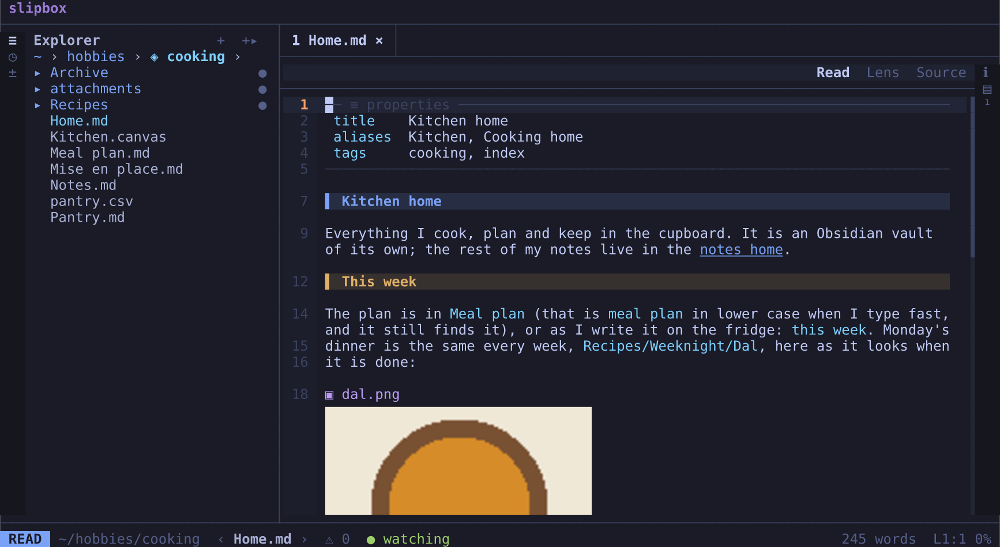

# Coming from Obsidian or zk

slipbox opens an Obsidian vault or a zk notebook as it is. There's no import and no conversion, and nothing is written
into it. slipbox reads their links the way they do, and writes new links the way they would. So you can keep using
either app on the same files.

This guide opens your vault or notebook. It shows what slipbox makes of it, and what it leaves to the app. Then it
shows two things you may want later: a name other folders can link to it by, and links as plain paths.

## Open it

```bash
slipbox ~/notes
```

To slipbox, a folder holding `.obsidian/` or `.zk/` is a vault: one collection of notes. Name any note or subfolder in
it, and slipbox opens the whole vault, the explorer showing the subfolder you named.

The explorer (`space e`) lists its notes and folders. Hidden ones aren't listed, such as `.obsidian/` itself and
Obsidian's `.trash/`. A folder with a name tools give their output, such as `build`, `target`, `dist`, `vendor` or a
`cache`, is listed but never indexed: search doesn't find its notes, and their links don't count. A new note isn't made
there ([Files](../manual/files.md#what-the-explorer-lists)).

To follow a link:

1. Open a note that links to others.
2. Press `tab` to put the cursor on its first link.
3. Press `enter` to follow it, wikilink or not.
4. Press `ctrl+o` to come back.

To see how slipbox reads the folder, run `slipbox info` there. The `links` line says how it will write links, and what
told it:

```text
links     wikilinks, by name, without .md — Obsidian's .obsidian/app.json
```

In a zk notebook, it says `markdown links, relative, without .md — zk's .zk/config.toml`.

## What slipbox reads

- **Wikilinks**: `[[name]]`, `[[folder/name]]`, `[[name#Heading]]`, `[[name#^block]]`, `[[name|text]]`. slipbox finds
  a name as Obsidian finds it. That's a note of that name anywhere in the vault, case aside, with `.md` optional. Or
  it's a note whose front matter gives that name as an alias. Of two notes with one name, the one nearer to the
  linking note wins. A real tie shows as ambiguous, and following it asks which.
- **Embeds**: `![[note]]`, `![[note#Heading]]` and `![[note#^block]]`. Alone in a paragraph, each is drawn in place,
  behind a bar. `![[photo.png|300]]` is a picture, drawn that wide where your terminal draws pictures. slipbox finds
  it by its name anywhere in the vault.
- **Tags**: `#tag` and `#nested/tag` in the text, and `tags:` in the front matter. `space f t` lists them, then a
  tag's notes.
- **Front matter** (Obsidian's properties) is a table at the top of the note. `aliases:` gives a note more names. A
  wikilink in it, such as `related: "[[coffee]]"`, is a link like any other.
- **Callouts**: `> [!tip] Title`. Obsidian's kinds and GitHub's are both drawn, each with its icon and colour.
- **Block ids**: `^id` at the end of a paragraph or list item. That's where `[[note#^id]]` lands.
- **zk's links**: `[text](ideas/202410021000-coffee)`, a path without `.md`. The path is from the note's folder. A
  path starting with `/` is from the notebook's top.



The rest is Markdown: tables, code, maths and diagrams. [Reading](../manual/reading.md) shows how each is drawn.
[Links and vaults](../manual/links-and-vaults.md) shows every link form.

## Links written their way

slipbox writes some links for you:

- after `[[` or `](`, when it completes one
- from the link picker, `space l i`
- for an agent's `slipbox link`

These links come out the way the folder writes them:

- In an Obsidian vault, they follow Obsidian's settings. Those are on its Files and links page: wikilinks or Markdown
  links, and the new link format. By default, a link is a wikilink by name: `[[coffee]]`.
- In a zk notebook, they follow `link-format` and `link-drop-extension` in `.zk/config.toml`. By default, a link is a
  Markdown link from the note, without `.md`.

To rename or move a note in slipbox, press `space n m`, or `r` and `m` in the explorer. slipbox fixes every link to
it, each in the form it was written. A wikilink stays a wikilink, and a name stays a name.

## What it doesn't do

- **Plugins.** Nothing a plugin adds runs. A Dataview query is a code block. A Canvas file (`.canvas`) is its text. A
  Templater tag is text.
- **The apps' own settings**, other than the link settings above. That means Obsidian's themes, hotkeys, templates,
  daily notes and attachment folder. It also means zk's templates and its note ids. Make a note with `zk new` in zk.
- **Folded callouts.** A folded callout (`> [!note]-`) is drawn open. Obsidian's `==highlight==` and `%%comment%%`
  are read as Obsidian reads them. A highlight is drawn highlighted, and a comment is hidden while you read
  ([Reading](../manual/reading.md#emphasis-code-and-links)).
- **Writing into the folder** of its own accord. slipbox keeps its own state in its own folders: where you were, the
  scratch and its trash. A note deleted in slipbox goes to slipbox's trash (`space v t`), not Obsidian's `.trash/`.

## A vault ends where another begins

In Obsidian, everything under the vault's folder is in the vault. In slipbox, a folder inside it that holds a marker of
its own is a vault of its own: a git repository you cloned there (`.git`), a zk notebook (`.zk/`), a folder you gave
`.slipbox/`. Its notes aren't your vault's:

- Search in your vault doesn't find them, until you widen it with `ctrl+a`.
- A wikilink by name doesn't reach them. Write a path, `[[clone/README]]`, and following it opens a peek: the note read
  in a floating window, your vault left as it was. `o` goes into the inner vault.
- The explorer marks its folder `◈`. `enter` on it goes into it, with its own tabs, and `ctrl+o` comes back.

[Vaults, home and Elsewhere](vaults.md) explains vaults, the peek and the rest with examples.

## Name it, if other folders link to it

A note in another folder links into your vault by a relative path, such as `../notes/inbox.md`. That link breaks if
either folder moves. A name works wherever the vault is, on every machine. To give the vault one:

```bash
cd ~/notes
slipbox init --name notes
```

In the TUI, `:name` does the same.

`slipbox init` adds a `.slipbox/` folder, holding the name and this folder's own settings. Obsidian and zk leave it
alone. `--private` keeps it out of git.

A link from another folder can then be `slipbox://notes/inbox.md`. slipbox writes that form when you link into the
vault from elsewhere. Obsidian and zk don't read these links, so use them between folders you read in slipbox.

## Make the links plain paths, if you want

Wikilinks need an app that looks names up. If you'd rather your notes read anywhere, on GitHub or in any editor,
slipbox rewrites them once as plain relative links:

```bash
cd ~/notes
slipbox convert-links --dry-run     # every line it would change, before and after
slipbox convert-links               # then write it
```

For example, in `inbox.md`:

- `[[coffee]]` becomes `[coffee](ideas/coffee.md)`.
- `[[coffee#Brewing|how I brew]]` becomes `[how I brew](ideas/coffee.md#brewing)`.
- `![[photo.png|300]]` becomes ``.

A link that reaches nothing is left as written, and so is one that several notes answer to. The warnings name each
one. Write its path by hand.

In the TUI:

1. Type `:convert-links` and press `enter`. The same preview opens, titled `links → plain paths: …`. It has a row for
   each link several notes answer to.
2. On such a row, press `enter` to pick its note.
3. Press `enter` on a change to write it all, or `esc` to cancel.

`slipbox undo` takes the whole conversion back.

Then have new links written as paths too. Otherwise, the vault's settings bring wikilinks back. Turn wikilinks off in
Obsidian's settings, or put this in the folder's `.slipbox/config.toml` (`slipbox init` makes one):

```toml
[links]
style = "markdown"
```

`links.style`, `links.path` and `links.extension` are in [Configuration](../manual/configuration.md).

## Where next

- [Getting started](getting-started.md): a first session, if you haven't had one.
- [Vaults, home and Elsewhere](vaults.md): how slipbox's vaults differ from Obsidian's, with examples.
- [Links and vaults](../manual/links-and-vaults.md): every link form, vaults, named folders and backlinks.
- [Making it yours](making-it-yours.md): a theme, your keys and settings.
