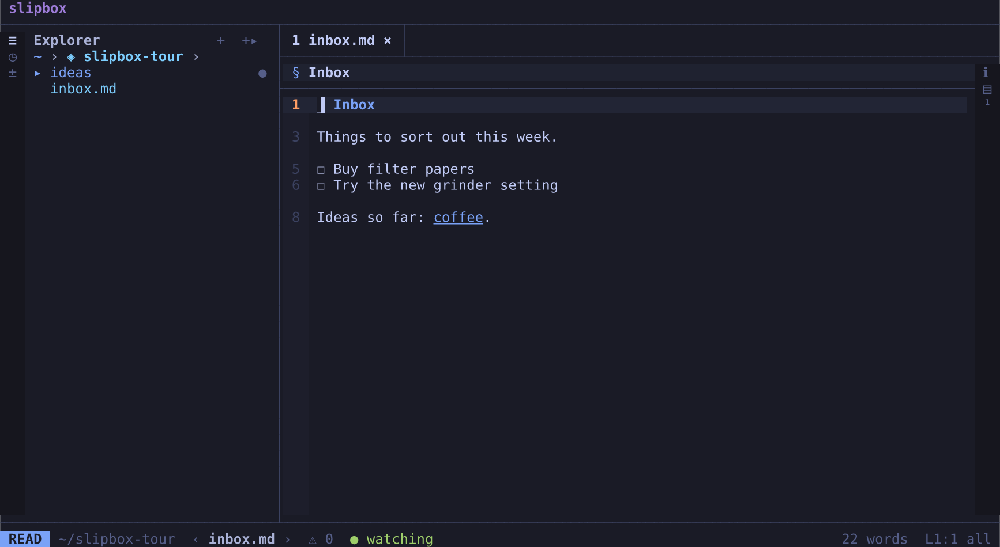
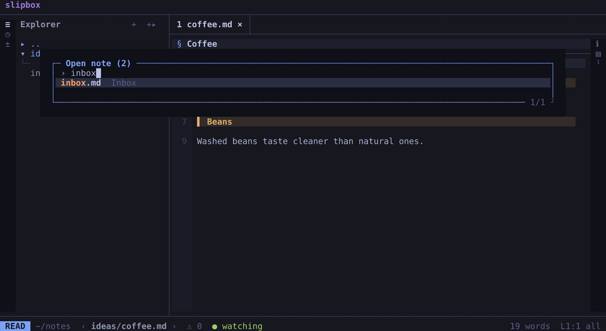
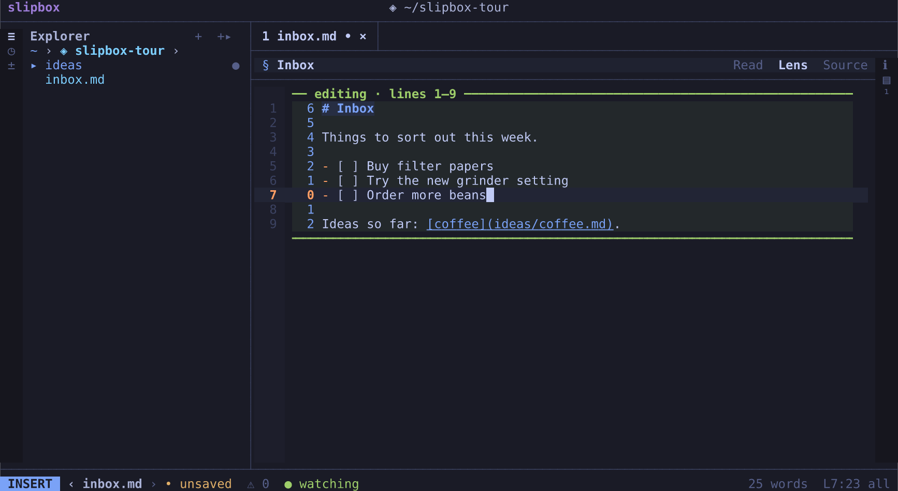

# Getting started

A first session with slipbox, in a folder of your own. You'll open it, move around, open notes, follow a link and come
back, search, change a line and save it, tick a task, and quit. It takes about ten minutes.

You need slipbox installed ([Installing slipbox](install.md)). You also need a terminal at least 90 columns wide, so
the explorer has room beside the note.

## A folder to start in

Any folder of Markdown notes will do. This guide calls it `~/notes`. To follow the steps exactly, make two small notes
in it, `inbox.md` and `ideas/coffee.md`:

```bash
mkdir -p ~/notes && cd ~/notes
slipbox write inbox.md --create --stdin <<'EOF'
# Inbox

Things to sort out this week.

- [ ] Buy filter papers
- [ ] Try the new grinder setting

Ideas so far: [coffee](ideas/coffee.md).
EOF
slipbox write ideas/coffee.md --create --stdin <<'EOF'
# Coffee

## Brewing

A ratio of 1 to 16 suits a pour-over.

## Beans

Washed beans taste cleaner than natural ones.
EOF
```

Each command prints `created` and the note's name. `slipbox write` is how scripts and agents write a note. With
`--create`, it refuses to write over a note that's already there, so it never touches notes of yours.

## Open the folder

```bash
slipbox ~/notes
```

slipbox fills the terminal. It opens the folder's `index.md` or `README.md` if there is one. Otherwise it opens the
first note by path, here `ideas/coffee.md`.

If you've used slipbox in other folders, a list of them may open first, called "Folders". Press `esc` to close it.

## The screen

- On the left, the explorer lists the folder's notes.
- On the right is the note, rendered, with its line numbers. Above it is a tab, `1 coffee.md`.
- Along the bottom, the status line shows the mode (`READ`), the note's path, its word count and where the cursor is
  (`L1:1`).



The arrow keys move, and the shortcuts of other editors work: `ctrl+f` finds, `ctrl+s` saves, `ctrl+z` undoes. vim's
keys work too. This tour gives the familiar key first, and [Keys you already know](keys-you-know.md) lists them all.

Two keys help while you learn the rest:

- Press `space`. A popup lists the keys that can follow it, in groups: `f` for find, `n` for note, and so on. `esc`
  closes it.
- Press `?`. It lists every key, with a filter to type into. `esc` closes it too.

The mouse works as well: click a note, a link or a tab. [The screen](../manual/screen.md) describes each part.

## Move

A cursor sits on the text, at the top of the note.

| To move | Press |
| --- | --- |
| Down or up a row | `down` and `up`, or `j` and `k` |
| A page down or up | `pagedown` and `pageup`, or `ctrl+d` and `ctrl+u` for half a page |
| To the top or the bottom | `ctrl+home` and `ctrl+end`, or `g g` and `shift+g` |
| To the next or previous heading | `alt+down` and `alt+up`, or `] ]` and `[ [` |

The mouse wheel scrolls.

## Open a note

The switcher finds a note by its name.

1. Press `ctrl+p`. A list opens, "Open note (2)".
2. Type `inbox`. The list narrows to `inbox.md`.
3. Press `enter`. inbox.md opens in place of coffee.md.



The explorer is for browsing.

1. Press `space e`. The explorer takes the keys: the status line says `FILES`, and `inbox.md` is selected.
2. Press `up` to move to `coffee.md`, then `enter`. coffee.md opens in a second tab, `2 coffee.md`, and the keys go
   back to the note.
3. Press `q` to close that tab. You're back in inbox.md.

Some terminals and multiplexers take a `ctrl` key for themselves: zellij takes `ctrl+p` and `ctrl+o`. Each of those
keys has another way in, under `space`. For the switcher, it's `space f f`. The [keys chapter](../manual/keys.md)
lists them all.

## Follow a link and come back

1. In inbox.md, press `tab`. The cursor jumps to the link, `coffee`. The right of the status line shows where it goes:
   `→ ideas/coffee.md (resolved)`.
2. Press `enter`. coffee.md opens.
3. Press `ctrl+o`. You're back in inbox.md, where you were.

A click on a link follows it too. `space h p` goes back, like `ctrl+o`.

## Search

To find something in this note:

1. Press `ctrl+f` and type `grinder`. The cursor moves to the match as you type, and a find row above the note counts
   the matches, `1/1`.
2. Press `enter` to keep the search. `n` and `shift+n` then go to the next and previous match.
3. Press `esc` to close the row.

To search every note:

1. Press `space f s` and type `beans`. The list shows each place it's found, the note and the line first:
   `ideas/coffee.md:7`.
2. Press `enter` to open coffee.md there, and `ctrl+o` to come back.

The first time you open a folder, slipbox builds its search index in the background. In a large folder, the list says
how far it has got.

## Change a line and save

1. Put the cursor on "Try the new grinder setting". After the search, it's there already.
2. Press `o`. The lens opens: the part of the note around the cursor shows its Markdown as written, between two
   rules. The rest of the note stays rendered. The status line says `LENS`.
3. Press `o` again. A new task, `- [ ]`, starts on the line below, and the status line says `INSERT`.
4. Type `Order more beans`.

   

5. Press `esc` to stop typing. The status line says `LENS` again. A dot (`•`) by the tab's name means the note has
   unsaved changes.
6. Press `ctrl+s` to save. The message says `saved inbox.md`, and the dot goes.
7. Press `esc` once more to close the lens. The whole note is rendered again.

`i` and `a` start typing before and after the cursor, in the same way: the first press opens the lens, the second
types.

While you type, the keys of any editor work. `shift` with an arrow selects, typing replaces the selection, and
`ctrl+z` and `ctrl+y` undo and redo. When you're not typing, the vim keys you may know work too: `dd`, `cw`, `u` to
undo, `.` to repeat.

If you forget `ctrl+s`, slipbox saves a changed note by itself after half a minute without a key.

The [editing chapter](../manual/editing.md) has the rest. That includes source mode, which shows the whole note as
Markdown: `ctrl+k` switches to it and back.

## Tick a task

1. With the note rendered, put the cursor on "Buy filter papers".
2. Press `ctrl+l`. Its box is ticked, and a message says `done ✓`. The note is saved at once: the line is now
   `- [x] Buy filter papers`.

`ctrl+l` again unticks it. `space n t` does the same, and so does a click on the box.

## Quit

Press `ctrl+q` to quit. `space q q` and `:qa` quit too.

If a note has unsaved changes, slipbox stays open and names it: `unsaved changes in inbox.md`. Then `ctrl+s` (or `:w`)
saves it, or `:q!` quits without saving.

Plain `q` closes a tab or a split, but never quits.

Next time you run `slipbox ~/notes`, your tabs come back, each note where you left it.

## Where to go next

- [Making it yours](making-it-yours.md): a theme, your own keys, your editor, settings for a folder.
- [Working with agents](agents.md): slipbox beside a coding agent, both on the same files.
- [Coming from Obsidian or zk](from-obsidian-or-zk.md): opening a vault or a notebook as it is.
- [Finding things](../manual/finding.md), [Links and vaults](../manual/links-and-vaults.md) and
  [Editing](../manual/editing.md): the chapters behind this session's steps.
- [Keys](../manual/keys.md): every key, as `?` lists them.
- [How slipbox works](../manual/how-it-works.md): the ideas behind what you just did, and what slipbox promises.
