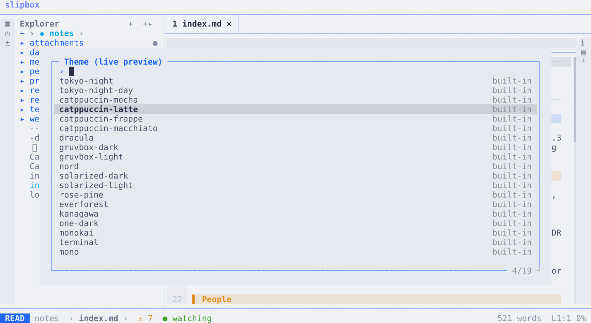
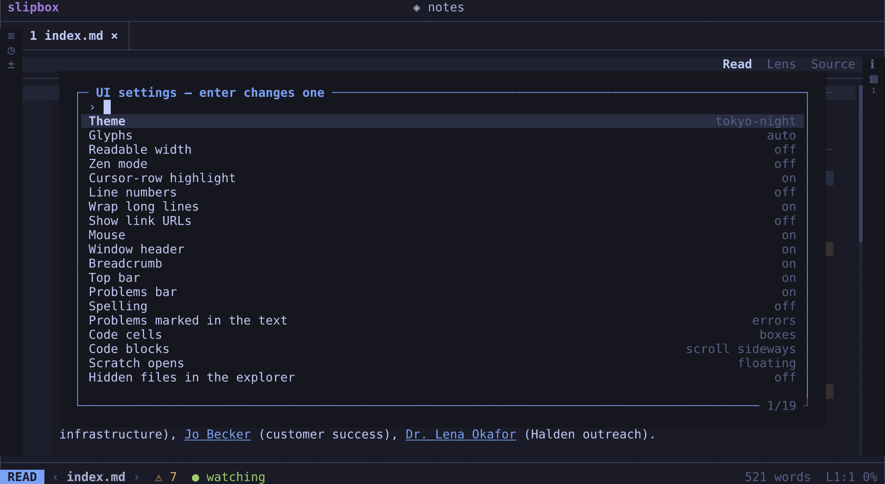

# Making it yours

slipbox works without any settings. This guide is for when you want it to look and behave your way. It covers:

- a theme, and the icons
- keys of your own
- settings for every folder, or for one
- your editor
- spelling
- indentation

It shows the settings people change first. The [configuration chapter](../manual/configuration.md) has every one.

## Your settings file

Your settings live in one TOML file, `~/.config/slipbox/config.toml`. It isn't there until you make it:

```bash
mkdir -p ~/.config/slipbox
touch ~/.config/slipbox/config.toml
```

Then open it in any editor. While slipbox runs, saving the file applies it at once. There's nothing to restart.

A mistake in it, such as a typo or a value slipbox doesn't take, shows as a warning. That one setting keeps its
default, and the rest of the file still applies.

In a folder, `slipbox info` lists the settings files slipbox read there.

The examples below are pieces of this file. A line `[render]` starts a table, and the settings under it belong to it.
The configuration chapter writes them as `render.glyphs`.

## A theme

1. Press `space u t`. The theme picker opens.
2. Move through the list. Each theme is shown on the screen as you move.

   

3. Press `enter` to keep the one you're on, or `esc` to go back to the one you had.

A theme picked this way is remembered for this folder. For every folder, name it in your settings:

```toml
theme = "nord"
```

The settings file wins. A theme you picked in a folder gives way when you change `theme` in the file.

`slipbox themes` lists them all. Tokyo Night (`tokyo-night`) is the default, and `tokyo-night-day` is its light one.
There are also Catppuccin's four, Dracula, Gruvbox and Solarized (light and dark), Nord, Rosé Pine, Everforest,
Kanagawa, One Dark and Monokai.

Two more are special:

- `terminal` takes the colours of your terminal's own theme. It suits a terminal without true colour.
- `mono` has no colour at all. slipbox uses it when `NO_COLOR` is set.

**A theme of your own.** Any base16 or base24 colour scheme can be a theme. Put it as a `.yaml` file in
`~/.config/slipbox/themes/`, and it's a theme named after its file. `~/.config/slipbox/themes/harbour.yaml` is
`theme = "harbour"`.

**Single colours** go in `[colors]`, over every theme or over one. Each names a part of the screen (a role) and its
colour. A table sets more than the foreground:

```toml
[colors]
border = "#5e81ac"                    # the frame's lines
cursor_line = { bg = "#3b4252" }      # the cursor's row

[colors."tokyo-night"]                # only while this theme is on
h1 = { fg = "#ff9e64", bold = true }  # top-level headings
```

The configuration chapter lists the roles worth changing, and what each colours.

## Icons

slipbox draws its icons from one of three sets, and picks one by itself:

| Set | Its icons | slipbox picks it |
| --- | --- | --- |
| `nerd` | A Nerd Font's icons | In Ghostty, kitty and WezTerm, which carry them |
| `unicode` | Symbols every font has (plain Unicode) | In other terminals |
| `ascii` | Plain characters, for the Linux console | Where the terminal can show no more |

Press `space u g` to try each one on the screen.

If your terminal uses a Nerd Font, say so in your settings, with `render.glyphs`:

```toml
[render]
glyphs = "nerd"
```

## The rest of the look

`space u u` lists the settings you can change on the screen, with their values. They include:

- line numbers
- wrapping
- a readable width
- zen: the note alone, without the panes and bars
- the mouse



`enter` on one changes it. The change is remembered for the folder, as a picked theme is.

In your settings file, they become the default everywhere:

```toml
[ui]
line_numbers = false
readable_width = true   # the text no wider than 100 columns, centred
```

## Your own keys

Every key runs a named command. You can change every key in the `[keys]` table. Each entry is a key, or a sequence of
keys, and the command it runs:

```toml
[keys]
"g b" = "history.back"            # g then b goes back, as ctrl+o does
"leader u 1" = "theme.set nord"   # a command with what it acts on
"alt+z" = ""                      # "" takes a key away
```

Keys are written as the [keys chapter](../manual/keys.md) writes them:

| Written | Means |
| --- | --- |
| `ctrl+w v` | `ctrl+w`, then `v` |
| `shift+g` (or `G`) | A capital G |
| `leader` | The leader key |

`slipbox commands` lists every command's name.

Editing keys, visual mode, the explorer and the outline have tables of their own: `[keys.source]`, `[keys.explorer]`
and so on. The configuration chapter describes them.

**The leader.** Most of slipbox's keys start with `space`, the leader. To start them with another key, set
`input.leader`:

```toml
[input]
leader = '\'
```

Every leader key moves with it. `space n n` becomes `\ n n`, and `leader` in your `[keys]` means `\`.

Choose a key slipbox doesn't use by itself. If it does, slipbox warns you, and that key then waits for the next one.

**Aliases** are short names for the `:` prompt, as `:w` and `:q` are vim's:

```toml
[aliases]
inbox = "note.open inbox.md"   # :inbox opens the inbox
```

`""` removes a default alias.

**Groups.** Press `space`, and the popup lists the keys that can follow, in groups. `n` is `+note`, and `f` is
`+find`. Keys of your own under a new prefix take a group name in `[groups]`. A few words after a colon explain it:

```toml
[keys]
"leader j i" = "note.open inbox.md"
"leader j c" = "note.open ideas/coffee.md"

[groups]
"leader j" = "journal: the inbox, the coffee notes"
```

`space` now lists `j` as `+journal`, and `space j` lists its two keys.

## Settings for every folder, or for one

Your settings file applies in every folder. A folder can have settings of its own as well, in a `.slipbox/config.toml`
inside it. In that folder, they win over yours.

`slipbox init` gives a folder one:

```bash
slipbox init ~/notes
```

It prints `created ~/notes/.slipbox/`, with the full path. The `config.toml` in it starts with a few commented
examples. Settings for this folder alone go there:

```toml
# ~/notes/.slipbox/config.toml
theme = "catppuccin-latte"

[editor]
autosave_ms = 5000   # save a changed note after 5 seconds without a key
```

A folder with `.slipbox/` is a root, as a git repository is. [Links and roots](../manual/links-and-roots.md) says what
that means for its links.

A folder inside another root takes the outer one's settings too, and the nearer folder's settings win. A git repository
has no settings of its own until you `slipbox init` it. `--private` keeps its `.slipbox/` out of git.

A folder's settings come with the folder, synced or cloned from someone else. So they can't choose what runs on your
machine, or what reaches the network. These come only from your own file:

- the programs slipbox starts: your editor, a linter, a language server
- which folders you trust
- keys or aliases that run a program or throw work away
- fetching pictures from the web
- installing from npm
- the update check

A folder that sets them gets a warning instead.

## Your editor

slipbox edits notes itself ([Getting started](getting-started.md)). But for a long edit, you may want the editor you
know.

Press `space n e` to open the note in it, in this terminal, at the cursor's line. slipbox waits, and shows your changes
when the editor closes.

The editor is the one your `VISUAL` or `EDITOR` variable names, else `vi`. To choose another for slipbox alone, set
`editor.command`:

```toml
[editor]
command = "hx {file}:{line}"   # {file} and {line} are filled in
```

If you keep an editor open elsewhere, `space n s` sends the note to it instead. By default, that's a running Neovim.
slipbox finds it, and asks which one when several are running. `space n p` asks again.

For another editor, give the command that opens a file in it, in `editor.remote`:

```toml
[editor]
remote = ["code -g {file}:{line}"]
```

## Spelling

Spelling is off until you turn it on. In a folder, press `space u s`, and it's remembered there. For every folder, set
`spell.enabled`:

```toml
[spell]
enabled = true
languages = ["en-GB"]   # a note's language when it doesn't name one
```

Misspelt words are marked.

| To | Press |
| --- | --- |
| Go to the next or previous misspelt word | `] s` and `[ s` |
| List suggestions for the word under the cursor | `z =` |
| Add the word under the cursor to your own words | `z g` |

Your own words are kept one a line in `~/.local/share/slipbox/spell/words.txt`. They count in every language.

A note in another language names it in its front matter: `lang: tr`, or `lang: [tr, en]`.

slipbox comes with English (American) and Turkish. Any other language, British English included, needs a Hunspell
dictionary. That's the kind LibreOffice and most systems use.

slipbox finds the ones your system has installed, in `/usr/share/hunspell` and the like. Without an `en_GB` one,
`en-GB` is checked in American English. Or point it at your own, in `spell.dictionaries`:

```toml
[spell]
dictionaries = { de = "~/dicts/de_DE.dic" }   # its .aff beside it
```

## Indentation

slipbox has no indentation setting of its own. It follows `.editorconfig`, the file many editors read. It finds that
file in the note's folder or any folder above it.

Without one, slipbox does what the file already does. Failing that, it does what the file's language usually does.

For notes indented by two spaces and always ending in a newline, write this in `~/notes/.editorconfig`:

```ini
root = true

[*.md]
indent_style = space
indent_size = 2
insert_final_newline = true
```

`tab` and `shift+tab` while typing, and `>` and `<` in source mode, indent by that step. A save adds the final newline.

An `.editorconfig` in your home folder covers every folder under it. The Info view (`space n i`) says how a file is
indented, and where that came from.

## Where to go next

- [Configuration](../manual/configuration.md): every setting, the order the files apply in, the environment variables.
- [Keys](../manual/keys.md): every key, and the notation.
- [Editing](../manual/editing.md): the lens, source mode, spelling, handing a note to your editor.
