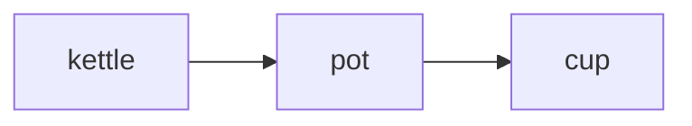

# Reading notes and documents

<a id="reading"></a>

slipbox shows a note drawn as a page. This chapter covers how that page is drawn, how you move through it, and what
slipbox does with files that aren't notes.

On the page:

- headings are set apart
- tables are fitted to the window
- code is highlighted
- pictures, diagrams and maths are drawn where the terminal allows

The Markdown itself is always one key away. `ctrl+k` shows the note as source, and pressing it again brings the page
back; so do the Read and Source buttons on the window's header. Changing the Markdown is [Editing](editing.md). The
parts of the screen around the note are in [The screen](screen.md).

## Moving through a note

A cursor sits on the page, as in vim's normal mode. It's a block on one character, with a band across its row.
`space u l` turns the band off, and so does `ui.cursorline = false`.

The cursor moves by the rows you see:

- A wrapped paragraph has a stop on each of its rows.
- Table borders and blank rows are stops too.
- Moving up and down keeps the column.
- A wide character, such as a Chinese one or an emoji, is a single stop.

| To move | Press |
| --- | --- |
| a character, or a row | the arrows, or `h` `j` `k` `l` |
| to the next or previous word's start | `ctrl+right` and `ctrl+left`, or `w` and `b` |
| to a word's end | `e` |
| to the row's start or end | `home` and `end`, or `0` and `$` |
| to the row's first non-blank | `^` |
| to the top or bottom of the note | `ctrl+home` and `ctrl+end`, or `g g` and `shift+g` |
| to the next or previous heading | `alt+down` and `alt+up`, or `] ]` and `[ [` |
| to the next or previous paragraph | `ctrl+down` and `ctrl+up`, or `}` and `{` |
| to the top, middle or bottom of the window | `shift+h`, `shift+m`, `shift+l` |
| half a page | `ctrl+d` and `ctrl+u` |
| a page | `pagedown` and `pageup` |
| to a line by its number | `ctrl+g`, or `:42` |
| to the next or previous link | `tab` and `shift+tab` |

| To scroll the cursor's row to the window's | Press |
| --- | --- |
| middle | `z z` |
| top | `z t` |
| bottom | `z b` |

The window keeps `ui.scrolloff` rows (3) between the cursor and its top and bottom edges.

The mouse wheel scrolls the page, and moves the cursor only as far as it must to stay on it. A click puts the cursor
where you click. A click on a link follows it.

Every movement key, with the editors' alternatives, is in [Keys](keys.md).

`enter` follows the link under the cursor. When the cursor isn't on a link, `enter` follows the row's first link.
Following links, and coming back with `ctrl+o`, is in [Links and backlinks](links-and-vaults.md).

The numbers down the left side are the note's line numbers in its Markdown. Each one sits on the row where its line
starts, so a long line wrapped over several rows has one number. `space u n` hides them, and
`ui.line_numbers = false` starts without them.

The status line's `L18:1` is the line and column of the text under the cursor.
[The screen](screen.md#the-status-line) has the rest of the status line.

## Selecting and copying

You select and copy on the page as you would in the Markdown:

1. Select with `v`, `shift` with an arrow, or a drag.
2. Copy with `y y` or `ctrl+c`.

What you copy is the text as you see it, not the Markdown under it.
[Undo, redo and the clipboard](editing.md#undo-redo-and-the-clipboard) has the keys and the clipboard.

## How a note is drawn

### Headings

Each heading has an icon for its level and a tinted band across the window, in its level's colour. So the six levels
are easy to tell apart.

Both ways of writing a heading work:

- `#` to `######` before it
- a line of `=` or `-` under it

### Paragraphs and line breaks

A paragraph wraps to the window.

A single line break in the Markdown is a space on the page, as in every Markdown reader. Between two Chinese or
Japanese characters, it's nothing.

To break a line, do one of these:

- end it with two spaces
- end it with a backslash
- write `<br>`

### Wrapping and width

The text column is the window's width, less `render.inset` columns (4) held back at the right. So a table's border
never touches the edge. On a narrow window the inset shrinks, but never below one column.

Wrapping breaks at spaces, and between Chinese and Japanese characters. It never puts a closing mark such as `。` at
the start of a row. A word too long for a row, such as a path or a web address, breaks after a `/`, `-`, `_`, `.` or
similar mark. A no-break space never breaks.

These change the column:

- **Readable width** (`space u shift+w`, `ui.readable_width`) caps the column at `ui.readable_max` columns (100) and
  centres it. Zen mode turns it on.
- **`render.max_width`** caps the column without centring it.
- **Wrapping off** (`space u w`, `alt+z`, `:wrap`, or `ui.wrap = false`) draws each paragraph on one row, and each
  table at its natural width.

Wrapping off wins over readable width and `render.max_width`.

With wrapping off, the window scrolls sideways:

- The cursor keeps four columns from either edge.
- A sideways wheel or trackpad scrolls.
- A scrollbar runs along the window's bottom row.

With wrapping on, a code block too wide for the window scrolls sideways on its own instead, as
[Code blocks](#code-blocks) says.

### Emphasis, code and links

- `**strong**` text is bold, in a lighter colour so it stands out even where a terminal's bold is faint.
- `*emphasis*` is italic.
- `~~struck~~` is struck through.
- `==highlighted==` text, as Obsidian writes it, is drawn on a marker's yellow (the `highlight` colour), whatever is in
  it. The marks go on the text itself, so `a == b`, with spaces inside them, is text.
- `` `code` `` has its own background.
- `#tags` are drawn in a colour of their own. `enter` on one lists the notes that carry it.

`%%comments%%`, as Obsidian writes them, are hidden while you read. A comment can be:

- in a line
- a paragraph of nothing else
- a block of several paragraphs, from a line that starts with `%%` to one that ends with it

Source mode and the lens show comments as written. A link in a comment still counts as one of the note's links, though
it isn't drawn.

A link shows its text, coloured by whether it reaches anything:

- A link that reaches nothing is red.
- A link whose name fits several notes has a colour of its own.

A link without text shows its target as written. A `[[wikilink]]` shows the note's name, or its own text after `|`. A
web address in the text is a link too.

A web link's address can follow its text. `space u r` shows the addresses, and `render.show_urls = "always"` always
does. By default they show only where there's no colour to mark links.

How links resolve, and what each kind does when followed, is [Links and backlinks](links-and-vaults.md).

### Lists and tasks

- Bullets change with depth: `•`, `◦`, `▪`, `▫`.
- Numbers line up on the right.
- A long item hangs under its first word.

A task shows a box, `☐` or `☑`. In a numbered list, the box comes after the number. A done task's text is dimmed.

To tick a task, click its box, or press `ctrl+l` on its row. See [Editing](editing.md).

```text
☑ Buy a kettle with a thermometer
☐ Try a lower temperature for green tea
  ☐ 80 °C
  ☐ 70 °C
```

### Quotes and callouts

A quote has a bar down its left side, and its text is in italics.

A callout is a quote whose first line names its kind, as Obsidian and GitHub write them:

```markdown
> [!tip] Water first
> Heat the water to just off the boil, about 94 °C.
```

It's drawn with the kind's icon, a title and its bar in the kind's colour. The title is the one written after the
kind, else the kind's name:

```text
▎ ✦ Water first
▎ Heat the water to just off the boil, about 94 °C.
```

The kinds come in five colours: note, tip, important, warning and caution. Obsidian's other names fall in with them:

| Kind | Obsidian's other names |
| --- | --- |
| tip | `success` and `done` |
| important | `summary` |
| warning | `question` and `faq` |
| caution | `danger`, `error` and `bug` |

A kind slipbox doesn't know is drawn as a note.

- Capitals work as GitHub writes them (`[!WARNING]`).
- Obsidian's folding marks (`[!faq]-`) are accepted, and the callout is always drawn open.
- Written as `\[!note]`, it stays a plain quote.

### Tables

A table always fits the window. When its columns can't all have their full width, slipbox gives each column at least
its longest word. Then it shares out the rest of the room, so the table is as short as it can be and as few words as
possible are split.

Cells wrap like paragraphs. Once any row wraps, lines appear between the rows so you can tell them apart. The rule under
the header row is doubled. The alignment written in the header's rule (`:---:`, `---:`) is kept.

Where even that won't fit, the table is drawn as records. Each row is one block, with each value beside its column's
name:

```text
───────────────────────
Title   The Elements of
        Style
Author  Strunk and
        White
Status  done
───────────────────────
```

Resizing the window, or a pane beside it, fits every table again.

### Code blocks

A code block is drawn across the full width, on a background of its own, with its language at the top right.

Its code is highlighted when the fence names a language slipbox knows: shell (`bash`, `sh`, `zsh`, `console`), C,
C++, CSS and SCSS, diff, Dockerfile, Go, HTML and XML, Java, JavaScript, JSON, LaTeX, Lua, Makefile, Markdown, PHP,
Python, Ruby, Rust, SQL, Swift, TOML and INI, TypeScript, Vim script and YAML. A block without a language isn't
guessed at.

A tab is four columns.

A code block keeps its lines whole. When one is too long for the window, the block scrolls sideways on its own, as
code does on GitHub, and the rest of the note stays where it is. A tree, a diagram drawn in characters or a log keeps
its columns lined up.

- A `›` at the block's right edge says a row goes on past it, and a `‹` at its left edge says some of it is out of
  sight that way.
- The block's bottom row holds its scrollbar. Click or drag it to scroll the block.
- Moving the cursor along a line scrolls the block to keep the cursor four columns from either edge: `l` and `h`,
  `w` and `b`, `0` and `$`, `f`. Moving up and down keeps the cursor's column on the screen.
- A sideways wheel or trackpad over the block scrolls it, and so does the wheel with `shift` held. The block then
  stays where you left it until the cursor next moves.
- A click lands on the character under the pointer.
- Find scrolls the block to show the match.
- Copying takes whole lines, never only the part on screen.

Each block keeps how far it's scrolled while the window shows the note. Open another note in the window, and the
blocks start from the left again.

Code blocks in lists and quotes scroll the same way, and so does code in the scratch. The code a diagram or a block of
maths falls back to scrolls too.

`render.code_wrap = "wrap"`, or Code blocks in `space u u`, wraps the lines instead: a line too long carries on in the
next row, marked `↪`. With wrapping off (`space u w`), the whole window scrolls sideways and a code block moves with
it. The Markdown, in source mode and in the lens, follows wrapping alone.

### Footnotes

A reference to a footnote is drawn as its label in brackets, such as `[1]`. Its definition is drawn where the note
writes it, as `1.` with the text hanging beside it.

`enter` on a reference jumps to its definition, and `ctrl+o` comes back.

The footnotes view (`space n f`) lists a note's footnotes, and adds and changes them. See
[Footnotes](finding.md#footnotes).

### Front matter

A note's front matter is YAML between `---` lines, or TOML between `+++` lines. It's drawn as a block of properties at
the top:

```text
── ≡ properties ─────────────────────────────────────────────────────
 title  Coffee
 tags   kitchen, ideas
─────────────────────────────────────────────────────────────────────
```

- The keys are in a column, and a long key is cut short with `…`.
- Their values are beside them.
- A list is written out with commas.
- A nested map is written as `name: value; name: value`.
- A `[[wikilink]]` in a value is a link you can follow.

Front matter that doesn't parse is shown as written, with the error under it, so you can see what to fix.

The Info view lists the properties too ([The screen](screen.md#the-info-view)). The properties editor
(`space n shift+p`) edits them ([Editing](editing.md)).

### HTML in a note

A block of HTML is shown as it's written, dimmed. Comments (`<!-- -->`) are hidden.

Inside a paragraph, tags such as `<kbd>`, `<sup>` and `<mark>` are dropped, and their text is kept.

## Pictures

A picture is always drawn as a line naming it: `▣` and its alt text. For example, `` is
`▣ A grinder`.

Where the terminal can draw pictures, a picture on a paragraph of its own is also drawn under that line. It's fitted to
its window, with its proportions kept: as wide as the text column, never larger than its own size, and no taller than
the window, so it shows whole with its `▣` line. In a short window, or for a tall and narrow picture, it's never made
smaller than 12 rows tall or 20 columns wide: it's taller than the window then, and you scroll past it as you scroll
past text. A picture beside other text stays its `▣` line.

**At its own size.** Click a picture, or press `z p` with the cursor on its `▣` line, to see it at its own size. The
text around it stays as it was. A picture wider than the window scrolls sideways on its own, with a scrollbar under
it: `z h` and `z l` scroll it a quarter of the window at a time, and so do a sideways wheel, the wheel with `shift`,
and a drag of its scrollbar. Click it, or press `z p`, again to fit it to the window.

- A picture stays at its own size while its window shows the note, through scrolling, edits and resizing. Another note
  in the window, and it's fitted again.
- A picture's own size is at most one million pixels and 2,048 pixels a side, what slipbox prepares for the screen. A
  bigger one is shown at the most of it that's prepared.
- With the lens open, a click changes a picture's size and leaves the cursor where it is.
- With wrapping off, a picture at its own size scrolls sideways with the window.

- slipbox draws PNG, JPEG, WebP and GIF files. It draws SVG drawings too, turning them into pixels at the size
  they're shown.
- A picture embedded by name, as Obsidian writes it (`![[grinder.png]]`), is found as a link by name is found.
- Obsidian's sizes are kept. `![[grinder.png|300]]` is 300 pixels wide, and `|240x180` is the box it fits in.
- A picture in an [embedded note](#embedded-notes) is drawn there too.
- `enter` on a picture in the folder copies its path.

**Which terminals draw them.** slipbox asks the terminal when it starts. Pictures are drawn in a terminal that speaks
the Kitty graphics protocol or sixel, as kitty, Ghostty, WezTerm and foot do. They're never drawn as blocks of coloured
characters. In a terminal that speaks neither, a picture is its `▣` line alone.

While you resize a window, its pictures wait, and are drawn at its new size when you stop. With sixel, pictures can
also disappear while you scroll quickly, and come back when you stop.

Pictures and mathematical displays prepare in the background; their text stays visible until they are ready.
A drawing that takes more than three seconds or exceeds the display limits keeps its text instead.
Large bitmap previews are reduced to at most one million pixels before reaching the screen.

`render.images = "never"` turns pictures off. When a terminal you expect to draw them doesn't, see
[Troubleshooting](troubleshooting.md).

**Pictures on the internet.** A picture whose address is on the web is fetched only as `render.images_remote` says:

- `ask`, the default: the picture is its `▣` line until you press `enter` on it. Then slipbox asks whether to fetch it
  this once, or to fetch from that site without asking until slipbox quits.
- `show`: it's fetched as soon as the note is drawn.
- `never`: it's never fetched, and `enter` copies its address.

A fetched picture is kept in slipbox's cache, one file per address. From then on it's drawn from there, without asking.

Downloads share a queue: at most three run at once, with 32 waiting. They stream into temporary cache files rather
than collecting whole responses in memory. Automatic requests wait for a later redraw when the queue is full;
pressing `enter` reports when you need to try again. Changing the remote policy to `never`, or quitting, cancels
pending downloads and removes partial files. Switching tabs leaves session-owned downloads running for cache reuse.

A fetch gives up:

- after 15 seconds
- on anything that isn't a picture
- on anything over 20 MB

It says why, and isn't tried again until you press `enter` on the picture.

Only your own config sets `render.images_remote` ([Configuration](configuration.md)). A folder's own
`.slipbox/config.toml` that sets it is ignored, with a warning. So a folder you clone can't have its pictures fetched.

[Privacy](privacy.md) lists everything slipbox fetches.

## Diagrams

A Mermaid diagram is a code block whose language is `mermaid`. slipbox draws it in the terminal's own characters:
boxes, lines and arrows, with its words in the text's colour.

````markdown

````

```text
┌────────┐     ┌─────┐     ┌─────┐
│        │     │     │     │     │
│ kettle ├────►│ pot ├────►│ cup │
│        │     │     │     │     │
└────────┘     └─────┘     └─────┘
```

slipbox draws these kinds:

- flowcharts
- state, sequence, class and entity-relationship diagrams
- XY charts

A diagram too wide for its spacing is drawn closer together. Still too wide, it's drawn as close as it goes and
scrolls sideways, as a code block does. It stays a code block when:

- it's too wide and code blocks wrap (`render.code_wrap = "wrap"`)
- it's of a kind slipbox doesn't draw (`pie`, `gantt`)
- slipbox can't read it

Its label then says why, such as "too wide to draw" or "not drawn: pie".

Diagrams render in the background. Until one is ready, its source remains visible with `mermaid — drawing…` in the
header; you can keep reading and editing. Completed diagrams are remembered on disk, so the same source and rendering
options can appear immediately in a later session. The screen, `slipbox render` and export share this bounded cache.
Changing width, glyphs, colours, font, the drawing library or slipbox's version uses a different cache entry. The disk
cache holds at most 2,048 results and 32 MiB of drawing data, with database overhead; older results are discarded. Set
`SLIPBOX_DIAGRAM_CACHE=off` to bypass it. A missing or unavailable cache does not prevent rendering.
A diagram that took too long to draw on screen is remembered as well: later sessions show its source with that label
without trying again, until slipbox or its drawing library is upgraded. `slipbox render` and export still try it with
their own, longer limit.
A diagram that exceeds a rendering limit stays as code. Its label says why, such as "took too long to draw",
"source too large to draw" or "drawing output too large". On screen, a timeout gets one retry. Waiting diagrams are
drawn as capacity becomes available. `slipbox render` and export allow five seconds per diagram without an automatic
retry, then leave it as source. This is a limit for each diagram, not the entire note; startup and queue wait add time.

Where the terminal draws pictures, `render.mermaid = "picture"` draws diagrams as pictures instead. They're in the
theme's colours and a font found on your machine, centred, and at most 60 rows tall. Without such a font, or where
pictures aren't drawn, a diagram is drawn in characters as above.

## Maths

slipbox draws maths as text. It reads maths written as Obsidian writes it: `$…$` in a line, and `$$` around a block.

| You write | You see |
| --- | --- |
| `\alpha` | `α` |
| `x^2` | `x²` |
| `\sum_{i=1}^n` | `∑ᵢ₌₁ⁿ` |
| `\mathbb{R}` | `ℝ` |

Fractions and square roots are written out (`(a+b)/c`, `√x`).

A block is centred. `aligned` rows line up at their `&`, and `cases` and matrices get tall brackets.

A dollar sign that isn't maths stays one. `$` with a space just inside it, or a digit straight after the closing one,
is money. So "costs $5 and $10" reads as written.

Maths using a command slipbox doesn't know is shown as written. A block of it is shown as a code block labelled "as
written". A block wider than the text is a code block too, labelled "too wide to draw".

Where the terminal draws pictures, `render.math = "picture"` typesets a block of maths as a picture, as big as the
words beside it. Maths in a line is always text.

## Embedded notes

A paragraph made only of embeds draws each embedded note in place, behind a bar, under a header naming it:

```markdown

```

```text
⧉ coffee › Grind
▎ ▌ Grind
▎
▎ Medium-fine, like table salt. Too fine and the water stalls; too
▎ coarse and the cup tastes thin.[1]
```

| You write | It embeds |
| --- | --- |
| `` or `![[note]]` | the whole note but its front matter |
| `` or `![[note#Heading]]` | that heading and what follows it, up to the next heading as high |
| `` or `![[note#^id]]` | the paragraph, list item, table or quote marked `^id` |

An embedded note is read-only. It's always as its file is now, so when the file changes, the page showing it changes
too.

- Its links lead where they would from the embedded note.
- All its rows count as the embed's own line in the note showing it.
- Its headings stay out of that note's outline.
- `enter` on the header opens the embedded note.

A note that embeds itself, or one already being drawn, says so instead of drawing it again. Embeds inside embeds go
three deep. Past that, a line says to open it.

An embed beside other text, or one that reaches nothing, is drawn as a reference: `⧉` and its text. A picture embedded
this way is a picture.

## Data files

slipbox opens data files as well as notes, and draws them as pages too:

- JSON (with `.jsonc` and `.json5`)
- YAML
- TOML
- INI (with `.cfg`, `.conf`, `.properties` and `.env`)
- CSV and TSV

Their sections and keys make the outline and the breadcrumb, and find works in them. A link can lead into one. For
example, `[editor](config.toml#editor)` opens at that section. `ctrl+k` shows the file as text.

Nothing is ever rewritten. When you edit a data file, you edit its text, so its comments, order and layout stay as they
were ([Editing](editing.md)).

- **TOML and INI**: each `[section]` is a heading, deeper for each dot in its name. Each key and value is a row, with
  the keys in a column.
- **YAML and JSON**: a tree, with lines joining each key to its parent. A short list of plain values, or a small map,
  stays on one line. A file of several YAML documents shows each as `document 1`, `document 2`.
- **Records**: a list of two or more objects with plain values, in YAML or JSON, is drawn as a table, a row for each.
  So are TOML's `[[name]]` entries.
- **CSV and TSV**: one table, its first row the header. Past 2,000 rows, the rest are counted. `ctrl+k` shows them all.
- **Values** are coloured by kind: numbers and dates, true, false and null, and text. A comment on the line above a
  key is drawn after its value, dimmed. Longer comments are rows of their own.

A value that is a web address is a link, and so is a path that names a file in the folder. Keys that name another
file, such as `$ref`, `$schema`, `extends`, `include` and `import`, are links too. They're shown as broken when they
reach nothing. [Links and backlinks](links-and-vaults.md) has how such links count.

A data file that doesn't parse can't be drawn. It opens as text, with the error in a message. Once it parses again,
`ctrl+k`, or the window header's Read, draws it.

## Other files

- **Text files**, any other file that holds text, open as text, highlighted by their language. Org and AsciiDoc files
  are text files to slipbox.
- **Code** in a language slipbox's code view knows opens in the code view. Its comments are drawn as prose, and each
  definition is a cell. That is [Code](code.md). `render.code = "source"` opens code as text instead.
- **Binary files**, such as pictures, PDFs and archives, never open. A link to one copies its path. A file named like
  text that holds binary bytes is treated the same.

Which of these the explorer and the switcher list is in [Files](files.md).

**Big notes.** When you open a note of more than 128 KB for the first time, the window says it's reading it. That
lasts a moment at most. Then it draws the note where you left it. Big notes are read on other threads, so slipbox
answers your keys meanwhile. When many are waiting at once, such as when a vault is first indexed, each takes its turn.

If a note can't be read there, it is shown as its source, and a message says why. When its thread was at fault, by
running out of time or stopping, opening the note again tries once more. Editing the note always does. Your vault's
index isn't affected: the note's links, tags and headings are read all the same.

**Text that isn't UTF-8.** Bytes that aren't valid UTF-8 are drawn as `�`, and a message says so.

**Text that could fool your terminal.** A note can't send your terminal commands. slipbox removes terminal escape
sequences and control characters from everything it draws: notes, file names and headings alike. It also removes the
invisible characters that reverse the direction of text, so a line can't disguise what it says.

## Themes

Theme selection, built-ins, user themes and the terminal/mono choices are explained in
[Customization](customization.md#themes). Exact colour overrides are in [Configuration
settings](configuration.md#colours).

## Glyphs

slipbox draws its icons, bullets, boxes and lines from one of three glyph sets:

| | `unicode` | `ascii` |
| --- | --- | --- |
| a heading | `▌` | `#` to `######` |
| bullets | `•` `◦` `▪` `▫` | `*` `-` `+` `-` |
| tasks | `☐` `☑` | `[ ]` `[x]` |
| a quote's bar | `▎` | `\|` |
| a picture, an embed | `▣`, `⧉` | `[img]`, `=>` |
| callouts | `ℹ` `✦` `❢` `⚠` `✖` | `(i)` `(*)` `(!)` `(!)` `(x)` |

The third set, `nerd`, uses icons from a Nerd Font:

- a different icon for each heading level
- icons for callouts, pictures, folders and buttons

It needs a Nerd Font in the terminal, or a terminal that brings the icons with it.

The setting `render.glyphs` is `auto` by default, which picks:

1. `ascii` when your locale isn't UTF-8, or on the Linux console
2. `nerd` in Ghostty, kitty and WezTerm, which bring the Nerd Font icons with them
3. `unicode` everywhere else

| To | Use |
| --- | --- |
| pick a set with a live preview | `space u g` |
| set one | `:glyphs unicode` |
| choose one in place of `auto` | `SLIPBOX_GLYPHS` |

If icons show as boxes or question marks, pick `unicode`.

## Drawing a note on the command line

`slipbox render` prints a note as slipbox draws it. It's for scripts and agents, or to look at a note without the TUI:

```bash
slipbox render ideas/coffee.md --width 80
```

```text
── ≡ properties ────────────────────────────────────────────────────────────
 title  Coffee
 tags   kitchen, ideas
────────────────────────────────────────────────────────────────────────────

▌ Coffee

Notes on making a better cup at home, mostly by trial and error.
```

- `--width N` is the width to draw for, from 20 to 1000 columns. It's the terminal's width by default, else 100. The
  inset is held back from it, as in the TUI.
- `--theme` and `--glyphs` choose for this one render.
- Colour is used when the output is a terminal and `NO_COLOR` isn't set, in as many colours as the terminal has.
  `--plain`, `--color never` or a pipe give plain text. `--color always` gives colour even so.
- Without colour, a web link's address follows its text, as `<address>`, and a picture's path follows its name.
- `--json` gives the rows as text and the headings, each with its level, text, anchor and line.

In the output:

- Pictures are their `▣` line.
- Diagrams are drawn in characters, and maths as text.
- A code block's long lines wrap, marked `↪`: printed text has no window to scroll.
- Embedded notes are drawn in place.
- A data file is drawn as in the TUI.

A text or code file has no page to draw. `slipbox render` says so and exits with status 2. `slipbox read` gives its
text.

Every option is in [The command line](cli.md).
