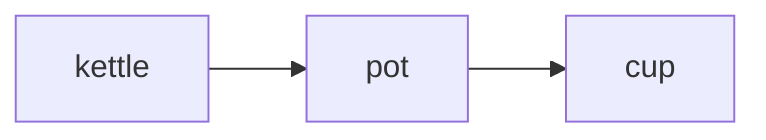

# Reading

slipbox shows a note drawn as a page: headings set apart, tables fitted to the window, code highlighted, pictures,
diagrams and maths drawn where the terminal allows. This chapter covers how that page is drawn, how you move through
it, and what slipbox does with files that aren't notes. The Markdown itself is always one key away: `ctrl+k` shows the
note as source and back, and changing it is [Editing](editing.md). The parts of the screen around the note are in
[The screen](screen.md).

## Moving through a note

A cursor sits on the page, as in vim's normal mode. It's a block on one character, with a band across its row
(`space u l` turns the band off, as does `ui.cursorline = false`). It moves by the rows you see: a wrapped paragraph
has a stop on each of its rows, and table borders and blank rows are stops too. Moving up and down keeps the column,
and a wide character, such as a Chinese one or an emoji, is a single stop.

| To move | Press |
| --- | --- |
| a character, or a row | `h` `j` `k` `l`, or the arrows |
| a word | `w` and `b` to the next and previous word's start, `e` to a word's end |
| to the row's start or end | `0` and `$`, or `home` and `end`; `^` to its first non-blank |
| to the top or bottom of the note | `g g` and `shift+g` |
| to the next or previous heading | `] ]` and `[ [`, or `alt+down` and `alt+up` |
| to the next or previous paragraph | `}` and `{` |
| to the top, middle or bottom of the window | `shift+h`, `shift+m`, `shift+l` |
| half a page, or a page | `ctrl+d` and `ctrl+u`; `pagedown` and `pageup` |
| to a line by its number | `ctrl+g`, or `:42` |
| to the next or previous link | `tab` and `shift+tab` |

`z z`, `z t` and `z b` scroll the cursor's row to the middle, top or bottom of the window. The window keeps
`ui.scrolloff` rows (3) between the cursor and its top and bottom edges. The mouse wheel scrolls the page, and moves
the cursor only as far as it must to stay on it. A click puts the cursor where you click, and on a link follows it.
Every movement key, with the editors' alternatives, is in [Keys](keys.md).

The link under the cursor is the one `enter` follows; on a row without one, `enter` follows the row's first link.
Following links, and coming back with `ctrl+o`, is in [Links and roots](links-and-roots.md).

The numbers down the left side are the note's line numbers in its Markdown, each on the row where its line starts,
so a long line wrapped over several rows has one number. `space u n` hides them, and `ui.line_numbers = false` starts
without them. The status line's `L18:1` is the line and column of the text under the cursor;
[The screen](screen.md#the-status-line) has the rest of it.

## Selecting and copying

- `v` starts a selection by character and `shift+v` one by whole rows; then move to extend it. `shift` with an arrow,
  `home` or `end` selects too.
- `y y` or `ctrl+c` copies the selection, and so does `y` alone in visual mode. With nothing selected, `y y`
  copies the cursor's row.
- With the mouse, drag to select and copy, double-click for a word, triple-click for a row.
- `esc` clears the selection.

What you copy is the text as you see it on the page, not the Markdown under it. Three more copies are about the note
rather than its text: `y p` copies its full path, `y r` its path and the cursor's line (`ideas/coffee.md:18`), and `y l`
the target of the link under the cursor.

Copies go to the system clipboard. If yours can't be reached, over SSH for instance, see
[Troubleshooting](troubleshooting.md).

## How a note is drawn

### Headings

Each heading has an icon for its level and a tinted band across the window, in its level's colour, so the six levels
are easy to tell apart. Both ways of writing a heading work: `#` to `######` before it, or a line of `=` or `-` under
it.

### Paragraphs and line breaks

A paragraph wraps to the window. A single line break in the Markdown is a space on the page, as in every Markdown
reader, except between two Chinese or Japanese characters, where it's nothing. To break a line, end it with two
spaces or a backslash, or write `<br>`.

### Wrapping and width

The text column is the window's width, less `render.inset` columns (4) held back at the right, so a table's border
never touches the edge; on a narrow window the inset shrinks, never below one column.

Wrapping breaks at spaces, and between Chinese and Japanese characters, never putting a closing mark such as `。` at
the start of a row. A word too long for a row, such as a path or a web address, breaks after a `/`, `-`, `_`, `.` or
similar mark. A no-break space never breaks.

- **Readable width** (`space u shift+w`, `ui.readable_width`) caps the column at `ui.readable_max` columns (100) and
  centres it. Zen mode turns it on.
- **`render.max_width`** caps the column without centring it.
- **Wrapping off** (`space u w`, `alt+z`, `:wrap`, or `ui.wrap = false`) draws each paragraph on one row and each
  table at its natural width. The window then scrolls sideways: the cursor keeps four columns from either edge, a
  sideways wheel or trackpad scrolls, and a scrollbar runs along the window's bottom row. Wrapping off wins over
  readable width and `render.max_width`.

### Emphasis, code and links

- `**strong**` text is bold, in a lighter colour so it stands out even where a terminal's bold is faint; `*emphasis*`
  is italic, and `~~struck~~` is struck through.
- `` `code` `` has its own background.
- A link shows its text, coloured by whether it reaches anything: a link that reaches nothing is red, and one whose
  name fits several notes has a colour of its own. A link without text shows its target as written. A `[[wikilink]]`
  shows the note's name, or its own text after `|`. A web address in the text is a link too.
- `#tags` are drawn in a colour of their own, and `enter` on one lists the notes that carry it.
- A web link's address can follow its text: `space u r` shows them, and `render.show_urls = "always"` always does.
  By default they show only where there's no colour to mark links.

How links resolve, and what each kind does when followed, is [Links and roots](links-and-roots.md).

### Lists and tasks

Bullets change with depth (`•`, `◦`, `▪`, `▫`), numbers line up on the right, and a long item hangs under its first
word. A task shows a box, `☐` or `☑`, after its number in a numbered list; a done task's text is dimmed. Click a box,
or press `ctrl+l` on its row, to tick it: see [Editing](editing.md).

```text
☑ Buy a kettle with a thermometer
☐ Try a lower temperature for green tea
  ☐ 80 °C
  ☐ 70 °C
```

### Quotes and callouts

A quote has a bar down its left side, its text in italics. A callout, written as Obsidian and GitHub write them, is a
quote whose first line names its kind:

```markdown
> [!tip] Water first
> Heat the water to just off the boil, about 94 °C.
```

is drawn with the kind's icon, a title (the one written after it, else the kind's name) and its bar in the kind's
colour:

```text
▎ ✦ Water first
▎ Heat the water to just off the boil, about 94 °C.
```

The kinds come in five colours: note, tip, important, warning and caution. Obsidian's other names fall in with them
(`success` and `done` with tip, `summary` with important, `question` and `faq` with warning, `danger`, `error` and
`bug` with caution), and a kind slipbox doesn't know is drawn as a note. Capitals work as GitHub writes them
(`[!WARNING]`). Obsidian's folding marks (`[!faq]-`) are accepted, and the callout is always drawn open. Written as
`\[!note]`, it stays a plain quote.

### Tables

A table always fits the window. When its columns can't all have their full width, slipbox gives each column at least
its longest word, then shares out the rest of the room so the table is as short as it can be and as few words as
possible are split. Cells wrap like paragraphs; once any row wraps, lines appear between the rows so you can tell
them apart. The rule under the header row is doubled, and the alignment written in the header's rule (`:---:`,
`---:`) is kept.

Where even that won't fit, the table is drawn as records: one block per row, each value beside its column's name.

```text
───────────────────────
Title   The Elements of
        Style
Author  Strunk and
        White
Status  done
───────────────────────
```

Resizing the window, or a pane beside it, fits every table again.

### Code blocks

A code block is drawn across the full width on a background of its own, with its language at the top right.
Its code is highlighted when the fence names a language slipbox knows: shell (`bash`, `sh`, `zsh`, `console`), C,
C++, CSS and SCSS, diff, Dockerfile, Go, HTML and XML, Java, JavaScript, JSON, LaTeX, Lua, Makefile, Markdown, PHP,
Python, Ruby, Rust, SQL, Swift, TOML and INI, TypeScript, Vim script and YAML. A block without a language isn't
guessed at. A line too long for the window carries on in the next row, marked `↪`, and a tab is four columns.

### Footnotes

A reference to a footnote is drawn as its label in brackets, such as `[1]`, and its definition, where the note writes
it, as `1.` with the text hanging beside it. `enter` on a reference jumps to its definition, and `ctrl+o` comes back.
The footnotes view (`space n f`) lists a note's footnotes: see [Finding things](finding.md).

### Front matter

A note's front matter, YAML between `---` lines or TOML between `+++` lines, is drawn as a block of properties at the
top: its keys in a column, a long key cut short with `…`, and their values beside them. A list is written out with
commas, a nested map as `name: value; name: value`, and a `[[wikilink]]` in a value is a link you can follow.

```text
── ≡ properties ─────────────────────────────────────────────────────
 title  Coffee
 tags   kitchen, ideas
─────────────────────────────────────────────────────────────────────
```

Front matter that doesn't parse is shown as written, with the error under it, so you can see what to fix. The Info
view lists the properties too, and the properties editor (`space n shift+p`) edits them: see
[The screen](screen.md#the-info-view) and [Editing](editing.md).

### HTML in a note

A block of HTML is shown as it's written, dimmed. Comments (`<!-- -->`) are hidden. Inside a paragraph, tags such as
`<kbd>`, `<sup>` and `<mark>` are dropped and their text kept.

## Pictures

A picture is always drawn as a line naming it, `▣` and its alt text: `` is `▣ A grinder`.
Where the terminal can draw pictures, a picture on a paragraph of its own is also drawn under that line: sized to the
text column, its proportions kept, at most 12 rows tall. A picture beside other text stays its `▣` line.

- slipbox draws PNG, JPEG, WebP and GIF files, and SVG drawings, which it turns into pixels at the size they're shown.
- A picture embedded by name, as Obsidian writes it (`![[grinder.png]]`), is found as a link by name is found, and
  Obsidian's sizes are kept: `![[grinder.png|300]]` is 300 pixels wide, and `|240x180` is the box it fits in.
- A picture in an [embedded note](#embedded-notes) is drawn there too.
- `enter` on a picture in the folder copies its path.

**Which terminals draw them.** slipbox asks the terminal when it starts. Pictures are drawn in a terminal that speaks
the Kitty graphics protocol, such as kitty, Ghostty or WezTerm, or sixel, such as foot; never as blocks of coloured
characters. In a terminal that speaks neither, a picture is its `▣` line alone. With sixel, pictures can disappear
while you scroll quickly and come back when you stop. `render.images = "never"` turns pictures off. When a terminal
you expect to draw them doesn't, see [Troubleshooting](troubleshooting.md).

**Pictures on the internet.** A picture whose address is on the web is fetched only as `render.images_remote` says:

- `ask`, the default: it's its `▣` line until you press `enter` on it, which asks whether to fetch it this once, or to
  fetch from that site without asking until slipbox quits.
- `show`: fetched as soon as the note is drawn.
- `never`: never fetched; `enter` copies its address.

A fetched picture is kept in slipbox's cache, one file per address, and drawn from there, without asking, from then
on. A fetch gives up after 15 seconds, on anything that isn't a picture, and on anything over 20 MB; it says why, and
isn't tried again until you press `enter` on it. Like most settings, `render.images_remote` can be set by a folder's
own `.slipbox/config.toml` as well as yours: see [Configuration](configuration.md), and [Privacy](privacy.md) for
everything slipbox fetches.

## Diagrams

A Mermaid diagram, a code block whose language is `mermaid`, is drawn in the terminal's own characters: boxes, lines
and arrows, its words in the text's colour.

````markdown

````

```text
┌────────┐     ┌─────┐     ┌─────┐
│        │     │     │     │     │
│ kettle ├────►│ pot ├────►│ cup │
│        │     │     │     │     │
└────────┘     └─────┘     └─────┘
```

Flowcharts, state, sequence, class and entity-relationship diagrams and XY charts are drawn. A diagram too wide for
its spacing is drawn closer together; still too wide, or of a kind slipbox doesn't draw (`pie`, `gantt`), or one it
can't read, it stays a code block, its label saying why: "too wide to draw", "not drawn: pie". The first diagram you
open takes a moment: until it's ready, it shows as its code.

Where the terminal draws pictures, `render.mermaid = "picture"` draws diagrams as pictures instead, in the theme's
colours and a font found on your machine, centred and at most 60 rows tall. Without such a font, or where pictures
aren't drawn, a diagram is drawn in characters as above.

## Maths

Maths written as Obsidian writes it, `$…$` in a line and `$$` around a block, is drawn as text: `\alpha` is `α`,
`x^2` is `x²`, `\sum_{i=1}^n` is `∑ᵢ₌₁ⁿ`, `\mathbb{R}` is `ℝ`, and fractions and roots are written out (`(a+b)/c`,
`√x`). A block is centred; `aligned` rows line up at their `&`, and `cases` and matrices get tall brackets.

A dollar sign that isn't maths stays one: `$` with a space just inside it, or a digit straight after the closing one,
is money, so "costs $5 and $10" reads as written. Maths using a command slipbox doesn't know is shown as written, a
block of it as a code block labelled "as written"; a block wider than the text is one too, labelled "too wide to
draw".

Where the terminal draws pictures, `render.math = "picture"` typesets a block of maths as a picture, as big as the
words beside it. Maths in a line is always text.

## Embedded notes

A paragraph made only of embeds draws each embedded note in place, behind a bar, under a header naming it:

```markdown

```

```text
⧉ coffee › Grind
▎ ▌ Grind
▎
▎ Medium-fine, like table salt. Too fine and the water stalls; too
▎ coarse and the cup tastes thin.[1]
```

- `` and `![[note]]` embed the whole note but its front matter.
- `` and `![[note#Heading]]` embed that heading and what follows it, up to the next heading as
  high.
- `` and `![[note#^id]]` embed the paragraph, list item, table or quote marked `^id`.

An embedded note is read-only, and always as its file is now: when it changes, the page showing it changes too. Its
links lead where they would from the embedded note. All its rows count as the embed's own line in the note showing
it, and its headings stay out of that note's outline. `enter` on the header opens the embedded note.

A note that embeds itself, or one already being drawn, says so instead of drawing it again. Embeds inside embeds go
three deep; past that, a line says to open it. An embed beside other text, or one that reaches nothing, is drawn as a
reference, `⧉` and its text, and a picture embedded this way is a picture.

## Data files

slipbox opens data files as well as notes, and draws them as pages too: JSON (with `.jsonc` and `.json5`), YAML,
TOML, INI (with `.cfg`, `.conf`, `.properties` and `.env`), CSV and TSV. Their sections and keys make the outline and
the breadcrumb, find works in them, and a link can lead into one: `[editor](config.toml#editor)` opens at that
section. `ctrl+k` shows the file as text. Nothing is ever rewritten: when you edit a data file, you edit its text,
so its comments, order and layout stay as they were ([Editing](editing.md)).

- **TOML and INI**: each `[section]` is a heading, deeper for each dot in its name, and each key and value is a row,
  the keys in a column.
- **YAML and JSON**: a tree, with lines joining each key to its parent. A short list of plain values, or a small map,
  stays on one line. A file of several YAML documents shows each as `document 1`, `document 2`.
- **Records**: a list of two or more objects with plain values, in YAML or JSON, and TOML's `[[name]]` entries, are
  drawn as a table, a row for each.
- **CSV and TSV**: one table, its first row the header. Past 2,000 rows, the rest are counted; `ctrl+k` shows them all.
- **Values** are coloured by kind: numbers and dates, true, false and null, and text. A comment on the line above a
  key is drawn after its value, dimmed; longer comments are rows of their own.

A value that is a web address is a link, and so is a path that names a file in the folder. Keys that name another
file, such as `$ref`, `$schema`, `extends`, `include` and `import`, are links too, shown as broken when they reach
nothing. [Links and roots](links-and-roots.md) has how such links count.

A data file that doesn't parse can't be drawn: it opens as text, with the error in a message. Once it parses again,
`ctrl+k` draws it.

## Other files

- **Text files**, any other file that holds text, open as text, highlighted by their language. Org and AsciiDoc files
  are text files to slipbox.
- **Code** in a language slipbox's code view knows opens in the code view: its comments drawn as prose, each
  definition a cell. That is [Code](code.md); `render.code = "source"` opens code as text instead.
- **Binary files**, such as pictures, PDFs and archives, never open. A link to one copies its path. A file named like
  text that holds binary bytes is treated the same.

Which of these the explorer and the switcher list is in [Files](files.md).

**Big notes.** Opening a note of more than 128 KB for the first time, the window says it's reading it, for a moment
at most, then draws it where you left it.

**Text that isn't UTF-8.** Bytes that aren't valid UTF-8 are drawn as `�`, and a message says so.

**Text that could fool your terminal.** A note can't send your terminal commands: slipbox removes terminal escape
sequences and control characters from everything it draws, notes, file names and headings alike. It also removes the
invisible characters that reverse the direction of text, so a line can't disguise what it says.

## Themes

The theme sets every colour on the screen. slipbox has these built in:

- `tokyo-night` (the default) and `tokyo-night-day`;
- `catppuccin-mocha`, `catppuccin-latte`, `catppuccin-frappe` and `catppuccin-macchiato`;
- `dracula`, `gruvbox-dark`, `gruvbox-light`, `nord`, `solarized-dark`, `solarized-light`, `rose-pine`,
  `everforest`, `kanagawa`, `one-dark` and `monokai`;
- `terminal`, which uses your terminal's own sixteen colours, so its theme shows through;
- `mono`, with no colours at all: bold, dim, italics and underlines only, links underlined.

`space u t` lists them with the ones you've added, and changes the theme as you move through the list; `enter` keeps
it, `esc` puts the old one back. `:theme nord` switches straight to one, the `theme` setting chooses the default, and
`slipbox themes` lists them on the command line.
When `NO_COLOR` is set, slipbox uses `mono` whatever the theme says.

Your own themes, base16 and base24 schemes, and colour changes to single parts of the screen, are in
[Configuration](configuration.md); [Making it yours](../guides/making-it-yours.md) walks through them.

## Glyphs

slipbox draws its icons, bullets, boxes and lines from one of three glyph sets:

| | `unicode` | `ascii` |
| --- | --- | --- |
| a heading | `▌` | `#` to `######` |
| bullets | `•` `◦` `▪` `▫` | `*` `-` `+` `-` |
| tasks | `☐` `☑` | `[ ]` `[x]` |
| a quote's bar | `▎` | `\|` |
| a picture, an embed | `▣`, `⧉` | `[img]`, `=>` |
| callouts | `ℹ` `✦` `❢` `⚠` `✖` | `(i)` `(*)` `(!)` `(!)` `(x)` |

The third set, `nerd`, uses icons from a Nerd Font: a different icon for each heading level, and icons for callouts,
pictures, folders and buttons. It needs a Nerd Font in the terminal, or a terminal that brings the icons with it.

The setting `render.glyphs` is `auto` by default, which picks:

1. `ascii` when your locale isn't UTF-8, or on the Linux console;
2. `nerd` in Ghostty, kitty and WezTerm, which bring the Nerd Font icons with them;
3. `unicode` everywhere else.

`space u g` picks a set with a live preview, `:glyphs unicode` sets one, and `SLIPBOX_GLYPHS` chooses one in place of
`auto`. If icons show as boxes or question marks, pick `unicode`.

## Drawing a note on the command line

`slipbox render` prints a note as slipbox draws it, for scripts and agents, or to look at a note without the TUI:

```bash
slipbox render ideas/coffee.md --width 80
```

```text
── ≡ properties ────────────────────────────────────────────────────────────
 title  Coffee
 tags   kitchen, ideas
────────────────────────────────────────────────────────────────────────────

▌ Coffee

Notes on making a better cup at home, mostly by trial and error.
```

- `--width N` is the width to draw for, from 20 to 1000 columns: the terminal's width by default, else 100. The
  inset is held back from it, as in the TUI.
- `--theme` and `--glyphs` choose for this one render.
- Colour is used when the output is a terminal and `NO_COLOR` isn't set, in as many colours as the terminal has.
  `--plain`, `--color never` or a pipe give plain text; `--color always` gives colour even so.
- Without colour, a web link's address follows its text, as `<address>`, and a picture's path follows its name.
- `--json` gives the rows as text and the headings, each with its level, text, anchor and line.

Pictures are their `▣` line, diagrams are drawn in characters and maths as text; embedded notes are drawn in place. A
data file is drawn as in the TUI. A text or code file has no page to draw: `slipbox render` says so and exits with
status 2, and `slipbox read` gives its text. Every option is in [The command line](cli.md).
