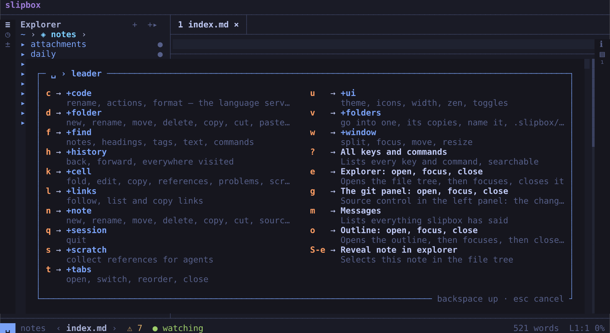

# The screen and navigation

This chapter is a tour of slipbox's screen. It says what each part is for, what it tells you, and how to show, hide,
move and resize it.

How a note itself is drawn is in [Reading](reading.md). Every key is listed in [Keys](keys.md).

## A map of the screen

Here is slipbox with a folder of notes open, two notes in tabs, the explorer on the left and the outline on the
right:

From the top:

- **The top bar** holds the `slipbox` chip, which opens the command palette. In its middle, it says where you are:
  the vault and its branch. At its right end, it shows the vault's state while slipbox indexes it (`indexing 3…`).
- **The tab strip** has a tab for each note you have open.
- **The explorer**, on the left, shows the folder's notes and files as a tree. The column of buttons at the left edge
  is the **left rail**.
- **The window**, in the middle, shows the note. Above the note is its **window header**: the **breadcrumb**, the
  headings the cursor is under, and the **Read**, **Lens** and **Source** buttons, which switch how the window shows
  the note. The numbers down its left side are the note's line numbers. Its last column is its scrollbar.
- **The outline**, on the right, shows the note's headings. The buttons at the right edge are the **right rail**.
- **The status line**, at the bottom, shows the mode, the file, and where you are in it.

Brightness shows which part has the keys, never a coloured border. The focused pane's title is bright, and the others
are dimmer. The active tab is bright while the note has the keys.

The lines between the parts are light by default. `ui.lines = "heavy"` draws them heavy (`━ ┃`). Tables in a note are
always drawn light.

The terminal's title names slipbox and the file on screen.

The pictures and drawings in this chapter use the Unicode glyph set. With Nerd Font icons, or plain ASCII, the buttons
and marks look different. See [Glyphs](reading.md#glyphs).

## The top bar

The top bar holds the `slipbox` chip. Click it to open the [command palette](#the-command-palette). While the vault
is being indexed, the bar also shows how far that has got, at its right end. Without the left rail, the explorer's `≡`
button sits on it too.

**Where you are** is in the middle of the bar:

- **The vault**, after `◈`: its name if it has one, or else its path (`◈ ~/notes`). Home is `◈ ~`. A file outside
  home and every vault says `Elsewhere`, without the `◈`, since it's in no vault. [Vaults, home and
  Elsewhere](vaults.md#names-and-pointers) explains names.
- **Your workspace**, when it isn't the vault's own. A folder of home you opened by name has a workspace of its own,
  shown after home: `◈ ~ › notes`.
- **The branch**, dimmed, in a git repository: `◈ kestrel · main`. A worktree shows its branch after the vault's name:
  `◈ kestrel@fix-menu`. A branch with an upstream shows how far it's ahead of it and behind it, as of the last fetch
  (`· main ↑2 ↓1`). A merge or a rebase under way is said after it (`· main merging`, `· fix rebasing 2/5`). A
  detached head shows its commit.

It sits in the middle of the screen, moved aside only as far as the chip and the right end need. When the bar is short
of room, a long path is cut first, from the front, keeping its end (`◈ …earch/notes`). Then it gives up a part at a
time: the ahead and behind and a merge or rebase under way, then the branch (cut first, then gone), then the workspace.
The vault's name is cut last. Each part given up gives a cut path its room back. On a very narrow screen it isn't
shown.

Click the vault to list the named folders you've opened, and press `enter` to go into one. In a git repository, click
the branch for the branches: pull, push and fetch first, then the branches to check one out.

`space u b` hides the top bar and shows it again. `ui.top_bar = false` hides it from the start. With the bar hidden,
the note gains its row, `:` still opens the palette, and the status line says where you are instead. See
[Configuration](configuration.md) for every `ui` setting.

## Tabs

A tab holds one note, or two in a [split](#windows-and-splits). The strip shows each tab as:

- its number
- the file's name, with its extension
- a `×` that closes it

A note that was just reloaded from disk shows `↻` for a few seconds.

When the tabs don't all fit, the strip shows a run of them that includes the active one. A `+N` button at the right
counts the rest. Click it for the list of tabs.

| To | Press |
| --- | --- |
| open this note in a new tab | `ctrl+t c`, `space t c`, or `:tabnew` |
| follow the link under the cursor into a new tab | `ctrl+enter`, `space l t` |
| go to the next or previous tab | `g t` / `g shift+t`, `ctrl+tab` / `ctrl+shift+tab`, `space t n` / `space t p` |
| go to tab 1 to 9 | `alt+1` … `alt+9`, `space t 1` … `space t 9` |
| pick a tab from a list | `ctrl+t t`, `space t t` |
| move the tab left or right | `space t shift+h` / `space t shift+l`, `ctrl+shift+pageup` / `ctrl+shift+pagedown` |
| close the tab | `ctrl+t q`, `space t q` |
| close the other tabs, or all of them | `space t o`, `space t shift+q` |
| pin the tab, or unpin it | `ctrl+t m`, `space t m`, `:tabpin` |

Every `space t` key also works after `ctrl+t`.

With the mouse:

- Click a tab to switch to it.
- Drag a tab to move it.
- Middle-click a tab, or click its `×`, to close it.
- Turn the wheel over the strip to go to the previous or next tab.

**Pinned tabs** keep their note. A pinned tab has `⚑` before its name. It stays at the left of the strip with the
other pinned tabs, in the order you pinned them.

Anything that would open over a pinned tab (a link, the switcher, `:e`, the explorer) opens in a new tab instead.
Closing the other tabs, or all of them, leaves the pinned ones. `ctrl+t q` still closes a pinned tab.

## Windows and splits

A tab can be split in two, side by side or one above the other. Each window has its own:

- cursor
- find
- history of where it has been

So the two can show different notes, or two places in the same one.

| To | Press |
| --- | --- |
| split side by side | `ctrl+w v`, `space w v`, `ctrl+\`, or `:vs` |
| split one above the other | `ctrl+w s`, `space w s`, or `:sp` |
| go to the other window | `ctrl+w w`, `space w w` |
| go to the window, or pane, to the left, below, above or right | `ctrl+w h` / `j` / `k` / `l`, or the arrows |
| move this window to the left, bottom, top or right | `ctrl+w shift+h` / `j` / `k` / `l` |
| swap the two windows | `ctrl+w x` |
| close this window | `q`, `ctrl+w q` |
| keep only this window | `ctrl+w o` |
| move this window out into a tab of its own | `ctrl+t c` |
| follow the link under the cursor into the other window | `ctrl+w f`, `space l s` |

Every `ctrl+w` key also works as `space w`.

Going left from the leftmost window focuses the explorer. Going right from the rightmost window focuses the outline.

Moving a window also sets the split's direction. For example, moving it right makes a side-by-side split with this
window on the right.

When the windows would have fewer than 80 columns between them, a side-by-side split is drawn one above the other. A
stacked split too short for two windows shows only the active one.

In a split, each window names its file at the start of its header. The name is bright in the active window.

`q` closes the window. On a tab's last window, it closes the tab. On the very last tab, it does nothing but remind you
that `ctrl+q` quits.

To quit, press `ctrl+q` or `space q q`, or type `:qa`. `:q` closes the window, and quits on the very last one, as in
vim.

### Resizing

Drag the border between two windows, or between a pane and the note, to resize them. From the keyboard, use resize
mode:

1. Press `space w r`. Or resize one step at once with `ctrl+w >`, `ctrl+w <`, `ctrl+w +` or `ctrl+w -`. The status
   line reads `RESIZE`, and a popup lists the keys.
2. Press `h` or `l` (or `<` and `>`, or the arrows) to make it narrower or wider. Press `k` or `j` (or `-` and `+`) to
   make it shorter or taller. The keys repeat without a prefix: `ctrl+w > > >` widens three steps.
3. Press `=` for equal sizes.
4. Press `esc`, `enter` or `q` to leave. Any other key leaves resize mode and then does its usual job.

What resizes follows focus:

- When the explorer or the outline has the keys, its width.
- When the Problems panel has the keys, its height.
- Otherwise, this window's share of the split.

Side panes stay between 12 columns and half the screen, always leaving the note 24. A split stays between 15% and 85%.

`=` evens the split. It puts the panes back to `ui.sidebar_width` and `ui.outline_width`, and the Problems panel back
to a third of the screen.

A split's size is kept in your workspace, and the panes' sizes for the vault. `ui.split_ratio` is the first
window's share of a new split, half by default.

You can change resize mode's keys under `[keys.resize]` in [Configuration](configuration.md).

## The side panes

Each side of the screen has a panel that shows one view at a time, and a rail of buttons, one for each view:

| Side | View | Button | Key | Covered in |
| --- | --- | --- | --- | --- |
| left | the explorer: the folder's notes and files | `≡` | `space e` | [Files](files.md) |
| left | the history: where this window has been | `◷` | `space h h` | [Finding things](finding.md) |
| left | source control, the git panel: the files changed, the branches | `±` | `space g` | [Git](git.md) |
| right | Info: what the file on screen is | `ℹ` | `space n i` | [below](#the-info-view) |
| right | the outline: the note's headings | `▤` | `space o` | [Finding things](finding.md) |
| right | the footnotes: the note's footnotes | `¹` | `space n f` | [Finding things](finding.md) |

A view's button is bright while the view shows. Click the button to show the panel on that view and give it the keys.
Click it again to hide the panel.

A view's key opens the view and gives it the keys. If the view is already open:

- When the note has the keys, the view's key gives them back to the view.
- When the view has the keys, the view's key closes it.

`space shift+e` selects the current note in the explorer.

Inside every pane:

| Press | To |
| --- | --- |
| `j` and `k` | move |
| `enter` | open what is selected, or jump to it |
| `h` and `l` | fold and unfold |
| `g g` and `shift+g` | go to the top and bottom |
| `/` | filter: type to narrow the rows, `esc` to clear |
| `q` | close the pane |
| `esc` | give the keys back to the note, leaving the pane open |

A view keeps its place, its selection and its filter while another view shows. It has them back when it returns.

The wheel scrolls a pane without moving its selection. A pane whose rows are wider than it scrolls sideways, with a
scrollbar along its bottom row.

Each pane's keys are listed in [Keys](keys.md). You can change them under `[keys.explorer]`, `[keys.git]`,
`[keys.outline]`, `[keys.footnotes]` and `[keys.info]`.

These settings set up the panes:

| Setting | What it sets |
| --- | --- |
| `ui.sidebar` | whether the explorer is open beside the note when slipbox starts (on by default) |
| `ui.outline` | whether the outline is open beside the note when slipbox starts (off by default) |
| `ui.sidebar_width` and `ui.outline_width` | the explorer's and the outline's widths, 30 and 32 columns |
| `ui.left_rail` and `ui.right_rail` | the rails (both on) |

Without the left rail, the explorer's `≡` sits on the top bar. The history and source control open with their keys.

Without the right rail, the outline's `▤` sits at the right end of the window header. Info and the footnotes open
with their keys.

### Narrow terminals

On a screen narrower than `ui.narrow_width` (90 columns by default), and in zen mode, the side panes don't sit beside
the note. Each opens over the note when you ask for it. It closes again once you've picked something.

Whether you like them open on a wide screen is kept apart. So widening the terminal brings them back.

### The Info view

The Info view tells you what the file on screen is. It follows you to the next file. It has four sections:

- **File**:
  - its path
  - the vault it belongs to
  - what kind of file it is
  - its size
  - when it was changed
  - its words and reading time
  - its lines
  - its encoding and line endings
  - how it indents
  - whether it's saved
- **Properties**: the note's front matter, keys and values. Nested ones are indented under their key.
- **Tags**: its tags, from the front matter and from the text.
- **Links**:
  - how many links it has, and how many reach nothing
  - its backlinks, headings, footnotes and tasks done
  - how links are written in this folder

`h` and `l` fold and unfold each section.

`enter` on a row opens what it names:

- a property's line in the front matter
- a tag's notes
- the list of links or backlinks
- the outline or the footnotes

On any other row, `enter` copies its value, as `y` does on every row.

`e` opens the properties editor. It's a floating window with the note's front matter to edit as text. See
[Editing](editing.md).

`slipbox stat <note>` gives the same information on the command line ([The command line](cli.md)).

The folder's own information (its name, its notes, its index and the watcher) isn't a file's. So it has a window of
its own: press `space v i`.

## The Problems panel

The Problems panel runs across the bottom of the screen, under the windows and the side panes. It takes a third of the
rows.

It has two tabs:

- **This file** lists every problem of the file on screen, each with its line. To open it, press `space n q`, or click
  the problem count in the status line. Moving through the list takes the note to each problem and marks it.
- **All** lists what's wrong across the folder, under a heading for each kind:
  - broken, ambiguous and fragile links
  - notes breaking their document type's rules
  - findings from a linter
  - files left in a merge conflict
  - notes nothing links to

  To open it, press `space v p` or type `:problems`. Or click the status line's `⚠ 0`, when the file has no problems
  of its own.

In the panel:

| Press | To |
| --- | --- |
| `tab` and `shift+tab` | switch between the tabs |
| `j` and `k` | move |
| `enter` | go to the problem |
| `/` | filter |
| `q` | close the panel |
| `esc` | give the keys back to the note |

Pressing the panel's key again while it has the keys closes it.

To make it taller or shorter, drag its top rule. Or give it the keys and use resize mode's `j` and `k`.

What the problems are and where they come from is in [Code](code.md). Broken links, and how to repair them, are in
[Links and backlinks](links-and-vaults.md).

## The window header

Each window has a header, a row between two lines above the note. From the left, it holds:

- in a split, the window's file name, bright in the active window
- the breadcrumb: the headings the cursor is under
- the **Read**, **Lens** and **Source** buttons
- in the window at the top right, without the right rail, the outline's `▤`

To hide the breadcrumb alone, turn off **Breadcrumb** in `space u u`, or set `ui.breadcrumb = false`. The header stays,
with its buttons. To hide the whole header and give its row to the note, turn off **Window header**, or set
`ui.window_header = false`. A split's windows then have their names on rows of their own, and without the right rail
`▤` moves to the top bar.
A window shorter than 8 rows has no header, and neither does zen mode, nor a floating window (a peek, the floating
scratch, a diff).

### Read, Lens and Source

The three buttons show how the window shows its file, and switch it:

| Button | The window shows | Keys |
| --- | --- | --- |
| **Read** | the note rendered, as a page; code as a document | `esc` closes the lens; `ctrl+k` leaves source mode |
| **Lens** | the note rendered, with the lens open on the block the cursor is in | `space n l` |
| **Source** | the file as written: a note's Markdown | `ctrl+k`, `space n v` |

The bright one is the window's mode, the same one the status line's chip names. Click another to switch to it straight
away. From Source, Lens opens the lens without showing the page first. Clicking the bright one changes nothing.

While you type, the button of the mode you're typing in stays bright, though the chip says `INSERT`. A click stops
typing first, as every click does. Your unsaved changes stay.

A button in italics, fainter than the others, is a mode the file can't be shown in. A plain text file, code in a
language without the code view (or with `render.code = "source"`), and a data file that doesn't parse have only Source.
A click on one of those says why. A data file you've changed since slipbox last checked it keeps Read and Lens lit: the
click finds out, and says so if it doesn't parse.

In a narrow window, the breadcrumb folds first, keeping room for the heading the cursor is in. Then the buttons shorten
to `R` `L` `S`, and at last only the bright one is left. Which of these a window shows depends on its width, and in a
split on its file's name, never on where the cursor is or the mode: the buttons stay put as you move and switch.

The command palette has them too: Read mode, Lens mode and Source mode.

### The breadcrumb

The breadcrumb shows `§`, then the headings the cursor is under, from the outermost in. For example:
`§ Coffee › Brewing › Grind`. When they don't all fit, the middle ones fold into `…`.

- Click a heading to scroll the window to it.
- Click `§` to find a heading in the note by typing part of it (`space f o` does the same).
- Click `…`, or press `space f b`, to see the whole path as a list. Type to filter it, and press `enter` to jump.

In a data file, the breadcrumb shows its sections and keys. In a code file, it shows its definitions.

## The status line

The status line describes the file in the focused window. From the left:

- **The mode**, in a coloured chip:

  | Chip | What has the keys |
  | --- | --- |
  | `READ` | the note, drawn as a page |
  | `SOURCE` | the note's Markdown, in source mode |
  | `LENS` | the note, with the lens open on the block being edited |
  | `INSERT` | typing |
  | `VISUAL`, `V-LINE` | a selection, by character or by whole rows |
  | `FILES` | the left panel: the explorer or the history |
  | `GIT` | the left panel: source control, the git panel |
  | `OUTLINE`, `FOOTNOTES`, `INFO` | the right panel's view |
  | `PROBLEMS` | the Problems panel |
  | `RESIZE` | resize mode |

  While you're in the middle of a key sequence, the chip shows what you've pressed so far instead: `␣ l` after
  `space l`, `C-w` after `ctrl+w`, `2d` after `2 d`.
- **Where you are**, dimmed, only while the top bar is hidden: the vault and its branch, as [the top
  bar](#the-top-bar) says them, without the `◈` (`~/notes · main`, `~ › notes`, `Elsewhere`). Click it for the
  branches. While the top bar shows, it says where you are, and the status line leaves the room to the file's path.
- **The file's path**, between `‹` and `›`. These two go back and forward in the window's history, as a browser's
  arrows do. Each is bright when there's somewhere to go. Hovering over one says where. Clicking the path lists the
  window's history above it, with **Copy path** first.
- **A marker**, when there's something to say:
  - `• unsaved`
  - `• unsaved ⚠ differs from disk`
  - `↻ reloaded`, after the file changed on disk
  - `✖ deleted on disk`

  On a narrow screen, the marker shrinks to its symbols. See [Editing](editing.md) for saving, and for files that
  change while you edit them.
- **The file's problems**, counted by severity, such as `✖ 1  ⚠ 3`. With none, it shows a dim `⚠ 0`. Click either to
  open the [Problems panel](#the-problems-panel).
- **Whether slipbox sees changes on disk**:
  - `● watching`
  - `⚠ not watching`, when watching failed
  - `○ not watching`, when it's turned off (`watch.enabled = false`)

At the right end:

- **The link under the cursor**, in a note drawn as a page, and whether it reaches anything. For example:
  `→ ideas/coffee.md (resolved)`.
- **The note's words**. While you select, it counts the selection's words instead (`12 words selected`). Front matter
  isn't counted. Each Chinese or Japanese character counts as a word.
- **`tab 2/3`**, when there's more than one tab.
- **Where the cursor is**. `L18:1` is the source line and column of the text under the cursor. The percentage is how
  far down the window is (`all` when the whole note fits).

When the line is short, the word count goes first, then the link, then the tab count. The position always stays.
Where you are, when the status line shows it, goes before the path does.

## Messages and questions

Messages float at the top right of the window, framed and marked by level:

| Mark | Level |
| --- | --- |
| `✗` | an error |
| `!` | a warning |
| `·` | information |

Up to four stack up, the newest on top. Each stays four seconds once it's on screen, and an error stays eight. Messages
never push the note down.

Click a message to see every message. `space m` or `:messages` lists everything slipbox has said, newest first. In that
list, `enter` copies one.

On a screen under 30 columns wide, a message takes over the status line while it shows.

Questions, such as a name for a new note or "delete it?", float in a window near the top of the content. Type the
answer after `›` and press `enter`, or press `esc` to cancel. You can also click the `OK` and `Cancel` buttons. A click
outside the window cancels.

A yes-or-no question takes `y` or `n`, and `esc` means no. `enter` is not an answer, so a stray one never deletes
anything.

## Lists

Every list in slipbox works the same way: the switcher, the pickers, the tab list, the palette and help.

- Type to narrow it. Each word you type must match, in any order. A capital letter makes the match case-sensitive.
- Move with the arrows, `tab` and `shift+tab`, or `ctrl+n` and `ctrl+p`. The selection wraps around the ends.
- Press `enter` to pick, or `esc` (or `ctrl+c`) to cancel.
- The wheel scrolls, a click picks, and a click outside the list closes it.

The bottom border counts the entries (`3/40`).

Lists of commands have a footer under them. It shows:

- the selected command's name
- what it does
- its other keys

Every key that works in a list is in [Keys](keys.md).

### The command palette

To open the command palette, press `:`, `ctrl+shift+p` or `space f p`, or click the `slipbox` chip.

With nothing typed, the palette lists the last five commands you ran from it or from help. Then it lists every
command, in groups. Type part of a command's name and press `enter` to run it.

Each command shows its first key and its alias. So the palette is also where you learn them.

The palette is a command line too:

- An alias typed exactly wins over the matches: `:q`, `:vs`, `:theme nord`.
- Type an alias that takes an argument, then a space. The palette lists what it can take: notes, themes or glyph sets.
- `:42` goes to line 42.

The aliases are listed in [Keys](keys.md). You can add your own under `[aliases]` in [Configuration](configuration.md).

### Help

`?` opens help, and so do `space ?` and `:help`. Help lists:

- every command with all its keys, in groups
- then the keys inside each pane, in resize mode and with the mouse

Type to filter it. The groups stay. `enter` on a command runs it.

If you open help while a pane has the keys, or during a selection, it starts at that part.

## The which-key popup

After `space`, a popup lists every key you can press next. Each has a name and a short explanation. Groups read
`+name`, such as `+links` and `+tabs`.

After any other key that starts a sequence (`g`, `z`, `y`, `[`, `]`, `ctrl+w`, `ctrl+t`), the popup appears if you
pause for half a second. So a sequence you know never flashes it.

| Key or click | Does |
| --- | --- |
| `backspace` | goes up a level |
| `esc` | cancels |
| a click on an entry | presses its key |

The popup's title is the keys pressed and the group's name, such as `␣ l › links`.

A group's explanation is under its name in the popup that lists it. A group that no popup lists, such as `z` or `[`,
has its explanation in its own title. For example: `z › scroll: the cursor's line to the middle (z), top (t), …`.

These settings change the popup:

| Setting | What it does |
| --- | --- |
| `input.which_key = false` | turns the popup off (resize mode still shows its own) |
| `input.which_key_delay_ms` | sets the pause |
| `[groups]` | gives the groups their names ([Configuration](configuration.md)) |

The same pause is how long a key waits before it runs, when it is both a command and the start of a longer one
([Keys](keys.md#the-which-key-popup)).

## Floating windows

Some things show in a floating window over the note, framed, near the top of the content:

- what's under the cursor (`shift+k`): a link's destination in a note, or a language server's description in code
- who last changed the cursor's line (Who changed this line, in the git panel's This file or the palette)
- a change shown as a diff (Preview the change, in the palette)
- a file as it was in an older commit (This file's history), or as it is on another branch when a link leads there
- the properties editor (`space n shift+p`) and a commit's message, which you type into

There is one at a time. In one you only read, you can move, select and copy as in a note. `esc` or `q` closes it, and
so does a click outside it.

## The mouse

Everything that looks clickable is clickable:

- the rail buttons
- tabs and their `×`
- the breadcrumb's headings
- the arrows and path in the status line
- a task's checkbox
- the entries of the which-key popup
- a message

Under the pointer, small targets light up.

In a note, a click moves the cursor, and a click on a link follows it. Drag to select. The selection is copied when
you let go. A double-click selects and copies a word, and a triple-click the row.

The wheel scrolls the note, a pane or a list. Over a code block too wide for the window, a sideways wheel scrolls the
block, and so does the wheel with `shift`. Drag a border to resize what's beside it. Drag a scrollbar's thumb to
scroll.

`space u m` turns the mouse off. That hands it back to the terminal, so you can select text the terminal's own way.
`ui.mouse = false` starts that way.

The whole list of what the mouse does is in [Keys](keys.md).

## UI settings

`space u` holds the settings you change while reading. `space u u` lists them all with their values. Pick one to
change it.

| Setting | Key | What it does |
| --- | --- | --- |
| Theme | `space u t` | picks the colours, previewed as you move. `esc` puts the old ones back |
| Glyphs | `space u g` | picks the icon set: Nerd Font icons, Unicode, ASCII, or chosen for you |
| Readable width | `space u shift+w` | caps the text at `ui.readable_max` columns (100), centred |
| Zen mode | `space u z` | hides everything but the note |
| Cursor-row highlight | `space u l` | a band across the cursor's row |
| Line numbers | `space u n` | the note's line numbers down its left side |
| Wrap long lines | `space u w`, `alt+z` | off, a note keeps its own width and scrolls sideways |
| Show link URLs | `space u r` | prints a web link's address after its text |
| Mouse | `space u m` | off, the terminal has the mouse |
| Window header | (only in the list) | the row atop each window: a split's name, the breadcrumb, Read, Lens, Source |
| Breadcrumb | (only in the list) | the heading path on each window's header |
| Top bar | `space u b` | the bar at the top |
| Problems bar | `space u d` | a column beside the text with each line's problems |
| Spelling | `space u s` | misspelt words marked |
| Problems marked in the text | `space u shift+d` | none, errors, warnings and up, or all |
| Code cells | `space u c` | the code view's cells in boxes, or on tinted bands |
| Code blocks | (only in the list) | a code block too wide scrolls sideways, or wraps |
| Scratch opens | (only in the list) | floating in the middle, or in the window on the right |
| Hidden files in the explorer | `shift+h` in the explorer | lists the files and folders whose names start with `.` |

How the theme, glyphs, wrapping, code blocks and URLs change a note is in [Reading](reading.md). Spelling and the
scratch are in [Editing](editing.md). Problems and code cells are in [Code](code.md).

**Zen mode** takes away:

- the top bar
- the tabs
- the rails
- the window headers
- the status line
- the lines between them

It also turns readable width on. The side panes still open on demand, over the note. To come back, press `space u z`
again, or type `:zen`.

**What a change keeps.** A change applies at once. It's remembered for the vault, across its workspaces, so it's
still there the next time you open it. It's yours: kept in slipbox's state on your machine, never in the vault's
settings or in your config file.

Each change is remembered with the setting it replaced. If you later edit that setting in your config file, the file
wins again. slipbox never writes your config.

Each setting's default is in [Configuration](configuration.md).

## Where you were

slipbox remembers where you were, so you can stop and come back.

**Each note's reading position.** Every note you read keeps its place: the top of the window and the cursor. Open it
again from the explorer, the switcher or the command line, and it opens there. A link to one of its headings opens at
that heading instead.

The place is kept by the heading it's under. So text added above it, by you or by an agent, doesn't move you.

**Your workspace.** A workspace is your tabs and windows in a place: the tabs and the pinned ones, their splits and
sizes, and each window's note, cursor and history (the last 50 places back and forward). When you start slipbox on a
folder rather than a note (`slipbox`, or `slipbox ~/notes`), it reopens your workspace there as you left it.
`ui.restore_session = false` turns this off.

When you start slipbox with a note, it opens that note instead. With no workspace to restore, it opens `index.md`,
`README.md` or `home.md`, whichever the folder has. If it has none of them, it opens the folder's first note.

A vault's workspaces share the rest: whether the explorer and the outline are open, and how wide, the Problems
panel's height, your [UI settings](#ui-settings), the palette's recent commands and the notes read lately. The recent
commands and the UI settings come back on every start.

**Each branch's workspace.** In a git repository, each branch keeps the workspace it had when you left it. slipbox
keeps them for the 30 branches left most recently.

Starting on a branch opens its tabs. Switching branches while slipbox runs, in slipbox or in another terminal, brings
back the new branch's tabs. A note with unsaved changes keeps everything as it is, and slipbox says so. This needs
`ui.restore_session` on.

**Each folder of home's workspace.** In home, each folder you open by name (`slipbox ~/notes`) has a workspace of its
own, beside home's own. The top bar names it: `◈ ~ › notes`.

Your workspaces are yours and the vault's alone: another vault has its own, and a worktree, a vault of its own, has
its own too. slipbox keeps them in its state folder on your machine, never in the vault. Where is in [Where slipbox
keeps things](environment-and-storage.md#where-slipbox-keeps-things).
