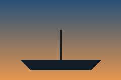
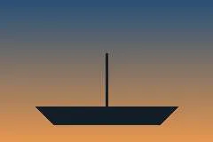

# Harbour walk, 7 September

Two hours at the old harbour with the 56 f/1.2 and the GR, starting at 18:10 for the last light. Mostly boats, a few
cranes, one man fishing from the pier who did not mind being photographed.

A second frame, the one I wanted for the walk and did not find on the card:

I am not sure which one is the keeper. The first has the light, the second has the man, and I only have the first.

The same frame again, uncaptioned, as the web export left it. And once more with the caption in Japanese, for Aiko,
who asked to see the harbour:

The small WebP the zine's site wants, made from the same frame:

And the one I sent Aiko in the end, ![the harbour, the version I sent][sent], which she printed.

## Notes

- Settings: f/5.6, 1/250, ISO 400 for the cranes; f/1.2 and 1/4000 for the fisherman, who turned out to be moving.
- Light: gone by 19:40; the sunset was at 19:22.
- Next: go back on a weekday, earlier, and bring the tripod for the water.

[sent]: ../images/harbour-01.jpg "The version I sent"
