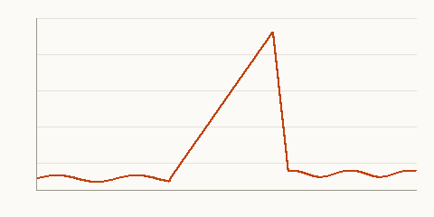

# Sync queue incident review

Blameless review of Tuesday's stall, Thursday 14:00, written with [Malik](../people/malik-haddad.md) straight after
the meeting while the room was still warm. Priya chaired; Aiko, Malik, Jo and I were there. Everything here is about the
system. Nobody is named as a cause.

## Summary

On 22 September the offline sync queue stopped draining for about two and a half hours (the alert at 13:52 to a
queue under 50 at 16:24); riders' edits waited 86 minutes from the first report to the skip. Edits made on phones
stayed on the phones, nothing was lost, and nobody saw an error. The first customer report arrived about a quarter of
an hour in. The [daily note](../daily/2026-09-22.md) has my notes as the day went, and the runbook is the thing we
followed.

## Timeline

The table from my daily note, embedded so that it never goes stale in this review:


My own memory of when we knew, which differs slightly from the log, as it always does:

| Time | What I thought was happening |
| --- | --- |
| 14:05 | A slow deploy |
| 14:40 | A queue stall, not a deploy |
| 15:30 | The retry loop, and we had a fix |

^timeline

## Symptoms we saw

What the runbook says to look for, embedded from the repository so that the review and the runbook cannot disagree:


Three things in one paragraph, back to back, because I wanted the reader to see the evidence together:


## Contributing factors

> What made this possible, in the order we found them:
>
> 1. The retry budget had no ceiling, so one bad batch kept the worker busy
> 2. The queue-depth alert fired at 5,000 items, but only after the queue had been stuck for a long time; depth was
>    the wrong signal
> 3. The runbook was in an old place, and the search found a stale copy
>
> ```text
> retry_budget: 0     # meant "no limit", read as "unset"
> alert.depth:  5000
> ```
>
> The first factor was in the code since March, and nobody questioned it, including me.

## The decision behind it

We chose offline-first for good reasons, written down in the
[ADR](slipbox://kestrel/docs/adr/0001-offline-first-sync.md), and the review changes none of them. What changes is
the retry budget and the alert.

## Attachments

Two things I tried to embed and could not:




## Actions

| # | Action | Owner | Due |
| --- | --- | --- | --- |
| 1 | Give the retry budget a ceiling of 5 and reject 0 | Aiko | 2026-09-26 |
| 2 | Alert on queue age, not depth | Malik | 2026-09-29 |
| 3 | Redirects from the old runbook path | Aiko | 2026-09-25 |
| 4 | Add a soak test with a poisoned batch | Aiko | 2026-10-02 |

- [x] Send the review to the whole team
- [ ] Revisit in 30 days (Priya sets the reminder)
