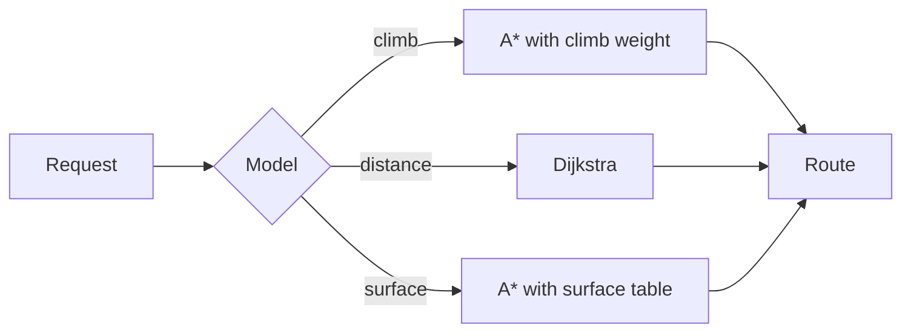

### Cost models for the route engine

What the route engine minimises when it picks a path. The engine is in
[graph.rs](../../work/kestrel/crates/route-engine/src/graph.rs); its decision to be Rust is ADR-0002. These are my notes
on the models we tried, with the maths I needed to explain them to Tomás.

###### The baseline: distance

The first model was distance, and it was wrong in the way every first model is: the shortest route is a main
road. For an edge of length $d$ the cost is just $c = d$, and a total of $C = \sum_i d_i$ over the path.

# Adding climbing

The second model charges for climbing, which a cyclist feels in the legs and a car does not. With gradient $g$ in per
cent and a weight $w$, an edge costs $c = d \cdot (1 + w \cdot \max(g, 0))$. The weight is the whole argument. In a
display form, the cost of a path $P$ is:

$$
C(P) = \sum_{e \in P} d_e \left(1 + w \max\left(\frac{\Delta h_e}{d_e}, 0\right)\right)
$$

An inline one in the style of the textbook, $E = mc^2$, does not belong in a cost model, but I keep it as a reminder not
to take the physics too far.

## Prices, for scale

The tile service costs $5 per thousand requests until the free tier runs out, and then $10; a coffee at the control
was $3.50 and the pastry $4. That is the scale the cost models have to be useful at.

## A diagram of the models



## The code

The cost function in Rust, as I propose to write it (the crate today has only the distance cost):

```rust
pub fn edge_cost(e: &Edge, w: &Weights) -> f32 {
    let climb = (e.rise_m / e.length_m).max(0.0);
    let surface = w.surface.get(&e.surface).copied().unwrap_or(1.0);
    e.length_m * (1.0 + w.climb * climb) * surface
}
```

And the Python I used to fit the weights from rides, which is not in the repository and should not be:

```python
def fit_weights(rides):
    """Least squares on observed speed against gradient and surface."""
    import numpy as np
    X = np.array([[r.gradient, r.surface_code, 1.0] for r in rides])
    y = np.array([r.speed_kmh for r in rides])
    coef, *_ = np.linalg.lstsq(X, y, rcond=None)
    return coef
```

The command I use to try a model:

```sh
cargo run -p route-engine -- --model climb --weight 0.8
```

A benchmark run, pasted as it came out of the terminal:

```
model     path_km  nodes  time_ms
distance     41.2   1204      3.1
climb        44.0   2310      6.8
surface      45.3   2987      8.4
```

And the line the engine logs for the same run:

```text
route: model=climb weight=0.8 nodes=2310 path_km=44.0 time_ms=6.8
```

A sketch of how Tomás wants weights written, in the little route DSL he is trying out:

```kestrelscript
model climb {
  weight 0.8
  surface gravel 1.4
}
```

## Indented code

The older engine's configuration, as it was in the first draft, pasted in as an indented block:

    [model]
    name = "distance"
    weight = 1.0

And the climbing variant Tomás tried, which his editor indented with a tab:

	model = "climb"
	weight = 0.8

## What I would change

Charge for surface before charging for climbing; riders forgive a hill sooner than a bad road. That is the next
experiment, and the weights table is in the `Weights` struct.
