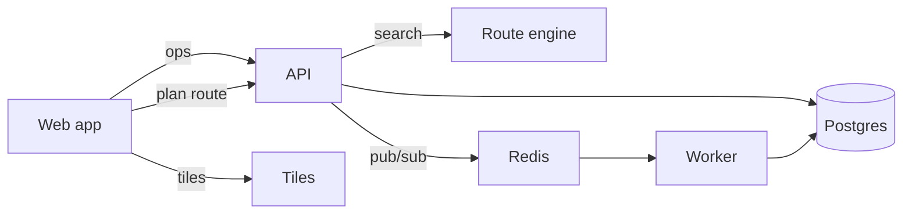

# Architecture

How Kestrel fits together, from the browser to the database. Terms in italics are in the
[glossary](/docs/glossary.md). Decisions behind the shape are in [ADR 1](adr/0001-offline-first-sync.md) (sync) and
[ADR 2](/docs/adr/0002-route-engine-in-rust.md) (the engine).

## Components

| Component | Where | Language | Job |
| --- | --- | --- | --- |
| Web app | `src/` | TypeScript | the map, route editing, the local store |
| API | `api/` | Python | accounts, routes, shares, the server side of sync |
| Route engine | `crates/route-engine/` | Rust | A* search, edge costs |
| Tiles | `crates/tiles/` | Rust | tile maths and the tile server |
| Worker | `api/` | Python | emails, cleanup, parked-op reports |
| Database | `db/schema.sql` | Postgres | everything durable |

The API's own README, with how to run it and where the OpenAPI spec lives, is [here](../api/README.md). The route
engine's manifest is [/crates/route-engine/Cargo.toml](/crates/route-engine/Cargo.toml).

## Data flow

A route edit takes this path. The web app writes the edit to its local op log first and shows it at once. The sync
loop sends the log to the API. The API stores the ops and tells the other devices. Planning a route is a different
path: the web app asks the API, the API runs the engine and returns a polyline.

## Where things live

- The **op log** is in IndexedDB on the device, and in `sync_ops` on the server. How it is drained is in
  [sync.md](sync.md).
- **Share links** are signed by the API with a secret from the environment, and verified on every view; see
  [route sharing](features/route-sharing.md).
- **Config** is `kestrel.toml` for the app and `config/` for environments. The shape is `config/schema.json`.

## Moving this repository

Everything above refers to paths from the root of this repository: `/docs/glossary.md`, `/crates/...`. If the
repository moves, those links keep working inside it, and the few that leave it do not. The ones that leave:

- Sam's design notes for the sync rewrite live outside the repo, in
  [sync-rewrite](../../../notes/projects/sync-rewrite.md) in his notes.
- The Kubernetes manifests for the workers are in the infra repository (`slipbox://infra/k8s/workers/sync-worker.yaml`).

## Reading order

1. This page.
2. [sync.md](sync.md), if you work on the client or the queue.
3. The ADRs, in order.
4. The runbooks, before your first on-call week.
