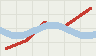

# Route sharing

Since 2.3 a rider can share a route with a link. This page is the feature: what the rider sees, what the API does
and where the code is. The decision behind it is [ADR 3](../adr/0003-sharing-links.md).

This page was `docs/sharing.md` until the `feature/route-sharing` branch moved it here; merged on 2026-09-29. Old
links to `docs/sharing.md` are broken and should be rewritten.

## What the rider sees

1. Open a saved route and press **Share**.
2. The share dialog shows a link and how long it lasts (72 hours).
3. Copy the link, or press **Stop sharing** to revoke it.

Whoever opens the link sees the route on the map, with its length and elevation, and cannot change it.

## The API

| Method | Path | Does |
| --- | --- | --- |
| POST | `/v1/routes/{id}/shares` | creates a share, returns the link |
| GET | `/v1/shares/{id}` | the shared route, if the signature holds |
| DELETE | `/v1/shares/{id}` | revokes the share |

A link looks like `https://kestrel.dev/s/<id>?expires=<unix>&sig=<hmac>`. The signature covers the id and the expiry.

## Code

- `src/routes/share.ts` creates the links.
- `src/routes/sign.ts` holds the signing helpers.
- `src/routes/share-dialog.wip.tsx` is the dialog's next version, with the expiry in plain words (see Open items), in progress since 2.3 shipped.

## Open items

- Showing "expires in 3 hours" in the dialog instead of a date.
- A way to share a route read-write with a friend, not planned.
