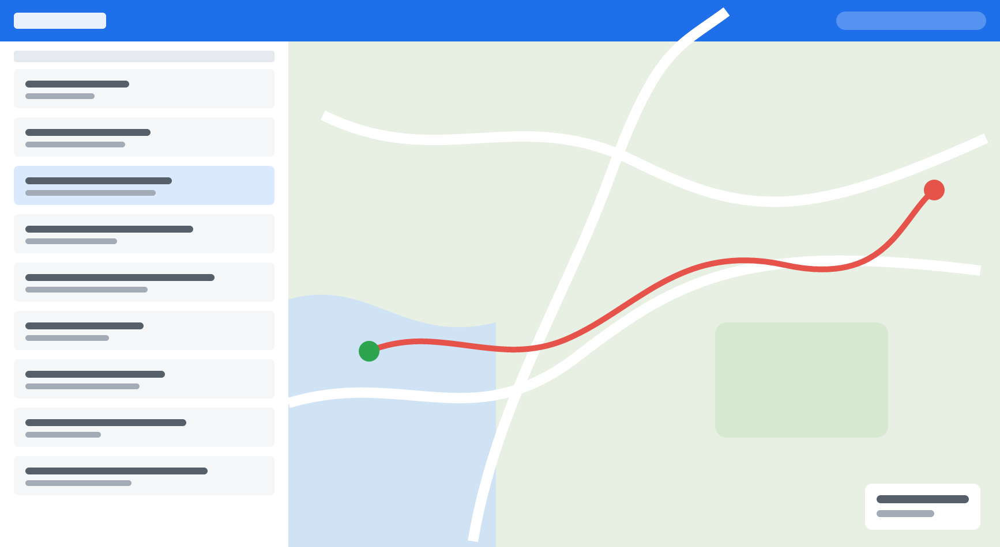

# Kestrel 2.3

*Draft by Jo, 2026-09-28. Reviewed by Sam; ships 2026-09-30.*

Two big things in this release: you can **share a route** with a link, and the app **keeps your changes safe when you
are offline**. Here is what changed.

## Share a route

Tap **Share** on any route and Kestrel makes a link. Send it to anyone, whether or not they have the app.

On a laptop, press <kbd>⌘</kbd> + <kbd>K</kbd> and choose **Copy share link** to skip the sheet. Links stay active for
72 hours1 and you can turn one off at any time. The start of a route can be trimmed so it does not show where
you live: look for the <mark>Hide first 200 m</mark> switch.

## Plan on a laptop

The route planner on the web now keeps the route list beside the map, so you can compare routes without losing your
place.

## Works offline, properly

When you have no signal, your edits wait in a queue and the app tells you so, with a banner and a count.

When the signal comes back, the changes are sent in the order you made them. If something is stuck, the banner says
"Sync stalled" and offers a retry.

## Smaller things

- Route names with accents and non-Latin letters sort correctly.
- The map no longer flickers when you rotate the phone.
- Fixed: a crash when opening a route with more than 2,000 points on older Android phones.
- Dark mode now also applies to the share sheet.

## Known issues

- iOS riders get sharing a few days after Android and web, while the app is in review.
- A link opened inside some chat apps' built-in browsers does not offer to open Kestrel; use the browser menu.

1 We may change the 72 hours after we see how you use it.

## Thank you

To everyone who wrote to support about lost routes: that is why the queue exists.
