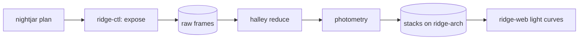

# halley and nightjar cookbook

Short recipes for the things we actually do at night. Each one is a snippet plus a line or two of why. The hosts are `ridge-ctl` (control PC), `ridge-arch` (archive) and `ridge-web` (public site).

If a recipe here disagrees with the code, the code wins and this note is wrong; please fix the note in the same change rather than leaving a comment in the channel, because nobody reads the channel at 03:00 and the next night assistant will trust whatever is written here, in exactly the order it is written, with exactly the typos it contains, which is how we once parked Aster pointing at the floor for most of a clear night while the weather station reported perfect conditions.

## When to use this note

- Starting or stopping a night on Aster or Brill.
- Re-running a reduction after a bad flat or a wrong filter in the log.
- Pulling frames or photometry out of the stacks archive.
- Changing the nightjar queue without restarting everything.
- Checking why the public site shows yesterday's all-sky image.

## The night pipeline at a glance

One clear night, from the plan to the public site:



halley reports every star as an instrumental magnitude, so the numbers in `vss_photometry` are
$m_V$ relative to the comparison stars, not fluxes. The conversion is the usual one:

$$
m = -2.5 \log_{10}\left(\frac{F}{F_0}\right)
$$

where $F_0$ is the zero-point flux for the filter, fitted each night from the comparisons.

To see the night's zero points without opening Python, ask stacks directly; the query is short
enough to keep in your head:

    psql stacks -c "select filter, zp, zp_err from zero_points where night = '2026-03-13'"

## Start and stop a night

Always start from `ridge-ctl`, logged in as `observer`. The start script checks Sable and Quill before it opens anything, and refuses politely if either is stale.

```bash
ssh observer@ridge-ctl
night-start --scope aster --plan plans/2026-03-14.toml
```

Stopping is the same idea; `--park` is the default but say it anyway so the log is explicit when someone reads it next week.

```bash
night-stop --scope aster --park --close-dome
```

If the dome refuses to close, do not rerun the script in a loop hoping it changes its mind. Check the roof interlock first:

```bash
ridgectl dome status --verbose | grep -E 'interlock|shutter|rain'
```

A night with both telescopes looks like this. The `&&` matters: Brill only starts if Aster did.

```bash
night-start --scope aster --plan plans/2026-03-14.toml && night-start --scope brill --plan plans/brill-vss.toml
```

Emergency stop, for when the rain sensor has already tripped, the scripts are sulking, and you need the shutter shut now:

```bash
ridgectl estop --all --reason "rain, Sable tripped at $(date -u +%H:%M)"
```

## Reduce frames

halley is a normal Python package. For a single night the CLI is enough:

```bash
halley reduce --night 2026-03-13 --scope aster --camera hcam2
```

For anything unusual, drive it from Python. This is the recipe for re-running one filter with a replacement master flat from the dome screen:

```python
from halley import Night, calib

night = Night.load("2026-03-13", scope="aster")
flat = calib.master_flat(night.frames(kind="flat", filt="V"), reject="sigma", sigma=3.0)
for frame in night.frames(kind="science", filt="V"):
    frame.bias().dark().flat(flat).write(overwrite=True)
```

Photometry for the Variable Star Survey uses fixed apertures. Keep the radii in pixels, not arcseconds, or the archive disagrees:

```python
from halley.phot import aperture

result = aperture(frame, targets=vss.targets_for(frame), r_in=6.0, r_out=12.0, r_sky=(16.0, 24.0))
result.to_stacks(table="vss_photometry", night=frame.night, if_exists="replace_night_and_filter_only")
```

## Query the stacks archive

stacks is PostgreSQL on `ridge-arch`. Read-only access is enough for almost everything:

```bash
psql "postgresql://reader@ridge-arch.example.invalid/stacks"
```

Frames from one night, newest first:

```sql
SELECT frame_id, filt, exptime, airmass, fwhm_arcsec
FROM frames
WHERE night = '2026-03-13' AND scope = 'aster'
ORDER BY obs_start DESC;
```

The light curve for one VSS star, with the bad-seeing nights removed:

```sql
SELECT p.mjd, p.mag, p.mag_err
FROM vss_photometry p
JOIN frames f USING (frame_id)
WHERE p.star = 'VSS-0217' AND f.fwhm_arcsec < 3.5 AND p.flags = 0 AND f.filt = 'V' AND p.mjd > 60700
ORDER BY p.mjd;
```

## Configure halley and nightjar

halley reads `halley.toml` from the working directory. Paths are relative to the data root unless they start with a slash.

The deployed copy is [halley.toml](halley/halley.toml), checked against [its schema](halley/halley.schema.json); the
season's targets are [[halley/targets.yaml]], and the reduction itself is [[halley/reduce.py]], run by
[night.sh](halley/night.sh).

```toml
[paths]
data_root = "/data/halley"
calib = "calib"

[aster]
camera = "hcam2"
gain_e_per_adu = 1.42
saturation_adu = 58000
```

nightjar keeps its queue rules in YAML. Priorities are integers; higher runs first, and ties go to the target at lower airmass.

```yaml
queue:
  - target: VSS-0217
    scope: aster
    priority: 80
    filters: [B, V, R]
    cadence: 2h
  - target: M42-outreach
    scope: corvid
    priority: 20
```

Weather limits live next to the queue. Quill's seeing is in arcseconds:

```yaml
limits:
  wind_max_kmh: 40
  humidity_max_pct: 85
  seeing_max_arcsec: 4.0
```

Per-host overrides go in a small TOML file next to the main one. It is fenced with tildes here
because the comment inside quotes a triple backtick from the chat where it was agreed:

~~~toml
# halley.local.toml — ridge-arch only. Agreed in chat as ```reduce_workers = 6```, then halved.
[runtime]
reduce_workers = 3
scratch = "/scratch/halley"
~~~

## Talk to nightjar over HTTP

nightjar has a tiny HTTP API on `ridge-ctl:8420`. Its full description is [the OpenAPI spec](nightjar/openapi.json);
how it runs is [[nightjar/deploy.yaml]] (per environment: [[nightjar/environments.yaml]]), and its
manifest is [package.json](nightjar/package.json). Adding a target to tonight's queue:

```json
{
  "target": "VSS-0342",
  "scope": "brill",
  "priority": 60,
  "filters": ["V", "I"],
  "exptime_s": 120,
  "requested_by": "Kenji Mori"
}
```

```bash
curl -X POST -H 'Content-Type: application/json' --data @vss-0342.json http://ridge-ctl.example.invalid:8420/queue
```

## Build and deploy

The archive tools ship as a container. The Makefile target builds and tags it:

```makefile
IMAGE := stacks-tools
TAG   := $(shell git describe --tags --always)

image:
	docker build -t $(IMAGE):$(TAG) -f docker/Dockerfile .
```

The calibration library has its own tiny Makefile on `ridge-arch`. Recipe lines must start with a
real tab, which is why this block is copied from the file rather than retyped:

```make
calib: masters/bias.fits masters/dark.fits

masters/%.fits: raw/%/*.fits
	halley calib build --kind $* --out $@ $^
	@echo "built $@ from $(words $^) frames"
```

```dockerfile
FROM python:3.12-slim
WORKDIR /app
COPY . .
RUN pip install --no-cache-dir .[archive]
ENTRYPOINT ["stacks-tools"]
```

## The public site

`ridge-web` shows the latest Tern all-sky frame. The page polls a JSON file rather than the archive:

```typescript
async function latestSky(): Promise<string> {
  const res = await fetch("https://ridge.example.org/sky/latest.json", { cache: "no-store" });
  const body: { url: string; taken: string } = await res.json();
  return body.url;
}
```

If the image is stale, the exporter on `ridge-arch` has usually stopped. Its log line looks like:

```
2026-03-14T02:11:09Z tern-export: skipped frame 88213 (exposure incomplete)
```

## A fix worth remembering

The bias level drifted after the HCAM-2 firmware update. This is the change we made to `halley.toml` after two nights of odd-looking residuals:

```diff
 [aster]
 camera = "hcam2"
-bias_level_adu = 1010
+bias_level_adu = 1024
 gain_e_per_adu = 1.42
```

## Things that are not code but look like it

The night log format, for reference; nightjar writes one line per exposure:

```
02:14:33  aster  VSS-0217  V  60s  airmass 1.21  fwhm 2.8"
02:16:01  aster  VSS-0217  R  45s  airmass 1.21  fwhm 2.7"
```

The directory layout under the data root:

```
/data/halley/
  raw/2026-03-13/aster/
  calib/2026-03-13/
  reduced/2026-03-13/aster/
```

## Safety rules

- Always write the reason into the night log before overriding nightjar.
- Keep the queue file in git; a hand edit on `ridge-ctl` is lost at the next deploy.
- Never run `night-start` from a laptop over the visitor Wi-Fi.
- Never delete rows from `frames`; mark them with `flags` instead.
- Do not change nightjar priorities while an exposure longer than five minutes is running.
- Tell Rosa (or whoever is the night assistant) before you touch the dome from home.
- Leave Dunmore out of every queue until the refurbishment is signed off.
- Ask Priya before changing any column in `vss_photometry`.
- Min-jun's test scripts run against a copy of stacks, never the live one.

Tomasz asked that this be written down plainly: the dome motor controller does not care what the software thinks the shutter position is, and if the encoder slipped during the day the only reliable check is to look at the camera in the dome or walk up the ridge with a torch, which is annoying at 02:00 in February but far cheaper than a new shutter seal, a new motor, and an awkward conversation with the trust about why the insurance excess is our problem this year.

## Check that it all works

One command at the end of setup, from `ridge-ctl`:

```bash
halley doctor && nightjar check --queue queue.yaml && ridgectl dome status
```
